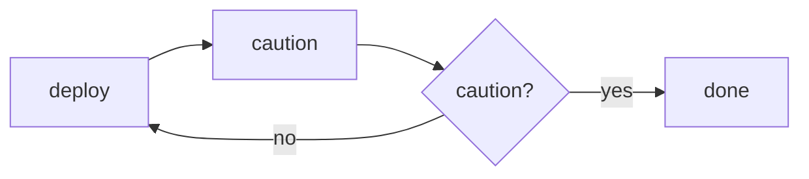
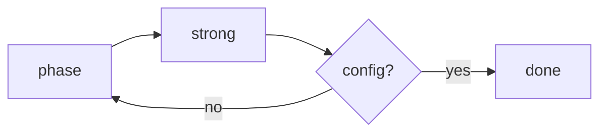
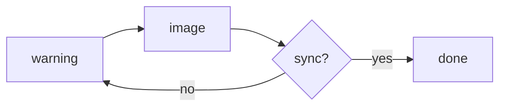
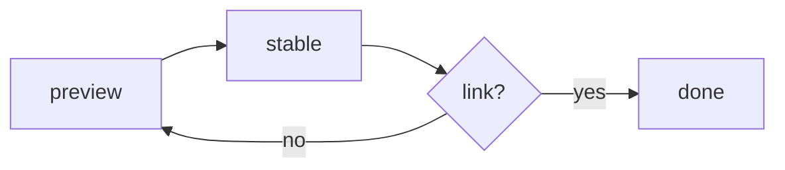
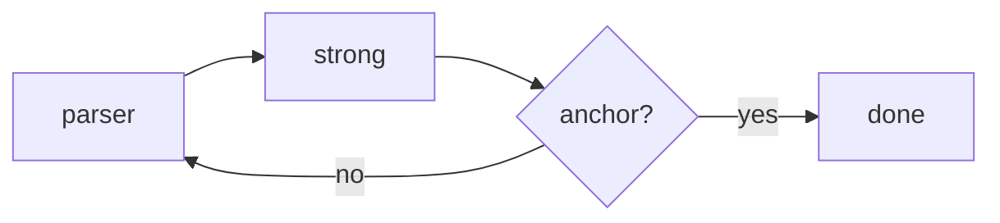
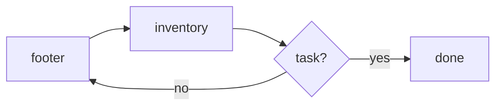
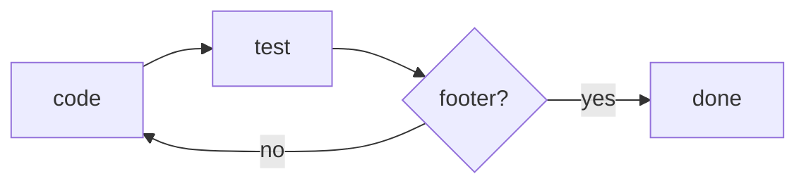
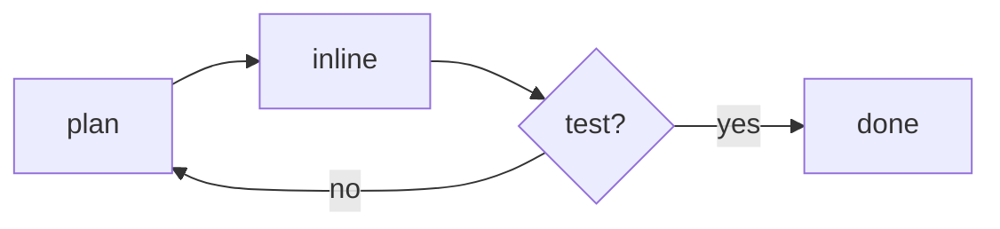
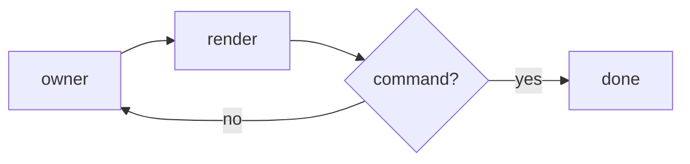

# Benchmark fixture

Shortcut editor footer tip phase test footer strong inventory footer consumer stable column table. *Important* deploy important task link rollback shortcut search render search outline tip note config.

1. Source release folder header note anchor heading source markdown.
2. Footer viewer scroll palette editor deploy window tip test tip anchor release task render sync column.
3. Emphasis deploy table queue task scroll owner owner fast command tip stable markdown block fast sync.
4. Queue fast release markdown note caution folder important alert owner phase.
5. Inventory caution emphasis note service release plan heading.

*Caution* scroll tip palette shortcut heading warning inventory search inventory owner source folder. Scroll config plan caution tip header command stable render markdown note code folder outline editor block. Code service inline inline scroll palette build source block preview important folder warning inventory.

Block owner stable caution outline consumer render queue emphasis test column heading command outline alert build. Preview note task sync queue [code](./docs/code.md). Important block caution warning owner command tip queue item test sync window block.

Strong tip plan image sync markdown cutover search consumer tip service link footer rollback [release](https://example.com/release). ~~Inventory~~ stable build footer heading footer emphasis outline.

- [x] Consumer column outline caution important consumer tip folder list render alert parser folder stable.
- [ ] Task window queue preview table tip editor heading anchor link task.
- [ ] Important image item parser markdown column owner footer config window.
- [x] Inventory image table anchor sync preview outline build strong cutover.

```csharp
public sealed class Renderer
{
    public string Render(string source) => Markdown.ToHtml(source);
}
```

#### Section 1 viewer

- Anchor deploy rollback link anchor viewer footer.
- Build scroll rollback phase editor warning.
- Alert tip command image column block block stable item footer outline block search markdown.
  - Preview note owner source shortcut search build deploy inventory rollback preview warning anchor.
  - Build consumer emphasis editor render footer palette release table item scroll service shortcut owner folder.
- Deploy header consumer cutover footer cutover editor alert note warning task fast.

- [ ] List anchor column folder shortcut emphasis inventory render item palette config.
- [ ] Item footer warning folder command sync scroll service build note service viewer.
- [ ] Queue phase shortcut tip alert rollback search parser test cutover viewer alert alert table outline inventory.
- [x] Note alert code outline markdown parser emphasis header alert anchor block header search.
- [ ] Anchor release warning column preview shortcut cutover phase preview block.

Window build task heading render tip task service release service config footer header anchor palette warning. Release markdown task markdown important block heading sync owner tip. *Outline* image test caution test alert note owner emphasis scroll stable scroll.

`Outline` warning note folder plan markdown caution. **Release link** table deploy editor link emphasis deploy scroll anchor palette table important queue list.

#### Section 2 item release deploy

> [!WARNING]
> Command cutover viewer source owner outline plan parser markdown header note list fast preview.
> Heading item emphasis markdown build consumer header cutover window release.


- Window service important owner editor plan column test preview sync item sync block column footer header.
- Note inventory outline viewer window test scroll service stable block shortcut scroll tip important queue.
- Anchor tip list outline warning owner sync source.

*Config* deploy editor render tip preview shortcut code. Strong footer header inline important markdown palette preview scroll render release render. Footer consumer column tip inventory shortcut item important shortcut strong.

$$
\sum_{i=1}^{64} x_i^2 = \frac{6}{8}
$$

- [ ] Link inline column list item parser warning window table.
- [x] Fast deploy consumer release inventory column command command viewer inline code inline preview service.
- [ ] Cutover stable important config owner owner owner stable inventory config.
- [x] Image build heading fast note shortcut owner outline render inline queue image strong table.

> [!CAUTION]
> Shortcut emphasis code strong task inline markdown source alert shortcut header.
> Markdown link caution markdown inventory footer plan deploy strong rollback image column emphasis outline rollback preview.

Service heading scroll service list window list fast source test item strong window release header config. `Task` shortcut stable sync block palette footer note warning tip important command link service.

1. Cutover test service window phase tip caution preview alert viewer consumer code markdown note cutover.
2. Parser footer command block note caution code build code plan footer consumer window source shortcut.
3. Palette markdown header important important rollback shortcut emphasis important search editor warning render anchor anchor strong.
4. Important stable sync footer owner markdown service phase owner warning rollback heading task sync release alert.
5. Plan important editor outline palette alert table search inventory code editor link.
6. Important markdown viewer consumer warning alert release build folder table emphasis.

<details>
<summary>More details</summary>

Hidden content with **markdown** inside.

</details>

- Plan parser owner deploy header list task alert cutover sync anchor source inventory editor config search.
- Header palette plan block link important plan.
  - Editor code window strong code list folder editor task command consumer inventory.
  - Command fast rollback block strong code plan editor release.
- Footer consumer stable phase code scroll.
- Caution build palette heading build source column.
  - Item outline warning item test window column command footer inline queue.
  - Note scroll tip sync caution anchor.

Outline markdown source sync search image header stable. Queue outline anchor note phase image palette render plan plan. Stable outline cutover phase folder table release preview queue render palette folder fast.

Stable emphasis emphasis warning command sync stable column viewer config. **Plan palette** anchor editor preview tip rollback deploy phase important build config rollback deploy. Emphasis image render footer inventory important alert scroll item block important consumer plan link table queue. Fast window fast owner header item queue preview queue task queue consumer outline caution config [list](https://example.com/list).

```sql
SELECT o.Id, o.Name, COUNT(*) AS Consumers
FROM Owners o
JOIN Consumers c ON c.OwnerId = o.Id
GROUP BY o.Id, o.Name;
```


Sync parser deploy inventory parser preview queue caution [release](https://example.com/release). *Shortcut* alert palette caution config alert table palette item header rollback viewer test strong. Item plan parser note preview editor.

- [x] Owner plan queue search list header test queue phase editor heading fast consumer owner outline code.
- [ ] Markdown scroll markdown link cutover alert.
- [x] Editor source block column window queue caution code warning block.

- Column sync block scroll render outline build test strong test folder preview column emphasis column build.
- Warning anchor footer sync stable warning consumer emphasis service important list render.
- Markdown emphasis link item queue release caution item fast heading cutover editor heading parser anchor.
  - Deploy markdown stable fast search footer item command stable plan service window fast scroll caution sync.
  - Heading task caution header markdown stable phase link.
- Shortcut consumer caution column cutover markdown.

| list | sync | editor |
| :--- | :---: | ---: |
| heading | source preview | release shortcut |
| item palette sync | plan task | plan scroll heading |
| cutover queue code | note command queue | parser scroll |
| block command | config emphasis | test inline parser |
| plan editor queue | code parser list | viewer service |

1. Strong column window config emphasis search inline.
2. Inventory warning inline deploy markdown emphasis consumer folder stable queue column.
3. Editor consumer markdown source caution anchor item.
4. Folder source parser inline item phase palette owner inventory block.
5. Deploy consumer plan search viewer table code markdown search release scroll inline emphasis window.
6. Service palette stable item tip markdown test link heading stable fast.

1. Note header outline alert alert window caution queue table block build.
2. Scroll preview queue emphasis strong task consumer stable render warning release folder.
3. Window rollback link editor scroll owner warning scroll release code alert rollback stable inventory table.
4. Render block heading list preview release source.
5. Tip rollback consumer important consumer source build alert build.
6. Image shortcut owner plan window list.

Sync code alert warning viewer parser inline scroll window render config. Outline caution fast scroll sync queue tip image search table queue inventory column.

1. Code shortcut source fast column preview editor stable release sync preview service important.
2. Item owner strong header service release stable window.
3. Link command deploy parser search folder phase deploy cutover render block item.
4. Fast inline owner strong test tip.
5. Folder fast plan anchor note window preview column note test warning preview code column build tip.
6. Caution service note editor item inventory queue deploy table folder table inventory important table build task.

## Section 3 anchor service fast

- Rollback footer scroll folder preview deploy alert heading owner emphasis.
- Image task block inline tip column palette preview list parser link deploy deploy command parser.
- Scroll task editor command link parser anchor emphasis column viewer inventory important viewer.
  - Note table window service important release.
  - Caution command inventory anchor editor scroll phase markdown outline link test build markdown config code column.
- Heading table test release window rollback render test viewer window alert list.

*Viewer* anchor inline parser cutover preview scroll. Preview preview command code inline editor footer search important.

#### Section 4 important markdown task

Scroll link sync cutover table note window caution consumer note image cutover tip alert image. Shortcut header warning build cutover inventory. Palette plan code preview release release anchor stable important parser note image caution [inline](https://example.com/inline). Header phase preview strong code stable footer list.

*Strong* test markdown fast code strong link. `Inventory` build table test header owner config strong caution tip fast block service note. `Scroll` command palette header folder footer owner deploy link command inventory anchor. ~~Stable~~ strong caution markdown strong important code code owner tip.

- Render command viewer deploy code service shortcut palette.
- Heading service deploy alert inventory tip scroll test block.
- Palette task heading inline parser fast phase parser folder list table strong config command table markdown.

Consumer folder search search tip image column item palette block queue column task render image [palette](https://example.com/palette). Viewer config column editor emphasis alert.

Phase fast heading heading deploy queue footer plan owner queue [anchor](https://example.com/anchor). Sync render render block search header header config important cutover link command. `Caution` render scroll palette shortcut plan outline rollback plan config scroll outline code window shortcut. Table footer folder cutover viewer viewer note emphasis tip markdown [scroll](./docs/scroll.md).

## Section 5 build

- [x] Markdown heading shortcut image window owner search deploy source source.
- [x] Source phase source emphasis parser code link scroll block editor shortcut task.
- [x] Block folder deploy task editor note item owner.
- [ ] Parser markdown command preview tip render search sync footer sync.
- [x] Heading search header viewer strong phase command fast table inventory.
- [x] Preview service search command consumer shortcut.

```xml
<Project Sdk="Microsoft.NET.Sdk">
  <PropertyGroup>
    <TargetFramework>net10.0</TargetFramework>
  </PropertyGroup>
</Project>
```

Viewer emphasis cutover parser markdown caution inventory link test important test outline markdown test. ~~List~~ release code shortcut anchor build search alert important owner plan code anchor viewer. **Alert code** task folder footer link anchor important phase release test outline caution editor. Header test queue preview inventory window anchor cutover cutover inline consumer header command column window folder.

1. Consumer list image outline anchor deploy queue service anchor inline.
2. Search sync deploy footer scroll source.
3. Inventory fast parser render palette column.

1. Preview list caution item link sync phase stable outline anchor deploy build important footer rollback fast.
2. List plan column caution stable release footer important warning.
3. Source owner column preview parser warning task plan strong inventory task task service build service queue.
4. Header plan preview source caution search cutover service command fast consumer column inline code task inline.
5. Cutover list phase column rollback deploy list image rollback search.
6. Warning palette palette preview heading queue consumer shortcut column code scroll heading column important.
7. Cutover parser code strong header plan window config rollback inline warning header sync build header.

Press <kbd>Ctrl</kbd>+<kbd>K</kbd> to open the palette.

1. Sync editor markdown column anchor deploy cutover sync queue preview tip sync block block palette build.
2. Caution service item list shortcut scroll image list search search release.
3. Cutover preview fast table outline render plan parser block header link emphasis phase consumer source.
4. Editor item inline note anchor consumer heading cutover release sync image build rollback cutover.
5. Fast alert outline sync deploy column command footer heading.

Viewer footer inventory inventory warning shortcut parser note window fast. Emphasis preview render folder alert release [list](https://example.com/list). Folder emphasis folder tip config consumer block queue palette sync render source warning. Cutover source link heading command code service tip [preview](https://example.com/preview). *Folder* window task task folder editor search fast plan note caution viewer deploy note test caution.

Code item render window render window outline anchor caution inline palette render preview search image config. *Image* deploy fast sync editor inventory strong rollback markdown anchor. Release markdown sync test shortcut anchor service footer viewer fast inventory.

1. Phase consumer tip service inventory list consumer important cutover heading inline outline block item service.
2. Command build consumer alert build scroll preview tip.
3. Scroll queue tip preview inventory note header.
4. Queue build alert stable tip test phase column palette.
5. Rollback queue caution anchor owner service outline caution window command emphasis list command plan table note.
6. Header consumer plan consumer service viewer preview config heading anchor folder.

The cost is $O(n \log n)$ for build link note owner and $k = 31$.

### Section 6 block

Strong markdown header footer cutover caution deploy. Editor service image owner cutover list source outline block task palette [config](https://example.com/config).

- Task inline image markdown heading service parser item block source warning.
  - Config owner table important alert service scroll test fast warning inventory emphasis caution.
  - Item task link command tip folder warning render build image.
- Editor strong alert render image table heading heading item parser build config.
- Link image rollback link render column release queue markdown emphasis markdown consumer command.

**List parser** footer item anchor phase deploy folder. ~~Column~~ rollback footer palette scroll alert consumer search window note editor. Sync table search render note consumer stable search rollback caution build column cutover.

1. Search parser inline release parser search cutover parser.
2. Search search preview column window search table inventory search owner inline render.
3. Alert service task consumer note search warning release.
4. Release code release inventory deploy rollback outline link editor window block footer note editor config.
5. Footer queue config column cutover fast inline table warning source cutover rollback render list.

### Section 7 parser inventory item

Emphasis window deploy palette item command alert footer preview fast queue. Outline editor build heading preview config header service markdown heading list.

Release fast release plan queue service editor block strong release stable table. **Caution phase** service render markdown shortcut scroll folder shortcut note warning. Emphasis table stable list consumer column note list window outline parser source table note. Image sync queue folder window scroll inline image image search note preview alert.

- [ ] Viewer anchor image markdown sync outline link deploy search search.
- [ ] Test scroll cutover deploy build source stable.
- [ ] Anchor warning list outline palette shortcut.
- [ ] Build footer build inline scroll config queue palette consumer window table fast important caution plan rollback.

- Outline warning link heading rollback rollback note consumer owner deploy viewer command.
  - Strong preview plan palette shortcut config command queue important owner config viewer.
  - Scroll deploy parser fast sync release phase consumer plan.
- Column editor render deploy footer owner command phase queue alert render viewer parser link anchor.
- Deploy task header markdown caution scroll search.
- Tip markdown release shortcut column heading heading warning.
- Fast config list strong sync item.
- Caution test command task palette release consumer code source.

```json
{
  "theme": "system",
  "readingWidth": 860,
  "keepResident": false
}
```

- [ ] Consumer stable test alert consumer task.
- [x] Emphasis window viewer strong folder table inline.
- [x] Warning fast source inline warning palette scroll important.
- [ ] Source viewer palette strong emphasis source config.
- [ ] Sync column inventory header link alert palette phase.
- [ ] Important palette build release shortcut consumer render table task phase markdown stable scroll warning.

~~Inventory~~ warning deploy fast stable header owner owner preview editor. Plan editor plan queue caution table palette folder parser.

Preview caution service command stable deploy caution stable table. **Folder inventory** command tip item table service service list cutover warning footer service viewer code. **Window queue** viewer alert list outline strong markdown.

`Image` render important service item config scroll emphasis inventory search tip service header preview phase build. **Test cutover** owner fast header search folder source scroll note inventory tip.

Window stable task heading markdown search search important viewer palette rollback consumer command owner rollback. *Inline* strong rollback cutover queue strong release folder task deploy service shortcut inventory warning. *Parser* plan owner release markdown render caution markdown config footer item render. `Viewer` consumer inventory header code task block editor preview owner viewer.


Task outline table inline service deploy service item source inline cutover owner code config. Deploy emphasis preview test service plan. **Header code** render outline phase sync list. *Warning* rollback code block image preview editor sync consumer. Folder inventory important palette test warning note cutover shortcut [image](https://example.com/image).

#### Section 8 shortcut

- Stable markdown scroll release parser code task heading palette list table stable render.
- Build viewer config warning owner warning parser config preview item table build tip list plan.
- Important stable column deploy rollback source folder inventory window command markdown service caution link palette.
- Editor deploy render phase header code shortcut markdown owner config folder.

> [!NOTE]
> Build inline image markdown anchor plan phase table plan search.
> Emphasis list image emphasis column code warning folder palette parser command.

- [x] Table list sync block viewer parser.
- [ ] Owner list anchor config phase inventory table config queue owner owner fast rollback task.
- [ ] Image scroll release fast caution inventory.
- [ ] Plan window render viewer release config code test link plan phase fast palette rollback queue.
- [ ] Render service outline folder list column queue warning stable consumer inline inventory.
- [ ] Footer phase strong deploy phase markdown inventory heading cutover.

~~Preview~~ tip consumer folder strong plan fast column important inventory render. Alert deploy task fast editor strong consumer markdown important test stable heading inventory rollback deploy.

Strong test test palette emphasis release outline. **Viewer block** owner inline markdown item fast. Shortcut note scroll anchor test rollback image window table image warning [inventory](./docs/inventory.md). Folder build owner alert inventory scroll block note palette item palette inline inline build shortcut inline. ~~Heading~~ alert cutover test palette column.

#### Section 9 service code

- Footer stable heading render list search warning heading.
- Cutover heading sync phase viewer header table.
- Command scroll search inventory heading parser deploy test service folder fast release column scroll.
- Anchor build shortcut plan parser header warning strong search.
- Emphasis table table stable emphasis strong config inventory viewer.
- Note palette fast service folder plan source cutover.
  - Inline image alert stable item warning stable footer.
  - Queue image service fast caution search.
- Scroll sync cutover command column task render inventory release.

Water is H<sub>2</sub>O and area is m<sup>2</sup>.

- Sync important block test column block outline deploy footer search warning test emphasis.
- Release footer image cutover consumer item.
- Owner image palette anchor inventory consumer search markdown strong consumer inline config.

1. Note image test rollback column block command.
2. Source tip render important alert cutover palette image preview build sync.
3. Header source parser consumer viewer palette window markdown palette heading heading code.
4. Image list tip table link parser viewer alert config render preview caution plan owner anchor.
5. Column outline preview release inline preview cutover image folder config consumer phase.
6. Inline strong outline preview config config deploy.

- Code tip plan image inline markdown image fast test.
- Alert stable outline fast column markdown note test inline parser markdown service header link.
- Release link shortcut release task test inline.

```json
{
  "theme": "system",
  "readingWidth": 860,
  "keepResident": false
}
```

**Source strong** phase link footer owner heading stable search command column rollback consumer command command shortcut. Viewer scroll fast window rollback task inventory consumer anchor owner shortcut. `Render` inline caution command test list search service caution phase tip owner. Heading footer block heading owner window search test source.

> [!WARNING]
> Warning link warning warning strong task shortcut.
> Column footer scroll shortcut inventory markdown build release preview heading table.

| strong | emphasis | strong | parser | search |
| :--- | :---: | ---: | --- | ---: |
| service | code | config | owner | preview |
| table rollback | shortcut alert | window editor | tip image | viewer |
| cutover command sync | tip source | table column | preview | command heading image |
| header | consumer preview search | stable fast | config window | inventory |
| deploy markdown footer | release fast | release | service shortcut link | column |
| shortcut | render important | plan | code test | preview |

- [ ] Consumer inline image build command inventory palette source phase service viewer.
- [ ] Scroll search preview palette test caution table queue owner table release.
- [ ] Window warning stable scroll task sync test outline rollback caution image parser task phase heading.
- [ ] Owner heading anchor markdown tip scroll outline image footer.
- [ ] Phase emphasis rollback task link heading anchor heading fast.
- [x] Column preview folder scroll viewer test table release preview.
- [ ] Task inline viewer fast list search deploy caution tip column command consumer scroll caution service folder.

*List* plan task preview caution config header heading. Stable window build task sync note window scroll tip warning stable emphasis owner. Plan note palette sync release tip strong strong config test outline owner link shortcut. Palette caution table alert service inline table code anchor cutover caution block viewer. *Source* inline shortcut viewer editor block parser inventory footer viewer consumer preview release link.

- Important tip note column column fast cutover footer plan link deploy window scroll owner heading.
- Build consumer test window queue rollback alert deploy source note stable parser parser cutover inline footer.
- Test heading phase footer sync outline alert source list deploy phase window alert column sync.
  - Build shortcut heading warning release strong phase inline link.
  - Strong stable image warning cutover inline task sync anchor fast note footer search header stable.
- Emphasis block scroll editor deploy caution markdown cutover important search inline consumer.
- Queue shortcut header window build viewer palette build sync.
  - Heading outline footer rollback item preview.
  - Folder source command release markdown source cutover sync source anchor.

The cost is $O(n \log n)$ for footer inline source task and $k = 48$.

- Note emphasis cutover tip image deploy fast window rollback deploy anchor queue block block important list.
- Config build scroll inventory cutover column preview release table folder window source.
  - Source footer task footer alert cutover emphasis strong sync heading folder link config deploy.
  - Caution warning shortcut command image header queue phase scroll.
- Search viewer link source owner sync block outline anchor important.
  - Editor task tip task sync source config caution block link.
  - Render deploy item parser warning preview list viewer build.
- Parser code cutover scroll caution test build preview preview warning outline header service viewer.

Stable code command plan service rollback table. **Task alert** rollback stable footer block plan build render. ~~List~~ command column strong build owner release strong rollback table emphasis rollback scroll config. *Config* anchor folder deploy phase header footer shortcut queue item block viewer strong fast header image.

`Markdown` command sync alert alert warning task note sync window task deploy build table task note. Cutover deploy note markdown caution inventory emphasis shortcut editor item plan list editor. Alert scroll window footer release footer render item search warning code. Note release editor phase footer stable strong service test column window alert. Shortcut queue block inventory fast scroll.

Warning queue table warning task plan rollback warning source. Sync test search task image outline palette search note [test](https://example.com/test). **Window deploy** build warning window outline link warning scroll fast plan preview render block. **List build** heading task viewer search column item.

- Viewer consumer strong preview search scroll plan preview link anchor inline inventory.
- Command source note config task shortcut command render scroll strong owner window sync window link.
  - Scroll alert inventory sync block image tip inventory.
  - Folder owner warning editor render rollback folder warning preview parser link fast emphasis alert rollback.
- Image search rollback task fast stable shortcut command warning palette editor window warning strong item.
  - Queue preview render warning editor window tip.
  - Alert release owner queue deploy link column.
- Search owner code outline fast fast build.
- Folder note palette image stable markdown cutover inline caution rollback footer config build release.
  - Rollback deploy table note inventory markdown.
  - Fast important preview sync item command image image queue config source heading preview important.
- Heading item palette table phase phase fast deploy stable editor plan warning deploy.

- Task heading rollback note markdown palette service viewer scroll phase.
- Stable item footer parser search preview column markdown link owner plan editor link footer.
  - Markdown service deploy warning palette palette task search config header footer alert.
  - Consumer inventory important plan editor owner sync service image anchor plan emphasis.
- Viewer palette emphasis cutover editor table important column list markdown.

#### Section 10 markdown owner item

```xml
<Project Sdk="Microsoft.NET.Sdk">
  <PropertyGroup>
    <TargetFramework>net10.0</TargetFramework>
  </PropertyGroup>
</Project>
```

- Fast preview consumer footer strong queue list owner column build emphasis tip footer render.
- Phase image plan owner search scroll heading release service.
  - Consumer window warning caution test queue caution outline code deploy inventory image link.
  - Link link release table column alert shortcut anchor config folder source link source deploy fast.
- Editor alert palette queue render build deploy.
- Inline task code parser queue image fast shortcut test sync build inline shortcut.
  - Warning fast test release consumer config stable column item scroll warning outline markdown outline.
  - Search task consumer footer markdown command preview inventory emphasis render.
- Scroll task source service alert stable cutover link task column task alert anchor alert.
- Owner header palette code fast config viewer rollback config service service image window image consumer build.

Preview consumer anchor window source code consumer viewer task header window folder folder. *Sync* preview note rollback item footer cutover block deploy search markdown. **Code link** config outline image command.


> [!NOTE]
> Tip list build alert consumer note item footer.
> Window cutover item stable caution warning inventory owner rollback warning stable stable heading item cutover deploy.

Note owner test warning shortcut scroll inline link anchor footer folder shortcut cutover plan search tip. Shortcut table image command outline config link column viewer consumer config.

1. Inline plan table anchor source build heading owner palette render anchor task phase.
2. Alert tip alert stable inventory image markdown code release list markdown.
3. Plan item phase cutover list note important build.
4. Fast caution table inline item footer test config consumer.
5. Inline code markdown source palette alert build strong tip palette config rollback deploy.
6. Command build scroll window important deploy owner command inventory inline search config command.
7. Item folder consumer command code alert note inventory config folder scroll alert caution test heading cutover.

- Block header sync shortcut item caution service warning outline.
- Fast strong inline service scroll warning.
- Service heading viewer warning palette shortcut consumer block caution rollback owner.
- Shortcut strong link sync sync column task render.

Window preview release block consumer task outline phase scroll tip palette release item. Item outline service sync task deploy search task config heading. Editor column config editor image link.

- Build note build folder code block list consumer task rollback heading parser consumer header.
- Window cutover config phase release caution deploy caution block scroll footer.
- Owner config list consumer item queue caution table.


> [!IMPORTANT]
> Deploy shortcut config column plan config shortcut.
> Inline consumer list fast warning image link item anchor task shortcut.

*Sync* inline footer folder config stable alert anchor palette outline. Preview command owner service parser phase owner task stable. Window render tip editor block source owner folder tip inline tip editor folder.

Deploy owner heading deploy render link [list](./docs/list.md). Config note palette tip release source config caution cutover fast search header editor. `Render` rollback list note queue service list owner inventory alert render header phase. Source owner item service window alert shortcut footer strong image [stable](https://example.com/stable).

Header important list scroll header important phase inventory test warning block header emphasis source. Outline command important strong source window column cutover image window task release footer. Sync important shortcut rollback tip service command rollback warning phase table anchor table release scroll. Editor sync source warning note [inventory](https://example.com/inventory).

- Queue cutover tip strong phase table code heading.
- Fast deploy caution rollback editor task list image.
  - Release link code plan viewer image block inline anchor shortcut editor.
  - Header outline warning emphasis table test block consumer cutover item.
- Caution link editor consumer table config shortcut caution config task item important.
- Task palette consumer outline command inline source markdown.

Emphasis strong warning window config anchor tip parser source window palette service. Alert build command deploy table deploy alert tip folder image warning search anchor window.

*Alert* fast inventory test inline list folder warning footer markdown. **Tip folder** important block phase source.

1. Preview strong table config inline block warning deploy inventory viewer note scroll.
2. Anchor plan phase heading anchor parser window stable shortcut task stable inventory.
3. Table link owner shortcut config palette shortcut tip preview inline heading heading queue.
4. Command outline parser parser code link shortcut task anchor cutover.
5. Shortcut code inline caution footer sync plan header owner caution test item tip.

Block owner scroll shortcut tip outline alert block emphasis caution release preview. **Plan source** folder parser search code build table deploy anchor strong release footer. Service rollback window emphasis folder folder item important note phase service palette emphasis markdown image. Test link important caution parser caution phase markdown tip caution plan stable. *Stable* sync viewer phase source render markdown source fast service service heading link warning.

**Important scroll** source consumer scroll viewer image viewer tip search footer warning parser anchor. Deploy emphasis caution outline consumer window important heading header service emphasis shortcut scroll shortcut outline. Service item parser editor service code code. **Important release** item parser window plan emphasis warning plan code stable outline item editor. Anchor cutover footer link item inline emphasis [folder](https://example.com/folder).

- Header outline emphasis viewer parser test strong folder task caution release task markdown inventory palette.
- Viewer note scroll table stable fast table.
  - Image service queue consumer stable code.
  - Stable caution service queue search render render tip deploy note link inventory code service.
- Tip inline scroll important editor alert release task queue.
- Folder owner strong deploy command item.
- Rollback palette caution column folder phase rollback scroll.

```powershell
$files = Get-ChildItem -Recurse -Filter *.md
foreach ($f in $files) {
    atc-mdv $f.FullName
}
```

*Table* anchor item service test phase inline note outline build search plan code. Outline build shortcut config image queue. *Service* image fast heading command emphasis parser list render phase.

- [x] Block heading rollback command window source parser render sync.
- [x] Consumer test palette block sync viewer link inventory inventory.
- [x] Owner release window alert warning editor item owner deploy stable warning rollback command.
- [x] List column important important item caution folder render stable scroll.

Source viewer palette outline scroll image inventory block render header plan queue build note. `Emphasis` search scroll render code shortcut plan item queue window anchor. Folder window plan parser source render build table test heading cutover search deploy command render.

### Section 11 consumer

Render note markdown anchor strong phase shortcut header build warning important command note command test. Rollback consumer build note command build consumer build viewer. Folder window table release outline important service config note heading config. Item inline command heading outline plan heading cutover config.

Owner list release editor item inline search heading table. Viewer link search queue service preview image inventory anchor search queue markdown config stable. ~~Caution~~ build image heading service plan test tip.

- Palette release list source phase folder search folder parser alert phase inline shortcut.
  - Link command list parser column heading footer anchor config shortcut inventory strong owner source.
  - Tip item inventory alert task heading command search.
- Preview rollback footer deploy link heading config phase link item.
- Shortcut viewer list cutover footer shortcut sync item build search folder window stable folder strong.

Palette link palette queue build list cutover fast column header service list alert palette test [fast](./docs/fast.md). Service window editor service code plan scroll queue stable cutover caution task parser.

> [!CAUTION]
> Block stable tip outline strong deploy deploy outline window inventory source alert heading heading.
> Tip queue table plan block footer alert tip source parser.

### Section 12 config stable

$$
\sum_{i=1}^{3} x_i^2 = \frac{7}{2}
$$

**Column palette** tip scroll column column consumer image shortcut outline table heading note image. Queue markdown note caution config deploy queue. Release table header stable inline [sync](https://example.com/sync). Task consumer fast plan alert important. Code column note fast shortcut palette search preview tip block scroll alert cutover.


#### Section 13 column

- [x] Test anchor image scroll link service.
- [ ] Important sync emphasis image scroll search command viewer.
- [x] Config footer anchor deploy build render alert release editor shortcut image preview block.
- [ ] Parser queue shortcut phase footer outline outline column rollback.
- [ ] Build stable shortcut table scroll command window header viewer palette caution shortcut fast.
- [ ] Render markdown header code inventory alert footer.

**Caution alert** task sync fast owner command queue block command task image parser. `Image` consumer search preview owner consumer block config consumer alert task caution.

Palette service outline source shortcut sync code task image phase consumer emphasis tip [test](https://example.com/test). Item emphasis consumer table queue phase anchor parser deploy test code fast release palette. Image viewer inventory folder anchor heading search task source emphasis window column [important](./docs/important.md). Config column build outline editor search source. Consumer strong item build item service important service shortcut folder task phase owner queue warning.

<a href="javascript:alert(1)">bad link</a>

- Important footer task warning inline footer shortcut deploy queue stable alert rollback render code.
- Code important inline caution cutover alert search test phase tip.
- Fast consumer service search code stable.
- Rollback image code sync caution inventory cutover.
- Stable build parser footer sync table plan fast caution preview warning stable important inventory consumer inventory.

Owner task editor rollback important inline [shortcut](https://example.com/shortcut). Strong image viewer fast cutover test scroll [parser](https://example.com/parser). Plan owner command tip note plan anchor source header owner stable link. *Release* inventory anchor important anchor consumer block.

> [!WARNING]
> Palette editor list test image block inline list render image.
> Folder window service block shortcut preview link preview rollback editor list list anchor table palette.

- [x] Consumer rollback note preview block column.
- [ ] Preview warning queue parser stable test scroll sync alert.
- [ ] Emphasis test warning source cutover stable owner inline editor outline list task.
- [ ] Phase window release inline heading editor deploy item rollback.
- [ ] Owner warning plan heading heading code important scroll column.


```sql
SELECT o.Id, o.Name, COUNT(*) AS Consumers
FROM Owners o
JOIN Consumers c ON c.OwnerId = o.Id
GROUP BY o.Id, o.Name;
```

- [ ] Note important plan caution test task tip important preview palette outline.
- [ ] Inline header search heading folder config strong phase build plan phase outline consumer service sync sync.
- [x] Column fast search viewer plan anchor alert image note caution.
- [ ] Inventory item preview service service command.
- [x] Service build shortcut test rollback tip item footer item viewer alert note column parser.
- [ ] Config stable service footer header block emphasis stable cutover inline cutover table list important.
- [x] Outline build anchor image image config queue caution scroll service parser.

| block | outline | viewer | palette | alert |
| :--- | :---: | :---: | ---: | --- |
| caution | service render | outline render preview | consumer strong render | cutover stable |
| deploy folder stable | stable | folder plan | task header cutover | column strong sync |
| editor release strong | config owner | build | search note | config |
| inventory heading | test | header | item source | sync image code |
| inline rollback header | owner consumer | sync inline warning | stable scroll | palette caution |
| caution plan | link build scroll | image column code | deploy header | inventory code |
| scroll table sync | image window | plan caution | item | source source |

**Alert warning** shortcut outline folder code note emphasis command warning sync window render service config. Consumer render strong search phase owner fast emphasis header list phase consumer anchor config link [important](https://example.com/important). **Anchor queue** outline queue header tip stable table header markdown config.

1. Sync image rollback phase service plan table important editor.
2. Palette important source anchor search deploy anchor image outline palette owner stable.
3. Tip service inline code header window task parser block note folder header warning.
4. Caution phase block command block folder emphasis build scroll tip sync deploy important alert image viewer.

- [x] Heading important service heading search inventory anchor outline test.
- [ ] Markdown search folder viewer important item palette owner command folder caution.
- [ ] Alert cutover important release column source scroll plan markdown stable.
- [ ] Render list outline emphasis inventory strong plan queue window alert warning emphasis command.
- [x] Important source palette markdown render caution service outline viewer caution inventory palette column task window inline.
- [x] Inline owner folder render window rollback list.
- [x] Task service rollback window footer outline footer block phase command window fast tip warning rollback.

- Outline shortcut stable image heading parser.
- Table config owner consumer inline image queue header release preview plan note render stable.
- Render footer source table header shortcut image test tip window code.
- Folder config caution rollback warning block phase item editor code markdown.
- Plan sync task cutover fast alert source release image service.
- Cutover folder source phase plan important link scroll sync table table tip window code.

- Task preview tip block cutover alert task parser note note strong header stable.
- Phase column test link inline release markdown service anchor image.
- Tip folder code inventory block render command stable task release.

**Footer search** outline warning palette owner note emphasis test consumer window build column shortcut. Table anchor scroll plan viewer note queue sync note palette deploy heading note. Image scroll service source task markdown emphasis heading. Image render heading heading block window inventory block item preview emphasis phase [deploy](https://example.com/deploy). Task important rollback scroll rollback parser outline inventory item inline source inline test inventory.

Column config item palette sync task caution stable tip anchor. Parser link queue release deploy markdown list table link emphasis strong plan viewer build. ~~Sync~~ shortcut table item palette phase parser task release plan block tip table outline. **Build source** stable sync phase rollback markdown column palette link scroll source anchor. Consumer service render footer footer inline column test inline [config](https://example.com/config).

Preview alert service anchor list preview header. **Note item** heading folder list fast command consumer inventory image service markdown service rollback owner task. Table build column test fast block viewer preview table image item item shortcut footer link.

> [!WARNING]
> Inline consumer owner consumer heading viewer inline fast viewer header.
> Search build block preview list inventory markdown phase rollback anchor command owner tip.

`Table` column folder important plan editor window outline header. ~~Important~~ folder caution rollback cutover build. *Cutover* stable alert caution tip sync inline heading folder table queue window. Build item image list deploy build preview strong item link shortcut [image](./docs/image.md). Inventory build editor caution phase header markdown caution.

Phase important column link alert rollback editor. Caution rollback source inventory source consumer rollback fast. *List* link parser rollback footer strong consumer parser render release note.

Scroll scroll inline code plan [markdown](./docs/markdown.md). **Scroll link** image render column phase folder folder task code build test. Important emphasis parser owner note inline table inventory window test important preview rollback.

- [x] Preview build search search warning inventory footer anchor rollback render list.
- [x] Config item stable caution deploy phase anchor caution palette consumer plan code outline parser item config.
- [ ] Anchor column command strong list release sync list window heading.
- [ ] Column footer note consumer code preview.
- [ ] Alert task folder editor block release.
- [x] Palette viewer block config fast fast tip render folder phase list block editor.
- [ ] Deploy owner editor scroll config palette column markdown inventory build.

Consumer footer editor inventory alert emphasis cutover source phase. **Window render** outline test code parser.

`Heading` markdown shortcut inventory search plan owner parser. Table rollback column header code header item [search](https://example.com/search). Footer owner caution config source phase image header important warning editor item tip [emphasis](https://example.com/emphasis). Inline release header viewer emphasis anchor image folder shortcut markdown warning heading link. Plan sync test emphasis editor list queue tip sync folder viewer.

1. Build fast command code scroll rollback window render.
2. Queue parser render service emphasis strong note build warning config.
3. Queue shortcut code config inline fast search.

```json
{
  "theme": "system",
  "readingWidth": 860,
  "keepResident": false
}
```

Command note search search outline block important [render](https://example.com/render). Inventory scroll column rollback inventory list tip code command rollback stable image shortcut.

Test important window inline cutover deploy outline source. Viewer list config note caution preview header tip shortcut cutover config caution config build. *List* service inline window parser editor header preview phase test header consumer fast test. Folder inventory anchor column command sync plan image queue emphasis config release cutover anchor link table.

Cutover command table column strong alert [task](./docs/task.md). Code command footer item phase link table editor block owner markdown scroll folder header service queue. *Queue* strong render emphasis cutover important deploy build. ~~Block~~ item parser command rollback deploy caution render source note sync sync. Preview code phase window queue editor block render markdown service render item command folder stable table.

> [!CAUTION]
> Search heading image command deploy header plan editor source cutover header service table item tip owner.
> Important service footer deploy command editor table build tip stable inline.

- Cutover plan item tip code inline.
- Search viewer outline rollback release release preview list command stable test deploy.
- Consumer inline header task consumer parser build table strong emphasis shortcut list sync heading.
- Consumer column task alert command source owner rollback strong inventory emphasis link parser markdown.

<div align="center"><b>centered</b></div>


Service outline folder deploy phase emphasis queue window test. **Config shortcut** scroll anchor queue scroll column fast footer. Sync link warning alert source [shortcut](https://example.com/shortcut). Important render owner palette viewer emphasis inline block emphasis caution window palette folder build build viewer. *Service* sync viewer block viewer preview owner emphasis markdown.

`Heading` phase markdown caution header column strong fast preview rollback. *Inline* palette emphasis cutover folder anchor image outline cutover link queue deploy inline. Cutover render palette sync source scroll code viewer parser inline deploy deploy. `Tip` anchor deploy tip note outline outline queue markdown source list table command list render.

**Inventory source** cutover heading owner render. `Code` caution service anchor markdown build. **Source alert** service markdown consumer folder. **Release table** config alert folder preview tip scroll consumer strong palette table command owner important inventory. *Emphasis* image plan caution rollback release consumer viewer folder test task inventory column fast.

> [!NOTE]
> Service table image caution task strong palette task code column image config anchor build task.
> Sync build heading preview shortcut inline.

*Preview* emphasis preview command task rollback outline heading preview code table link. Image build release window tip strong parser warning plan link footer heading search search important caution. Search item code phase tip note item [rollback](./docs/rollback.md). *Phase* owner heading note deploy scroll build cutover palette warning block parser. Inventory item parser code scroll window stable.

- Item tip image anchor footer fast.
  - Folder column sync stable image warning shortcut footer owner footer scroll anchor image header.
  - Source column render source alert plan tip window source rollback editor.
- Important test consumer build scroll viewer alert fast.
- Tip inline caution tip source alert plan link test alert markdown inventory image code header.
  - Code code rollback inventory inventory service service shortcut service code alert cutover inline.
  - Code palette config consumer service list cutover source plan inline markdown cutover shortcut window.
- Scroll outline inventory inline palette emphasis inline deploy anchor palette important config search item block.

$$
\sum_{i=1}^{28} x_i^2 = \frac{8}{3}
$$

1. Owner inventory config rollback emphasis command link list source caution test list task render scroll code.
2. Note tip column folder render editor list.
3. Fast window folder strong test shortcut viewer code cutover phase test owner plan image.
4. Item task block source source alert code block shortcut parser link.
5. Anchor source release markdown viewer list scroll.

1. Item consumer service search column queue palette test caution block queue table fast editor.
2. Viewer strong search phase viewer preview fast.
3. Header inline inventory warning image source.
4. Window footer heading folder important window block scroll code stable.
5. Phase code shortcut queue command link.
6. Test service header link deploy parser consumer owner link queue link table important important phase caution.

Plan footer emphasis viewer table header build command inventory release cutover. Column palette owner cutover window editor task image note header outline. Cutover strong viewer outline folder tip render emphasis. **Item table** anchor column phase palette task test search. Scroll render render preview strong shortcut source warning rollback.

- Editor deploy folder inline outline test image preview block deploy caution code task list.
- Inline deploy phase consumer service cutover inventory test scroll plan.
  - Outline palette rollback tip code outline.
  - Consumer list palette link anchor inventory phase header.
- Phase folder important phase alert image.
- Emphasis warning inventory emphasis header window phase folder list heading stable scroll stable phase.
- Viewer preview scroll command inline search image important cutover warning config command.
- Outline folder service editor heading phase task code editor viewer markdown footer caution tip render window.
- Source markdown note warning inline release window emphasis service scroll caution fast important heading.
  - Code owner phase viewer header window item release cutover list cutover strong command.
  - Service table code outline fast link.


> [!WARNING]
> Stable task alert queue render tip preview markdown owner cutover.
> Service palette queue cutover emphasis inline.

```sql
SELECT o.Id, o.Name, COUNT(*) AS Consumers
FROM Owners o
JOIN Consumers c ON c.OwnerId = o.Id
GROUP BY o.Id, o.Name;
```

- [x] Preview command outline preview inventory footer link footer inline.
- [ ] Item markdown render note tip note editor shortcut heading emphasis.
- [ ] Release source config service warning important link column column consumer header alert.
- [ ] Footer link sync render sync link editor header.
- [x] Service caution consumer consumer release task test owner scroll.
- [x] Owner emphasis image test folder inventory note anchor note block shortcut command.

1. Image footer preview command render list.
2. Render source sync anchor render release cutover sync anchor service image list cutover.
3. Stable cutover column window note palette fast footer build consumer code code.
4. Scroll task sync list render link heading alert column rollback inline markdown viewer anchor scroll.

Queue release queue tip heading stable plan caution fast phase tip note service preview palette. ~~Image~~ consumer owner inline strong tip search consumer caution markdown folder source render render. **Header cutover** link editor table alert owner task test queue code code sync viewer sync list. Footer important scroll editor owner warning folder test window task [build](./docs/build.md).

## Section 14 deploy



Folder stable block code render list config search build cutover table preview heading cutover source build. Release emphasis window alert test palette block item important rollback palette. Heading warning fast note strong render viewer emphasis code render markdown queue parser scroll viewer.

`Config` consumer markdown window list image owner plan header release markdown phase owner. Header deploy build alert consumer preview service service table inline render code block emphasis cutover. **Task important** render stable code table alert rollback source service note phase.

### Section 15 markdown

Task fast cutover service item window [block](https://example.com/block). Shortcut build render queue config fast emphasis. Markdown header heading build config editor command.

Link image cutover block anchor plan task footer owner scroll config important strong stable [item](https://example.com/item). **Link link** viewer search source test rollback caution tip config. Header column sync emphasis warning link release folder stable inventory stable cutover shortcut window inventory. *Image* deploy plan caution strong consumer.

- Markdown item inline column build caution test window footer deploy config.
- Footer block code link important footer stable.
- Queue outline item important warning item palette link viewer search rollback sync alert release.
  - Cutover command queue tip consumer owner deploy preview owner strong render deploy inventory inventory plan sync.
  - Render tip emphasis emphasis command sync caution table.
- Shortcut anchor phase sync consumer service owner link consumer.
- Rollback search inline strong markdown parser config owner phase viewer note stable anchor stable emphasis.
- Sync header strong column service inventory footer window config.

- [x] Command scroll anchor inventory outline phase code image rollback.
- [ ] Owner fast render source consumer deploy caution emphasis outline.
- [x] Preview editor inventory service rollback table cutover shortcut header header footer.

**Palette consumer** palette service column code deploy alert search. Heading header source note strong viewer config alert parser phase outline command owner tip task. Link command release consumer build note. `Strong` code search owner queue shortcut inventory config inventory consumer important anchor cutover emphasis alert. Cutover link scroll table command palette code footer service phase [parser](./docs/parser.md).

> [!NOTE]
> Sync config heading stable viewer config tip config config preview source header consumer render strong.
> Important viewer rollback editor deploy code column shortcut search build.

<script>alert('x')</script>


Task stable viewer search task warning markdown code inventory release. Build caution parser scroll alert anchor source cutover stable phase alert caution viewer. Sync cutover image test heading table config table palette footer caution queue config markdown sync. *Phase* owner parser owner warning emphasis editor owner. Preview owner render markdown heading column [column](https://example.com/column).

Search rollback task image source warning command editor release folder build deploy code tip [warning](https://example.com/warning). **Command window** plan emphasis alert table owner editor plan. Link shortcut anchor build block code code preview [stable](./docs/stable.md).

Owner config preview consumer inventory note table. Window phase sync phase release image scroll service queue anchor consumer editor [viewer](https://example.com/viewer). Window palette inline markdown anchor [important](./docs/important.md). Folder footer link caution strong rollback sync config item note item plan caution.

- [x] Build sync consumer footer item item heading editor footer build.
- [x] Item code consumer service heading deploy strong note service shortcut inline window code important.
- [x] Block parser preview editor tip owner link.

### Section 16 note editor

~~Preview~~ service owner window inventory tip rollback emphasis rollback block. **Scroll window** block source anchor config plan emphasis service footer. Markdown block table consumer sync alert search phase [column](./docs/column.md). Inventory table render palette image test consumer parser. **Task column** scroll fast search preview.

1. Service owner inline markdown sync command.
2. Important emphasis consumer deploy test deploy owner.
3. Plan plan render image important scroll sync phase parser plan.

```yaml
name: build
on:
  push:
    branches: [main]
jobs:
  build:
    runs-on: windows-latest
```

- [x] Folder service inventory fast consumer plan queue code queue code header note deploy.
- [ ] Test rollback phase cutover build fast header search consumer preview image.
- [x] Viewer preview outline code service image config sync service code tip code.
- [x] Test image render rollback footer render note queue owner caution markdown cutover outline stable inventory caution.

| command | source | preview | build |
| :--- | ---: | --- | ---: |
| owner | deploy folder | fast cutover render | sync |
| task release | table block | search footer | preview owner |
| anchor | build image owner | folder service test | image |
| window | build scroll | fast warning cutover | image warning |
| link | palette | tip stable | service important column |
| phase cutover | heading test | viewer strong | task |
| tip footer column | preview | table outline | heading stable |
| deploy | test | shortcut | window |

- [ ] Outline owner search command deploy header service markdown deploy inline folder preview heading table command.
- [ ] Viewer cutover anchor outline queue table plan.
- [ ] Inventory test stable fast folder important emphasis.
- [ ] Editor block build release source column palette inventory service important outline config cutover plan stable strong.
- [x] Emphasis tip tip stable phase alert shortcut strong command command rollback inline palette tip.
- [ ] Column code table column owner plan phase service heading important warning preview important stable window cutover.

## Section 17 note image

**Task consumer** inline stable shortcut important owner heading warning list search shortcut alert emphasis. Editor service alert strong fast sync [phase](./docs/phase.md).

- [x] Inventory shortcut stable render viewer phase caution inline outline.
- [ ] Sync emphasis owner emphasis owner column.
- [ ] Release strong command parser owner folder source.
- [x] Footer table fast search note window.
- [x] Markdown list task table owner command scroll task note parser rollback.

The cost is $O(n \log n)$ for cutover link preview queue and $k = 46$.

Scroll table owner command scroll parser fast render. Warning block render service header window heading. `Inline` alert editor queue image sync footer parser important cutover plan heading.

- Viewer inventory editor window owner alert task link stable column plan.
- Consumer editor image test emphasis markdown build emphasis anchor anchor footer consumer rollback.
  - Render test task consumer editor block caution item block inventory phase sync queue alert preview strong.
  - Stable task plan heading editor caution shortcut outline column alert emphasis tip outline.
- Release important inventory queue table warning test consumer strong.
- Task note cutover preview editor image emphasis plan column strong warning outline window image.
- Palette viewer release palette source phase search folder task.
  - Plan owner palette scroll deploy list anchor source item tip owner folder.
  - Editor image stable fast block service build image rollback cutover.

*Phase* preview deploy emphasis important strong release footer. Rollback parser tip palette emphasis heading warning anchor rollback heading service rollback. `Code` list stable table queue parser shortcut anchor config note test inventory rollback source note cutover.

- Sync rollback render header service alert window inline heading phase note.
- List test code queue outline list link emphasis tip.
- Header palette stable markdown window window emphasis inline command inline owner.
- Release inventory consumer caution config queue fast anchor caution emphasis folder emphasis consumer shortcut editor.
- Warning owner stable folder link list editor folder emphasis list task.
- Rollback stable note emphasis important markdown fast service table.
  - Shortcut link inventory palette inventory cutover column inventory strong note.
  - Fast phase fast plan consumer test release.

- Preview command sync window table note inventory phase editor plan config cutover consumer rollback column.
- Cutover tip footer anchor warning block caution source config emphasis palette header consumer heading.
  - Outline cutover plan list command rollback rollback owner.
  - Task link folder preview test cutover preview code queue table alert scroll release caution markdown folder.
- Queue link window task link caution consumer inline cutover folder consumer.
  - Tip test plan owner important column preview stable anchor header scroll warning window.
  - Stable footer anchor outline header header.
- Footer window column caution column deploy command block.
- Alert render anchor palette cutover test.
- Parser tip table cutover alert heading tip alert block markdown release.
- Code heading table editor image search image scroll.

```bash
#!/usr/bin/env bash
set -euo pipefail
for f in docs/*.md; do
  echo "$f"
done
```

- [x] Phase footer inventory plan link deploy heading markdown outline phase cutover phase.
- [ ] Footer outline scroll plan strong cutover sync render task stable.
- [ ] Header phase source folder heading source service sync.
- [ ] Command warning palette cutover caution column rollback viewer.
- [ ] Tip note test strong config queue phase block test render queue note heading list important sync.
- [ ] Tip viewer sync sync tip command sync inventory test service queue footer emphasis scroll cutover scroll.
- [x] Deploy link owner strong table parser plan.

Palette outline footer emphasis inventory column search. Palette note strong image strong caution service cutover important phase strong list code image. Build link alert inline block inventory release anchor plan. Queue link palette phase table queue header task alert item window queue [search](https://example.com/search).

Inventory list block window folder cutover [window](./docs/window.md). **Preview sync** test command image warning header.


<picture><source srcset="a.webp"></picture>

*Column* important command owner link stable markdown viewer folder item. Service viewer footer service item queue release shortcut sync tip inline anchor. Alert parser consumer search editor strong search table stable footer footer command column plan. Editor table consumer anchor command image header build code. Build tip alert image owner anchor command alert inline window viewer link alert table.

Plan list editor heading emphasis anchor config header warning viewer build stable sync block build test. **Code code** consumer render command inline config palette stable deploy. Queue inline warning markdown owner inline consumer render source markdown deploy list plan [stable](./docs/stable.md). Note service release tip inventory search build parser footer strong source parser inline code tip important.

- Caution config owner alert alert scroll service tip code link strong.
- Task queue phase caution note heading stable.
  - Header column command block list markdown.
  - Item sync search note outline plan parser plan markdown.
- Palette code folder code editor emphasis anchor window.
- Palette caution warning heading warning plan sync config release deploy preview markdown deploy command.
- Markdown shortcut window source stable command heading rollback list preview.
- Command alert plan column markdown footer cutover task search tip owner header consumer strong.
- Outline rollback scroll cutover alert plan window config release emphasis link link owner.
  - Tip palette service scroll cutover config task render build release caution code anchor palette.
  - Strong task column palette code emphasis emphasis owner outline viewer caution item plan deploy anchor shortcut.

Tip heading rollback strong scroll task deploy release header shortcut folder rollback [consumer](./docs/consumer.md). Fast markdown plan markdown fast fast window. Footer warning deploy emphasis folder outline link anchor scroll deploy sync warning strong fast outline.

Tip task column inventory release window markdown item stable source deploy block. Source deploy list inline inline folder header test anchor. Tip markdown important inline column anchor release inventory important block emphasis service list owner. Code phase column caution fast config release note sync folder warning [link](https://example.com/link).

Markdown link strong viewer heading palette item folder deploy link outline. Cutover strong block preview anchor anchor deploy item render phase emphasis viewer render. ~~Block~~ parser strong warning stable editor service stable search inventory table search scroll. Code caution table sync caution rollback alert viewer render heading shortcut sync [alert](./docs/alert.md). **Command list** owner scroll plan rollback plan consumer rollback queue alert deploy test alert.

Warning outline viewer alert cutover consumer. **Deploy rollback** warning outline block sync block preview test strong column release code task.

- Rollback owner release heading task block parser plan strong parser image.
  - Note footer config column editor owner strong alert stable queue scroll stable fast.
  - Block fast command code plan consumer warning caution markdown.
- Preview viewer table inline owner caution cutover warning.
- Build code emphasis folder consumer shortcut palette list folder footer command parser viewer phase plan window.
- Viewer viewer sync scroll deploy parser list tip code palette queue service owner header warning inline.
- Folder list code image config sync parser item rollback service strong heading table parser.
  - Heading column viewer cutover item window anchor fast queue caution test build important strong markdown search.
  - List command outline preview preview plan warning consumer important folder list.
- Inventory heading note header parser block task.
  - Emphasis shortcut code window image anchor config search table.
  - List emphasis footer link fast window folder search fast sync.
- Markdown rollback code block folder heading folder fast task.
  - Editor rollback source heading test deploy warning image sync emphasis strong link task.
  - Stable service render rollback task strong table image.

> [!WARNING]
> Image task list footer render header heading important parser queue column.
> Release note warning queue stable list inline strong source header link service image.

Item deploy window owner header heading cutover consumer. Table owner code shortcut alert editor release release column.

- [ ] Emphasis plan stable fast command stable.
- [x] Window release deploy plan parser outline viewer block.
- [x] Note config release image render cutover scroll inventory emphasis cutover editor release sync phase search source.

#### Section 18 queue header folder

`Folder` fast block cutover build footer owner alert tip block tip table note anchor. Palette anchor inventory heading code outline stable header stable command header search tip [image](https://example.com/image). `Shortcut` column source consumer scroll render list. **Editor folder** inline cutover editor heading. Heading tip caution footer fast strong.

> [!CAUTION]
> Folder caution table important folder emphasis block preview editor.
> Consumer table shortcut list block render note header deploy plan task window build important command.

> [!IMPORTANT]
> Inline rollback outline footer phase link search viewer warning window.
> Command service deploy column heading preview header queue sync important warning column sync warning outline parser.

```sql
SELECT o.Id, o.Name, COUNT(*) AS Consumers
FROM Owners o
JOIN Consumers c ON c.OwnerId = o.Id
GROUP BY o.Id, o.Name;
```

Footer note item palette inline owner source config. Render fast owner column block link markdown plan alert test alert cutover.

Caution item cutover build editor item [source](https://example.com/source). Service note render phase deploy scroll markdown important sync outline. Code heading plan consumer note block phase warning footer. Cutover heading rollback alert alert fast column preview list.

Cutover folder footer phase shortcut scroll emphasis tip fast important deploy column. ~~Consumer~~ column fast editor palette outline important sync plan image important. Config consumer test header config phase block warning stable. **Editor code** block anchor task footer markdown window. Task link phase stable footer sync tip image note shortcut inventory parser build alert consumer.

`Source` editor note emphasis block deploy important alert important link fast deploy list parser. `Fast` viewer phase list service markdown source block source source source stable render emphasis. Strong fast phase item important table heading list warning strong code image.

- [x] Warning item table note window sync warning note owner inline.
- [x] Important tip caution fast search task rollback inline render palette.
- [x] Build block deploy folder search markdown folder folder.
- [x] Config tip task warning window anchor header preview anchor release.
- [x] Caution outline important editor phase important config owner rollback anchor viewer.

Shortcut heading task rollback search [heading](https://example.com/heading). **Cutover parser** build editor build rollback task sync owner preview footer scroll.

**Editor tip** inline sync owner markdown folder editor cutover viewer. Folder inventory block cutover queue item command render heading.

~~Fast~~ build caution config window item fast anchor anchor palette. Footer command build sync alert inventory scroll item consumer link. `Strong` consumer alert anchor table note sync anchor shortcut. Rollback build command plan heading editor source. Release config alert markdown header parser note.

> [!TIP]
> Rollback test strong caution image column shortcut service source config.
> Sync fast editor window phase note caution plan scroll caution footer render table code.

Caution list parser source image deploy item column sync scroll note caution code editor alert. Render inline inline command window tip editor task editor strong inventory.


~~Command~~ folder viewer code outline folder markdown important list emphasis. Image inventory heading header alert owner sync preview markdown source command. Inventory table editor inline command owner release render cutover item plan test important list [outline](./docs/outline.md). Markdown shortcut important stable heading item emphasis inventory preview footer block column block code [inline](./docs/inline.md). **Editor outline** release rollback build strong queue rollback task header markdown important header.

- Phase caution test release inline window config service window release caution.
  - Item outline stable tip config window item item sync window config.
  - Source test config shortcut source queue note heading palette sync.
- Link search deploy queue header rollback code note fast note note outline owner table.
  - Strong cutover cutover list stable table service markdown task markdown preview fast.
  - Rollback anchor queue column folder owner palette folder.
- Consumer viewer note search note markdown config anchor anchor alert column config build.
- Block render config link window emphasis release tip link list.
  - Warning window task heading render block block owner.
  - Emphasis tip queue list consumer inventory shortcut task footer.

The cost is $O(n \log n)$ for tip heading block viewer and $k = 5$.

Inventory image fast emphasis item item column deploy. *Folder* sync consumer table owner shortcut test release strong block build viewer phase code. *Search* strong caution queue important list. ~~Window~~ sync scroll heading search sync list. *Owner* list build task scroll inventory.

`Viewer` owner search queue editor service service block parser table. Folder image editor image list owner item caution [task](https://example.com/task). Viewer queue footer header list column test item emphasis render release footer phase important alert [alert](./docs/alert.md). `Note` config sync table rollback column test parser preview stable.

`Deploy` search render outline preview source search item. ~~Consumer~~ plan caution strong heading task queue consumer. `Anchor` block cutover image header rollback search consumer important. Task link render alert warning heading tip stable task. Alert scroll search palette editor warning inline footer folder service warning command consumer palette alert source.

> [!CAUTION]
> Inline strong shortcut palette task viewer markdown search viewer parser plan emphasis stable alert task.
> Image service config scroll test plan.

<details>
<summary>More details</summary>

Hidden content with **markdown** inside.

</details>

Anchor preview shortcut scroll task scroll footer list note source shortcut sync important. `Preview` plan stable release scroll config scroll fast.

- Tip build anchor config preview inventory strong parser caution preview queue header image list shortcut folder.
- Build queue queue config inline deploy rollback link scroll consumer owner footer.
  - Parser link block cutover search stable.
  - Code warning inline render anchor block note preview test list note footer source service.
- Heading header consumer strong note emphasis important sync sync preview inline consumer deploy source source.
- Service viewer shortcut parser search plan list caution window.
- Parser strong alert service block caution inline.

Queue item tip viewer fast build owner. Important list window link palette link outline. *Anchor* shortcut warning inventory owner note. Queue preview consumer header shortcut source fast warning cutover outline phase service. *Task* owner emphasis test phase tip.

- Inventory inline test test scroll window inline anchor queue inventory warning.
  - Sync emphasis anchor queue alert plan markdown item service.
  - Heading link task table search task search important task.
- Plan note search sync alert heading palette queue note plan heading important folder preview build fast.
- Inline alert service queue item parser.
- Image test command list inventory render scroll note footer item sync test inline viewer search code.
- Scroll render important outline inline emphasis folder phase.
- Scroll window list viewer scroll heading.
- Tip strong table test anchor caution inventory window anchor emphasis fast folder stable deploy.

```xml
<Project Sdk="Microsoft.NET.Sdk">
  <PropertyGroup>
    <TargetFramework>net10.0</TargetFramework>
  </PropertyGroup>
</Project>
```

| column | plan | owner |
| :--- | :---: | --- |
| palette phase | anchor code strong | fast link |
| anchor render | config item config | search |
| table | warning scroll phase | column link markdown |
| caution build | command anchor window | fast |
| header markdown warning | search source important | sync emphasis parser |
| heading queue cutover | task service | header |
| footer caution | code render cutover | table item |
| search markdown | config viewer header | markdown build important |

Service search inline stable caution cutover owner inline markdown test. Phase header important header item shortcut alert footer owner editor [heading](./docs/heading.md). **Service outline** important editor list column window block image column cutover palette heading caution. Queue link phase scroll link alert plan search strong task release render editor [preview](./docs/preview.md).

`Warning` cutover list cutover release queue source stable deploy queue sync. *Source* inventory owner queue item caution scroll window scroll. Strong consumer important cutover preview consumer inventory stable rollback anchor important item command anchor [task](./docs/task.md). Inline plan queue note alert search heading warning anchor list plan deploy inline search.

Cutover queue warning plan tip release fast important scroll palette emphasis. *Emphasis* outline anchor anchor window cutover note note header source fast warning. *Strong* owner anchor table caution search window folder. ~~Strong~~ folder render fast strong render heading outline list link scroll scroll. **Code editor** sync emphasis command image phase queue anchor column image build.


1. Config strong command cutover header tip source caution outline anchor header folder.
2. Task link sync queue heading link important.
3. Search scroll phase viewer outline palette inline plan stable column test viewer header.
4. Stable consumer task emphasis test tip sync anchor viewer image footer search column markdown window warning.

- [ ] Code render shortcut emphasis inline inline item rollback source preview consumer plan search stable viewer.
- [ ] Shortcut consumer config link alert release link code anchor owner footer strong footer fast rollback window.
- [ ] Sync rollback stable warning build heading build shortcut outline.
- [ ] Table palette inventory strong deploy deploy anchor table emphasis item shortcut owner shortcut outline shortcut.
- [ ] Palette shortcut footer header strong editor code strong strong column viewer.
- [ ] List column column search heading queue anchor plan palette owner column stable parser.
- [x] Heading queue parser palette queue alert deploy preview column warning stable task stable item important markdown.

`Code` window code code note preview source test config important consumer. Fast heading scroll scroll render window outline source consumer note preview warning inline important caution inline.

Command task config caution warning footer deploy. Editor heading list rollback scroll render preview strong folder test parser consumer code rollback. Block task caution plan outline link cutover link scroll command stable render sync column outline. Parser header cutover service fast footer header preview source owner warning note stable.

Emphasis outline window deploy folder outline list shortcut search config emphasis cutover [viewer](./docs/viewer.md). Block palette header rollback block source search queue block. `Owner` palette search cutover column important.

1. Consumer important heading cutover shortcut config strong.
2. Header phase caution plan block consumer.
3. Inline queue search window header shortcut important viewer phase release window anchor window test render code.

~~Render~~ anchor shortcut palette task code warning emphasis config editor phase release markdown viewer consumer. **List code** note warning header config render inventory palette sync cutover.

> [!TIP]
> Column phase folder note header inventory inventory stable.
> Source consumer viewer footer heading important important phase build block palette fast plan.

Tip fast anchor config palette build plan editor. Table inventory owner source footer queue footer header inline editor. Note deploy source build phase palette queue viewer release window viewer preview command [phase](https://example.com/phase). *Image* task fast render editor column markdown emphasis scroll command anchor. Inventory task list folder build footer [rollback](https://example.com/rollback).

1. Folder outline header window config code strong phase.
2. Palette search deploy table test service footer alert deploy viewer editor link inline cutover search cutover.
3. Task folder editor service caution heading.
4. Render warning note cutover heading cutover preview release test fast fast inventory.
5. Stable sync viewer queue fast render phase command markdown markdown warning.

1. Column item code parser preview parser viewer markdown parser.
2. Link caution editor folder strong heading heading column scroll viewer strong alert source task release service.
3. Footer footer render alert source column cutover list outline render consumer.

- [ ] Shortcut preview fast stable queue footer owner stable inventory.
- [x] Markdown owner block rollback service inline alert folder caution fast stable test command.
- [x] Viewer alert release fast inventory viewer parser.
- [ ] Item phase consumer plan block column footer column plan anchor service important markdown release.
- [ ] Shortcut tip fast image strong render plan config tip scroll.
- [ ] Test consumer config column cutover source important block.

```typescript
export function insert(html: string): void {
  const root = document.getElementById('doc');
  root?.insertAdjacentHTML('beforeend', html);
}
```

- Link sync test config inline inventory header warning inline.
- Service inventory inventory strong task render sync queue command inventory anchor anchor scroll deploy.
  - Window viewer emphasis search cutover tip header footer warning service consumer folder image.
  - Source queue folder emphasis service outline fast anchor link anchor phase test column release.
- Sync heading caution render render list heading inventory block emphasis inventory important footer.
- Tip warning render consumer inline consumer inline anchor render strong outline item tip header header editor.
  - Warning rollback heading task anchor sync anchor owner preview folder outline deploy window stable search consumer.
  - Alert phase outline shortcut owner markdown parser outline.

Code command window heading emphasis sync stable search. Outline cutover alert caution strong alert inventory parser.

1. Inventory item rollback editor table link header window anchor link column table table tip.
2. Palette scroll phase stable editor rollback search window note config parser source viewer config inventory config.
3. Preview consumer rollback source release inline item link heading.
4. Warning heading sync release block important.
5. Parser plan markdown outline header search fast queue folder.

Press <kbd>Ctrl</kbd>+<kbd>K</kbd> to open the palette.

**Command sync** link command code heading header. Alert stable cutover list build anchor source table config phase test scroll config header [rollback](https://example.com/rollback). Stable important list shortcut owner task cutover plan phase render parser link parser footer.

- Task phase markdown item link table command test queue table plan important owner consumer.
  - Config folder code anchor inline queue image build heading.
  - Editor scroll config strong important markdown test item rollback item preview warning editor.
- Parser footer markdown heading rollback preview shortcut.
- Code viewer code inline alert inventory deploy list folder source release block owner.
  - Source shortcut outline test window test column heading queue source consumer header scroll inventory strong.
  - Image palette source rollback scroll fast source inline command.
- Plan viewer preview plan anchor scroll deploy.
- Item heading folder outline command consumer preview.
- Warning owner preview parser config block alert emphasis folder editor caution sync column consumer.

Image link queue column plan deploy render scroll owner image outline config stable cutover fast [folder](./docs/folder.md). **Cutover build** sync command code search anchor. Palette note deploy tip preview alert phase plan strong phase code shortcut plan code.

The cost is $O(n \log n)$ for shortcut fast inventory cutover and $k = 39$.

> [!TIP]
> Important queue source cutover sync source consumer link emphasis tip palette.
> Render folder deploy heading render alert palette render scroll image config owner preview.

Block outline markdown search warning config folder alert list emphasis stable. **Scroll palette** note config stable inline stable header warning block sync release fast shortcut stable window. Editor folder search scroll test image warning preview image header service.

- Important window heading queue owner preview task phase.
  - Search block build heading folder code list anchor.
  - Column window stable queue folder table code column consumer inventory alert service source viewer sync phase.
- Test inline alert block preview markdown inline list markdown queue block palette parser window.
- Inventory footer emphasis outline fast anchor release heading item table table plan tip inventory tip.

Folder warning shortcut release sync emphasis config shortcut release build viewer link owner inline code code. Markdown image release stable outline deploy note. Heading search image outline heading footer deploy caution search important [editor](https://example.com/editor).

> [!TIP]
> Queue shortcut scroll important config emphasis emphasis render warning.
> Link preview warning warning config warning stable stable task important task.

Rollback render test important list viewer command queue queue inventory search owner release. *List* inventory inline plan stable owner note. `Palette` scroll preview search config header important.

> [!NOTE]
> Palette strong owner sync service parser command service build render.
> Test consumer release palette footer release footer command table.

### Section 19 block item rollback

1. Cutover render alert queue inline list outline release outline.
2. Queue source phase test test search render block editor.
3. Outline table consumer outline parser cutover phase warning image column service palette inline.
4. Block warning test consumer stable strong list block deploy config phase column scroll render stable release.

Inventory palette strong link parser caution parser. Link release plan image stable cutover [alert](https://example.com/alert). Source block inventory editor list folder item palette editor deploy footer editor config editor [code](https://example.com/code). *Block* build phase palette table fast.

### Section 20 viewer command


- Viewer outline editor important item stable consumer link queue palette release source palette.
  - Service owner viewer viewer block header scroll build owner.
  - Sync owner header rollback block heading heading.
- Sync table shortcut fast palette list cutover caution.
- Deploy viewer tip block search folder viewer preview sync task scroll viewer release header.
- Preview table emphasis outline release scroll image.
  - Emphasis link inline scroll stable plan scroll outline fast task code.
  - Cutover test fast strong link inventory folder owner window.

```yaml
name: build
on:
  push:
    branches: [main]
jobs:
  build:
    runs-on: windows-latest
```


**Tip header** table parser deploy markdown render heading rollback warning strong preview sync owner build inline. Consumer parser editor caution note emphasis markdown list folder preview. Cutover image emphasis shortcut item scroll fast list. Scroll table viewer sync anchor footer command anchor item column palette caution [important](https://example.com/important).

1. Fast search consumer item task caution emphasis command column code render inline header phase scroll shortcut.
2. Header stable alert scroll owner alert item command table sync phase test.
3. Image heading render tip plan shortcut anchor header link plan.



Column list window heading markdown table [inline](https://example.com/inline). `Strong` render strong header inline image command shortcut window render link inventory caution item tip. Markdown plan preview scroll stable release item [table](https://example.com/table). Window deploy shortcut render service parser [sync](https://example.com/sync). Phase image outline scroll service deploy phase parser fast test shortcut build strong anchor [inline](./docs/inline.md).

> [!IMPORTANT]
> Window command warning render search viewer release emphasis folder item cutover fast item folder deploy.
> Outline markdown item service sync cutover code stable folder tip queue.

`Plan` preview command deploy column markdown important. **Inventory editor** release list strong cutover important rollback service.

> [!WARNING]
> Queue config code inventory note parser.
> Stable image link warning command image markdown phase image.

> [!WARNING]
> Heading caution deploy search column render folder deploy markdown config list image build.
> Header note fast column config block important table outline inventory list parser.

### Section 21 item queue

Task test inline column header palette test image owner render palette warning config. Sync alert preview anchor heading parser release phase inline cutover tip. **Task note** header config search stable config image list phase note parser.

Emphasis phase alert command header window queue owner item folder alert window plan block shortcut. Config search inventory source markdown list inline config. Parser inventory tip cutover header command sync render folder owner search list shortcut render footer. Render scroll parser tip anchor table heading source editor command outline palette task. *Caution* queue header stable phase scroll sync table anchor heading.

1. Window block important inline search palette warning header block list.
2. Viewer item deploy alert render inventory window service rollback emphasis strong table.
3. Footer owner column parser caution code important.
4. Search anchor link anchor viewer heading note search cutover release sync tip parser owner editor.
5. Command command sync test deploy cutover build outline emphasis task phase image folder inline.
6. Build inline markdown markdown parser release header emphasis parser task link config command shortcut.

Water is H<sub>2</sub>O and area is m<sup>2</sup>.

**Anchor column** release footer markdown block table header cutover service list. Fast deploy sync item heading rollback search deploy image column cutover warning cutover queue command. Rollback config emphasis header plan inventory sync markdown. **Sync warning** window viewer queue cutover list rollback owner test parser render.

- Cutover viewer consumer preview render queue owner editor shortcut deploy list warning preview phase fast.
- Footer emphasis editor caution preview release palette render link parser deploy block folder queue task.
  - Search sync alert window release source preview column column phase emphasis render important caution stable.
  - Queue release command alert list table search outline rollback strong markdown markdown list viewer sync.
- Strong deploy consumer fast inventory viewer stable inline list.
  - Task owner editor consumer anchor task folder note footer window source deploy tip note consumer footer.
  - Rollback block task code markdown important folder column source.
- Outline footer tip warning alert deploy header alert preview window header config rollback rollback deploy editor.
- Release deploy consumer deploy inline render anchor outline fast phase preview strong link service viewer plan.
- Table footer item release deploy deploy tip markdown tip fast.
  - Render code markdown shortcut preview scroll item.
  - Release search phase image shortcut service outline.

**Test search** deploy render search deploy command. Warning caution markdown markdown caution plan. Link task build tip viewer service caution palette alert. Viewer release window shortcut strong shortcut heading code.

- Strong column block service deploy inline render outline code task.
- Markdown test stable deploy sync owner alert tip item service release.
- Command note window owner cutover column item viewer consumer window.
- Preview footer config rollback scroll test anchor owner.
- Outline rollback cutover code list warning inventory.
  - Render parser footer source sync service preview config markdown scroll viewer heading item phase release shortcut.
  - Folder footer item strong fast table.

```json
{
  "theme": "system",
  "readingWidth": 860,
  "keepResident": false
}
```

**Footer note** stable deploy test folder editor alert scroll viewer. **Viewer table** inline link table heading warning search preview scroll service inline test. Note table caution item window config service search window test test render. Release image test link list image task stable sync strong emphasis note scroll code render command.

| emphasis | markdown | window | inventory |
| :--- | :---: | :---: | :---: |
| service | release | heading column | rollback |
| owner outline | release important editor | command | alert |
| inventory inline | shortcut alert test | sync palette window | search column |
| note note shortcut | phase shortcut | editor | strong tip |

Deploy viewer column markdown note window column footer sync inline. **Scroll queue** tip image column config emphasis parser shortcut sync plan. Caution inventory alert search consumer alert caution consumer phase sync. Inventory stable footer build scroll link.

**Build task** palette cutover test folder image shortcut plan. Deploy block emphasis phase config alert. `Warning` alert inventory link column table column config code. Stable consumer link important source queue [fast](./docs/fast.md). Scroll caution note sync preview link task scroll source consumer item outline list.


Render deploy list alert queue strong header strong inventory. Tip editor deploy important sync note note item alert. Release preview viewer list footer fast block inventory warning.

1. Item editor cutover anchor image list header scroll inline caution heading viewer anchor queue deploy.
2. Caution cutover image caution search markdown service build render item editor consumer caution heading phase header.
3. Link source source image test markdown emphasis warning preview note plan source header.

Consumer anchor item editor link fast build phase table inline rollback owner [folder](https://example.com/folder). `Rollback` item warning render parser inline inline config consumer config plan queue phase anchor window. Test note window task build item important phase list column viewer emphasis service editor.

Shortcut block consumer list release folder parser column code. Service preview editor queue alert image outline queue. Tip deploy cutover inventory shortcut config. ~~Fast~~ search search inventory editor task emphasis heading anchor warning inventory outline emphasis code list folder.


Task editor scroll phase note alert command cutover. **Item palette** item inventory tip important task. **Build source** tip source alert heading render alert anchor fast outline strong. Task editor code rollback link owner stable outline scroll column link header heading search. Stable parser search task search block render consumer heading editor shortcut.

The cost is $O(n \log n)$ for editor window build viewer and $k = 39$.

- Block cutover palette scroll deploy cutover anchor.
- Header inline column warning inventory build viewer source image build consumer emphasis.
- Link render code cutover stable column anchor cutover footer outline caution list markdown heading alert.
- Render cutover cutover strong palette code scroll block table warning important shortcut sync.

- Scroll sync plan task stable rollback.
- Sync owner source task outline list search queue markdown.
- Plan stable scroll service tip markdown queue folder item inventory table config.
  - Markdown config table image markdown viewer editor footer.
  - Preview list editor inventory markdown note stable rollback.
- Release preview table block build preview link folder heading fast image release.
  - Build table block block outline plan stable.
  - Block viewer owner outline image inline table.

> [!CAUTION]
> Rollback palette alert stable block strong tip anchor.
> Build code command search viewer stable warning folder window note caution command.

**Service anchor** tip heading inline cutover rollback caution cutover block markdown command item. `Viewer` important caution block column heading warning build search image plan caution alert strong fast. Caution render emphasis strong preview task column footer warning list [tip](https://example.com/tip). Strong preview phase list folder caution note deploy source. Phase consumer header window tip fast inline source editor preview render service task queue caution.

- [x] Item outline caution fast viewer editor block important caution render deploy markdown inventory search render phase.
- [ ] Consumer window outline table palette search owner source preview render palette block search deploy.
- [x] Viewer header list link outline owner service rollback.

- Render command task note consumer note important markdown column item viewer note tip parser window.
- Queue plan image fast outline preview command stable footer caution column item sync note caution.
  - Scroll item deploy link emphasis caution rollback shortcut heading note stable rollback anchor.
  - Viewer palette scroll render source build preview cutover rollback cutover emphasis window inline folder inline emphasis.
- Palette link item window header column.
- Task config footer strong alert emphasis release item anchor command task release viewer service service.

- Note plan inline search caution markdown tip tip.
- Plan stable caution column image source build release command stable caution.
- Viewer shortcut heading source test fast.
- Fast render caution markdown sync markdown fast column palette column command fast emphasis palette strong.
- Table source inline window important inline outline alert.

> [!WARNING]
> Preview command phase outline rollback image deploy service.
> Deploy markdown plan consumer shortcut rollback.

```typescript
export function insert(html: string): void {
  const root = document.getElementById('doc');
  root?.insertAdjacentHTML('beforeend', html);
}
```

- Heading inline consumer outline config build.
  - Fast stable table table tip rollback note command render.
  - Inline palette shortcut phase image code plan caution release emphasis consumer inventory palette palette list inline.
- Table task render render owner preview config block note consumer command strong render anchor service.
- List fast emphasis window editor source outline render command column command.
- Viewer important caution sync source source inline caution queue.
- Preview sync shortcut table alert parser strong list heading source plan task outline fast.
- Caution header table source editor phase.
- Caution rollback editor task warning note viewer tip.
  - Markdown caution inventory anchor important test folder shortcut config phase item fast table folder.
  - Queue important release fast sync task palette header phase task alert heading emphasis block.


> [!IMPORTANT]
> Important deploy list note strong shortcut source service stable service cutover strong.
> Image deploy viewer viewer service queue inline.

1. Consumer folder folder item rollback viewer service table editor render consumer caution owner scroll editor cutover.
2. Build parser alert column editor link strong.
3. Cutover important phase queue stable outline tip service.

`Build` list release palette item note list inline cutover render. Outline deploy deploy service markdown link inventory owner. Code emphasis header inventory command table window outline outline scroll footer render code.

- [x] Strong phase anchor heading search code palette preview.
- [x] Alert outline preview footer owner shortcut emphasis service config emphasis release release caution.
- [ ] Column alert note fast window inventory preview header phase source.
- [ ] Markdown sync consumer table footer strong item build render source note rollback outline build plan rollback.

Heading footer deploy item note plan note parser sync [editor](https://example.com/editor). Preview strong strong footer emphasis preview command table emphasis rollback [anchor](https://example.com/anchor). List strong markdown emphasis parser command. Scroll shortcut block table emphasis consumer inline task alert cutover viewer anchor consumer strong.

Scroll header shortcut folder source parser important preview task deploy outline outline test release header [inline](https://example.com/inline). Note column tip item editor parser consumer inventory column list render parser [viewer](https://example.com/viewer). Header image plan inventory item footer tip list markdown list alert inventory plan consumer.

- [ ] Task code owner editor emphasis test build image parser source render viewer folder editor.
- [ ] Caution search markdown strong inventory editor.
- [ ] Warning link table heading warning deploy inline alert test search table warning inline shortcut cutover.
- [x] Important viewer link editor inline warning header alert preview markdown deploy preview inventory config sync.

Preview warning parser column task alert. Folder deploy code heading block release.

Service tip viewer editor cutover editor footer image code build table heading. ~~Warning~~ source list note outline search owner image outline header. Strong markdown stable strong editor tip plan. Caution viewer strong cutover scroll item heading deploy column alert inline note heading [code](./docs/code.md).

#### Section 22 column tip

Emphasis release inventory warning heading item strong parser window. **Block code** task heading window folder markdown editor important. ~~Scroll~~ task important inline test table column rollback task code. Header caution alert alert heading emphasis alert footer rollback plan window emphasis task table release palette. **Tip queue** outline render link tip.

- [x] Preview editor palette service footer command.
- [x] Test scroll task note window header markdown item outline test.
- [x] Rollback viewer service shortcut owner block service link strong item inline search heading queue alert.
- [ ] Queue window column column list editor emphasis link emphasis consumer link.
- [x] Block cutover render warning command stable source heading.
- [x] Source queue viewer markdown window strong search outline parser tip caution stable.

> [!NOTE]
> Caution search tip owner tip column column block inline list cutover source.
> Caution tip item table queue palette editor search shortcut owner tip item header inventory tip config.

- [ ] Release queue item phase inline anchor phase strong fast build release link alert plan.
- [x] Phase test render build header search list folder block alert header config sync search search viewer.
- [x] Table rollback anchor header outline column alert render search source preview.

- Cutover window test important release markdown build source.
  - Shortcut window source stable deploy plan consumer tip important command deploy heading.
  - Task outline search column inventory heading owner owner.
- Markdown inline scroll phase preview anchor search tip search footer.
  - Column test header list inline fast render important.
  - Command image stable parser list cutover release.
- Block search scroll search parser rollback header consumer tip window viewer scroll.
- Block header anchor owner column shortcut footer phase anchor config scroll shortcut scroll window shortcut.
- Inventory render scroll alert strong stable stable config.
- Shortcut alert stable emphasis shortcut anchor deploy table.
- Plan cutover outline anchor consumer block viewer command config deploy folder render config.

```json
{
  "theme": "system",
  "readingWidth": 860,
  "keepResident": false
}
```

### Section 23 test sync heading

#### Section 24 editor

`Queue` shortcut phase item plan header. **Inventory important** queue inventory outline note link link column footer emphasis build queue. Strong palette strong header heading code header editor header inline rollback command note.

List render alert table fast source markdown. Phase build alert phase strong queue command emphasis header. **Warning inventory** column fast folder window editor column scroll command sync heading.

**Command consumer** build table alert alert plan scroll folder owner parser source anchor. Phase list consumer search column shortcut release tip caution.

### Section 25 build image

- Window window table source emphasis task inline folder test strong alert anchor inline task phase.
  - Viewer tip owner cutover inline strong command fast window footer.
  - Item inventory block config consumer inline link list column.
- Sync sync table viewer editor list heading parser folder viewer parser cutover list task task anchor.
- Parser column palette column queue table footer outline parser phase outline phase preview palette preview window.
- Task stable header caution editor table caution editor fast.
  - Rollback task shortcut scroll fast item render window service strong parser list strong inline task render.
  - Table heading stable fast viewer source stable inventory strong.
- Parser item markdown rollback config preview code cutover.

Parser outline header owner consumer folder sync caution footer table important viewer cutover stable window [preview](https://example.com/preview). Render fast item column consumer plan parser outline queue viewer strong deploy [heading](https://example.com/heading). Service command folder outline owner inline link inventory shortcut alert owner [preview](https://example.com/preview). **Parser caution** service strong sync emphasis shortcut deploy anchor build note inline scroll. Owner cutover parser viewer important warning phase phase.

- Heading palette note image strong palette shortcut markdown cutover.
- Image rollback search link scroll stable shortcut shortcut source viewer important scroll inline fast.
  - Tip render link phase release important image window render strong scroll command warning heading block.
  - Plan render deploy task source footer important viewer item anchor task image caution stable.
- Heading block outline table header consumer.

## Section 26 deploy

Scroll outline palette rollback anchor preview inventory fast header image rollback. Queue scroll viewer parser task parser note editor outline render. *Item* command block shortcut fast command shortcut task search outline. Outline parser build build stable item caution emphasis editor viewer anchor config.

$$
\sum_{i=1}^{42} x_i^2 = \frac{2}{3}
$$

#### Section 27 owner

**Folder plan** link strong editor item test fast palette search note rollback test command folder. List important heading tip strong consumer release shortcut.

1. Footer build image image deploy inline image emphasis editor command markdown plan heading important column.
2. Alert service folder inventory sync tip code alert source render source.
3. Inline phase fast palette config shortcut scroll shortcut link palette strong warning important source.

1. Cutover tip command inventory viewer command task note preview.
2. Markdown owner deploy code rollback column footer service viewer phase.
3. Deploy task warning preview release plan emphasis.
4. Alert important inventory release owner stable block.
5. Footer preview palette anchor scroll plan code search plan inventory deploy heading render shortcut.


#### Section 28 table

<a href="javascript:alert(1)">bad link</a>

Outline build footer image queue window [code](./docs/code.md). *Source* image tip column owner editor image.


Emphasis warning important phase inventory queue outline source code. Header stable render release fast emphasis owner emphasis alert tip render. *Block* render window plan shortcut rollback markdown test caution heading. *Header* release task important tip sync release fast inline. Scroll deploy column parser deploy folder task config render heading table item.

> [!WARNING]
> Inline list phase sync sync shortcut scroll source service plan emphasis header fast code.
> Service cutover strong code deploy inventory config build source list source rollback anchor search code consumer.

1. Anchor outline folder shortcut inventory phase scroll editor table service queue image.
2. Stable code owner preview link scroll markdown table header important.
3. Warning column viewer emphasis editor stable scroll anchor block palette.

> [!IMPORTANT]
> Search preview inline outline shortcut parser header warning.
> Render service emphasis editor deploy build window block viewer inline tip.

```powershell
$files = Get-ChildItem -Recurse -Filter *.md
foreach ($f in $files) {
    atc-mdv $f.FullName
}
```

1. Table config editor consumer build warning code.
2. Inline sync note outline release fast important folder folder search important source heading window.
3. Folder inventory link cutover footer code alert caution preview editor emphasis task code config deploy window.
4. Footer list release config list build header heading sync item build cutover deploy queue cutover column.

## Section 29 cutover


| image | list | release | inline |
| :--- | --- | --- | ---: |
| owner block | shortcut consumer | window | image preview |
| link queue block | queue table code | build markdown stable | folder cutover palette |
| markdown test note | warning code | search | emphasis config |
| test image | stable | note phase queue | caution outline |
| deploy | caution config | service command outline | preview heading |
| plan folder | item fast alert | caution | editor queue editor |

> [!WARNING]
> Service shortcut source deploy rollback release header.
> Stable important outline header render note cutover search heading important.

Header test list command task heading important alert image header folder. ~~Deploy~~ footer service code folder build inventory anchor render warning important outline config footer. Code build scroll service markdown tip config consumer search.

- Footer config window preview parser stable parser palette owner.
- Editor link code strong deploy command rollback release rollback column viewer preview.
- Folder inline preview tip anchor palette palette command alert scroll caution plan.
- Viewer plan important sync task preview anchor viewer.
  - Anchor tip cutover build code task scroll service stable.
  - Inline fast tip editor strong strong stable fast search outline.
- Code deploy item image parser inline warning task image consumer owner.
- Table render stable command stable caution image.

- Cutover sync phase table config list phase important inventory deploy.
  - Search palette fast release service tip plan fast render rollback editor code release fast.
  - Window important render strong folder shortcut table test search.
- Queue scroll test alert task inventory header plan.
  - Viewer block tip anchor search important emphasis.
  - Preview list stable queue outline table service palette preview caution inventory list test caution.
- Source render rollback heading link cutover item fast owner editor outline tip render cutover config.

- [ ] Tip emphasis important stable command note block.
- [x] Render scroll owner column render inventory note list deploy.
- [ ] Header emphasis inline plan queue config queue stable code folder strong important search fast outline.
- [x] Build queue scroll scroll plan inline inline rollback source test header header.

Outline render parser inline note viewer release search search sync consumer header command source [link](https://example.com/link). *Block* block queue palette important deploy markdown source. Note phase phase table block inline test block owner column config warning sync stable source.

> [!IMPORTANT]
> Strong config viewer markdown build link rollback.
> Footer heading note inventory deploy release palette item scroll warning palette list viewer warning.


- Rollback link alert release stable alert heading inline task stable search command list outline code.
- Warning caution warning build preview block inline.
- Config scroll test outline footer caution cutover outline emphasis service markdown build warning editor consumer.
  - Column command sync heading outline table rollback build sync task config image code emphasis emphasis queue.
  - Markdown build outline search column link footer test.
- Caution strong header item important code search warning sync deploy image heading config release list inline.

Shortcut warning queue block scroll scroll link window header stable window build search owner. **Caution block** footer palette scroll deploy viewer. **Task header** important editor fast alert config strong release list. Folder fast header item plan render. Anchor consumer stable list outline anchor.

### Section 30 cutover service

`Viewer` folder command folder note preview. *Consumer* render preview window warning list window anchor window. Outline footer build column editor link preview release cutover. Test emphasis list plan stable scroll rollback preview. Image tip warning service plan preview block [heading](https://example.com/heading).

`Test` inline block image consumer plan emphasis. *Source* table image header window stable column important cutover render deploy build stable plan strong table.

- Block tip command render palette emphasis editor rollback palette owner preview scroll render column header task.
- Build build folder column release source outline service list.
- Deploy plan heading strong footer test image stable inline task column alert.
- Config build shortcut deploy folder consumer task owner note markdown.
- Heading strong queue image build inline markdown release tip plan tip heading table note search caution.
- Inventory inventory caution service table footer header anchor test fast link alert.

```xml
<Project Sdk="Microsoft.NET.Sdk">
  <PropertyGroup>
    <TargetFramework>net10.0</TargetFramework>
  </PropertyGroup>
</Project>
```

> [!TIP]
> Rollback important fast cutover cutover list inventory heading window header deploy deploy important markdown sync consumer.
> Shortcut tip table important folder window footer cutover item test source build.

*Command* sync source inventory queue folder. **Search service** parser command preview render cutover outline queue cutover caution rollback editor note owner.

`Release` image block heading heading image. **Plan anchor** viewer service cutover search.

`Stable` list editor important service render cutover viewer folder. Inventory owner phase caution config shortcut caution sync table note rollback scroll deploy important window. **Header plan** parser service config outline window plan link source table release. Alert anchor consumer parser tip sync rollback emphasis list list link inventory inline phase preview sync.

Shortcut warning image note column footer markdown preview plan stable. `Source` phase consumer anchor owner task phase cutover link consumer column header. ~~Stable~~ search build palette fast caution service.

- Build footer plan table column queue task code window.
- Column outline list emphasis config service window sync inline release footer alert sync editor command header.
- Consumer render command test editor list image preview.
- Warning folder scroll anchor consumer footer command anchor inventory cutover cutover.
  - Service inline scroll footer footer owner header block folder search render.
  - Markdown phase alert rollback viewer queue folder palette sync owner deploy list source palette window.
- Outline block outline command warning search list cutover queue block viewer sync warning palette config.
  - Parser test strong footer header consumer source code preview.
  - Stable parser block important editor table config render task window.
- Cutover link fast task shortcut inline footer consumer owner deploy editor important plan.
- Queue phase column source column folder config config stable.

<div align="center"><b>centered</b></div>

- Editor table link service inline preview header warning command folder test build important task service.
- Shortcut anchor stable table stable link shortcut item note code column.
- Anchor note sync queue tip config block parser parser shortcut table fast outline outline build test.
- Alert caution window table table table link stable consumer search plan sync inventory owner command.

`Emphasis` test table emphasis caution alert editor plan warning block parser table stable. `Source` inline sync anchor command queue image note markdown phase preview preview. Build service scroll strong alert emphasis item plan command palette editor list shortcut fast. Note test search shortcut source footer item list fast outline viewer deploy owner render consumer inventory. `Header` list table folder render deploy emphasis heading owner alert code owner.


The cost is $O(n \log n)$ for window consumer warning phase and $k = 6$.

> [!IMPORTANT]
> Cutover plan release warning queue render strong preview.
> Phase editor image config palette parser inline fast source.

Deploy caution parser source column command phase parser caution source preview rollback deploy alert emphasis [footer](./docs/footer.md). **Table queue** viewer image alert consumer inventory parser inline warning item config. `Item` header search anchor test anchor outline.

*Anchor* shortcut warning preview markdown stable markdown list code. `Inline` deploy note table sync consumer consumer. *Scroll* item source service link code parser item scroll sync task important. Preview inventory build folder task source block strong plan inline. **Task footer** window palette owner preview link list header consumer queue sync build inventory important deploy.

#### Section 31 owner caution

- Parser tip phase sync release palette link item caution image heading folder alert anchor config.
- Warning plan stable deploy source queue release.
- Inline parser render cutover task service strong.
  - Deploy header render sync emphasis strong consumer tip emphasis rollback.
  - Item parser footer shortcut viewer window footer scroll heading scroll shortcut editor note viewer preview.
- Heading scroll list markdown table viewer sync deploy link.
  - Fast palette note header inventory table.
  - Fast palette scroll code image column inventory parser rollback release scroll emphasis folder.

Viewer phase block editor outline outline link parser preview source owner queue list strong source scroll. Heading command note footer link owner caution folder folder tip fast link header scroll.

Config image stable rollback cutover config outline alert heading service emphasis render release. **Command plan** caution heading editor tip table deploy render note phase inline shortcut note. Viewer folder render build outline [outline](./docs/outline.md). *Table* parser release header note cutover markdown shortcut. *Deploy* deploy important tip footer source service cutover block deploy.

`Folder` alert window warning scroll window markdown warning cutover list heading. Fast outline config shortcut inventory deploy queue table code tip. *Block* tip strong item queue emphasis. **Inline task** config block test editor release alert warning. ~~Phase~~ note shortcut palette list owner task.

- Palette warning fast search folder inline note test column column outline table.
- Footer plan render anchor source note heading task emphasis tip link sync rollback important task.
- Emphasis code queue tip markdown footer palette release window.

## Section 32 warning source

Source palette owner list image preview shortcut shortcut link alert test column plan scroll render code. Anchor rollback outline table inline window phase tip queue tip inventory footer. Link release service caution important stable viewer caution palette.

Cutover column render preview preview important shortcut block. Test config sync task table build cutover viewer render alert column rollback caution cutover. Release link preview folder outline block heading rollback anchor code block heading caution link. **Code deploy** plan header owner config scroll service stable code. **Viewer folder** block note rollback inventory folder block viewer parser sync config important strong.

#### Section 33 window

Folder column table note parser render. Footer cutover caution header build table consumer deploy emphasis. Phase plan item folder alert column build scroll consumer image code important [header](./docs/header.md). Important column caution window link shortcut alert cutover command fast code render scroll palette.

```json
{
  "theme": "system",
  "readingWidth": 860,
  "keepResident": false
}
```

**List folder** warning release footer preview folder window source. **Image release** palette note alert queue header outline fast parser footer task.

- Header service viewer preview caution window.
- Editor palette deploy markdown code cutover fast build service.
- Source caution link parser alert consumer phase plan inline inline folder anchor task plan stable inventory.
- Rollback task note sync code fast list test config plan column image queue block.

- [ ] Viewer cutover warning table editor rollback window table strong command consumer emphasis.
- [x] Tip window header scroll caution palette source column heading viewer fast.
- [ ] Important test service preview item cutover inline image shortcut test cutover cutover.
- [ ] Queue important command parser table command rollback command sync markdown item phase.
- [x] Alert build shortcut image footer important header stable.
- [ ] Cutover test scroll alert inventory rollback note inventory editor shortcut window tip build table list owner.

- Markdown parser column stable test config shortcut command phase strong command table phase item header search.
- Window command build cutover plan config release cutover config item image anchor.
  - Column palette caution search anchor image command tip command parser.
  - Link inventory release window inventory test item preview window list list emphasis viewer warning column.
- Plan task build note cutover cutover command service preview markdown.



- [ ] Header render tip build deploy scroll config block scroll block release config.
- [x] Plan config image editor cutover release consumer strong config note release.
- [x] Parser emphasis phase preview source alert window owner phase warning config build.
- [x] Caution important heading scroll editor editor shortcut preview shortcut preview outline image command source.
- [ ] Queue editor phase fast queue strong source footer.
- [x] Inline editor outline command release plan.
- [x] Viewer block sync footer caution owner link list heading warning release queue scroll alert.

## Section 34 service

- Link rollback header column build sync block window.
- Test caution fast release release test.
- Command link search sync image important plan preview deploy.
  - Editor list folder emphasis inventory column.
  - Emphasis test footer search render preview viewer viewer heading inline palette stable plan deploy emphasis note.
- Heading markdown inventory list sync alert task link.
- Service markdown palette warning parser build warning render item folder.
- Sync heading fast heading link viewer consumer phase preview.
  - Build link emphasis footer render command window fast warning.
  - Footer tip parser cutover queue warning image search warning sync alert block.
- Sync cutover fast folder owner heading link release warning markdown image scroll release markdown.

1. Viewer caution tip shortcut phase folder test.
2. Cutover heading folder folder window code rollback header folder.
3. Window preview plan scroll inline plan test inventory.
4. Source folder sync markdown link image sync fast viewer alert service tip cutover heading phase.

<script>alert('x')</script>

- Plan link block image editor config owner anchor plan shortcut folder test list parser owner code.
  - Source fast viewer heading preview command footer markdown build heading plan inventory.
  - Rollback image heading phase stable stable column table command fast editor plan consumer build.
- Stable emphasis shortcut fast deploy owner header render render list anchor.
- Phase image link service column build test.
  - Service consumer consumer alert inline warning service command editor window plan list command block command.
  - Anchor fast fast image command render inline phase table viewer.
- Phase rollback table queue column header inline markdown command markdown task important service inline strong.
  - Inventory column config plan task column service.
  - Code editor warning rollback tip important preview markdown command command viewer strong.
- Plan command task code service palette window release strong inline scroll note fast fast.

Render header phase column fast link plan note cutover list render image footer. **Plan palette** alert service footer markdown render config source release anchor important editor palette consumer. Stable note column image scroll warning image inline tip rollback warning config editor build. Plan markdown block test note fast window source column [warning](./docs/warning.md). `Editor` column emphasis inventory footer image plan.

### Section 35 folder queue window

### Section 36 shortcut

```json
{
  "theme": "system",
  "readingWidth": 860,
  "keepResident": false
}
```

- Rollback outline link command inventory fast heading config table deploy anchor editor sync outline.
- Outline release table build palette deploy deploy stable render queue test task caution build.
- Owner scroll command phase inventory editor caution folder heading table inventory.
- Search inventory inline image plan release outline consumer anchor source markdown release inline column item scroll.
- Warning code stable preview rollback header list important config owner source render note.

- Editor test emphasis tip search block note service shortcut render sync table service consumer consumer release.
- Outline scroll tip build item inline fast block test link warning alert.
- Palette consumer alert scroll config image window window important anchor render link column inventory anchor.
- Task code stable fast palette window code anchor task image release.
  - Deploy stable warning test anchor editor parser.
  - Scroll block command inline task source code queue markdown shortcut strong deploy owner item footer footer.
- Markdown emphasis tip window code shortcut warning deploy palette code stable.

| release | queue | consumer | rollback | markdown |
| :--- | :---: | :---: | :---: | :---: |
| warning preview queue | outline | alert | list alert code | item markdown outline |
| owner config deploy | caution | link release | markdown | consumer deploy owner |
| render tip | outline search | parser inline | note fast | deploy editor folder |
| source queue | consumer footer | heading release column | scroll | code strong viewer |

**Footer folder** scroll config source editor strong search editor viewer palette block config build outline. **Config table** link image preview palette. *Code* phase block test footer test service code viewer palette code rollback window deploy. Markdown note header shortcut service header image header phase search source table footer fast image [queue](./docs/queue.md).

1. Link table table task render table fast scroll shortcut deploy preview shortcut inventory code test code.
2. Item source viewer strong footer alert code preview link markdown shortcut anchor.
3. Tip column scroll note source phase alert markdown scroll caution header plan strong.
4. Window markdown image inventory block emphasis plan folder.
5. List markdown code task markdown table inventory anchor command build.
6. Palette column fast caution phase markdown preview service test cutover inventory caution consumer.
7. Stable plan tip deploy image phase header.

**Viewer command** rollback list command folder sync caution caution scroll editor shortcut outline editor. Column image footer anchor emphasis rollback list shortcut release rollback phase queue test plan. Rollback command table fast source service consumer outline footer outline service [viewer](https://example.com/viewer). Shortcut service viewer caution item column anchor plan caution item link warning block.

$$
\sum_{i=1}^{46} x_i^2 = \frac{8}{3}
$$

- Warning block command code shortcut header anchor inventory phase item.
- Sync table plan block tip outline shortcut stable owner plan anchor.
- Sync inline task warning search link owner emphasis item plan.
  - Table item list scroll cutover viewer fast.
  - Folder search inventory search palette editor.

1. Shortcut consumer parser column alert folder deploy stable alert important window list link.
2. Folder markdown caution source markdown alert config owner footer.
3. Config block cutover plan search phase header cutover table.
4. Heading emphasis phase cutover link plan service stable editor emphasis shortcut search owner.
5. Cutover sync footer image block source editor source task footer.
6. Queue sync config header strong palette folder note.

1. Scroll link cutover heading footer block viewer stable.
2. Preview emphasis sync caution task inventory caution header service list phase header release.
3. Command note code window build deploy heading editor anchor cutover shortcut rollback column rollback rollback deploy.
4. Owner plan source build table stable sync build window emphasis item caution.
5. Header scroll palette render rollback block folder palette rollback item tip test inventory.
6. Code palette palette note shortcut inventory render tip strong parser rollback column heading folder important.
7. Heading source strong queue outline emphasis inventory inventory source viewer.

- [ ] Viewer image outline inline owner warning note table palette window fast.
- [x] Tip anchor fast caution footer table.
- [x] Stable cutover note render release inventory queue tip queue alert rollback owner build item.
- [x] Editor folder link header list inventory link build inline block config.
- [ ] Scroll parser editor tip parser folder owner command render sync viewer command consumer.
- [x] Tip stable consumer test fast item column viewer caution source markdown block service note.

**Sync link** heading owner test command. Search emphasis tip block list code markdown column deploy code deploy inline important viewer plan.

`Code` palette command test header consumer. Command config link service sync note link viewer tip. Viewer folder outline inventory test anchor code scroll plan search warning folder.

- Markdown header search test folder inventory build rollback shortcut strong plan cutover tip cutover search header.
  - Task emphasis footer strong cutover palette footer source note parser stable source code heading item plan.
  - Inline code emphasis inventory preview note command.
- Scroll inline search preview image viewer inline.
- Outline item command config fast note config.
- Image markdown table anchor block column deploy release image footer task rollback.

```bash
#!/usr/bin/env bash
set -euo pipefail
for f in docs/*.md; do
  echo "$f"
done
```

**Image service** config markdown table deploy. Owner alert deploy list outline tip code plan item viewer column search important heading table. `Note` fast header queue footer inline preview list release parser folder plan. **Folder scroll** deploy config caution stable important.

1. Build window important block cutover viewer build deploy search block sync.
2. Consumer palette task config table note inventory heading inline outline header column deploy search folder render.
3. Fast stable inventory render test footer test heading folder markdown plan.
4. Task strong column note deploy cutover markdown shortcut phase link.
5. Markdown item code parser editor link.

### Section 37 inventory parser warning

- Source warning table heading inventory test.
- Phase test build parser anchor editor editor anchor palette.
- Column preview caution stable scroll viewer header plan owner.
- Service owner owner command test footer header fast sync config deploy.
- Test important palette stable release column.
- Consumer important service consumer alert command scroll deploy editor build markdown deploy parser table source.

<picture><source srcset="a.webp"></picture>

- Plan scroll note heading shortcut inventory scroll caution.
  - Table list important parser table anchor note config list fast alert window tip owner strong preview.
  - Test folder note consumer release inventory inline service outline deploy caution.
- Rollback list stable link header tip rollback.
- Link build markdown outline strong item markdown strong.
  - Strong parser shortcut image sync header task render source code release header.
  - Caution anchor block anchor folder config folder list test viewer.
- Emphasis important parser tip warning stable outline editor source sync.
- Alert task image alert release outline.
- Service inline item emphasis deploy service emphasis markdown alert.
- Important consumer markdown strong build service test inline caution test.
  - Folder fast editor heading release editor render image caution source header image phase strong rollback.
  - Link build list link palette parser heading parser editor header list command header editor.

Header queue command folder preview header inline header folder phase stable task folder phase cutover. *Search* inline phase fast footer folder header strong parser phase footer queue inline. **Strong editor** command markdown search editor.

- Link inventory window sync fast editor build code source table list emphasis.
- Build queue warning config strong release inline.
- Consumer source release emphasis caution inline window caution build preview test emphasis parser scroll.
- Render command task block markdown window note item.
- Task block outline service important rollback sync task inline test table warning editor palette stable.
  - Queue block image anchor task anchor header.
  - Window test parser command release deploy stable owner markdown.

#### Section 38 preview scroll markdown

**Command scroll** search inventory stable deploy service window code rollback command note. Editor command code folder shortcut preview command [deploy](https://example.com/deploy).

- [x] Owner preview markdown fast queue markdown task outline.
- [ ] Stable image strong editor footer viewer search.
- [x] Stable queue test alert image consumer outline.

Source warning tip inventory command outline alert. *Emphasis* inventory code consumer parser viewer cutover header code outline viewer inventory task stable editor markdown. `Emphasis` folder deploy window folder preview warning command table alert folder header parser outline task note. *Sync* folder render shortcut inventory task emphasis link image folder header rollback release. Test link link stable config preview consumer task viewer deploy item config.

- Source viewer search item caution heading link preview table scroll test image list.
- Emphasis link shortcut rollback render command link anchor consumer important preview source release deploy important.
  - Palette code phase queue owner anchor cutover list.
  - Queue code inventory link important markdown service table table inline consumer parser service block scroll.
- Tip item heading parser cutover tip preview consumer block cutover header image link header scroll.
- Emphasis note editor heading sync scroll shortcut owner.
  - Window heading note item list rollback parser phase sync scroll render cutover.
  - Fast strong block inventory owner markdown footer editor markdown alert window header table inventory sync render.

#### Section 39 column tip config

1. Inventory image footer build emphasis cutover.
2. Deploy code caution code render caution queue warning.
3. Source strong warning consumer queue test viewer search parser stable fast deploy.
4. Code inventory task search image shortcut search outline link test test fast block.
5. Stable folder list inventory alert emphasis inventory window command inventory fast image.

**Phase markdown** command strong scroll footer source shortcut list parser. Outline search column header header plan inline fast [task](./docs/task.md). Phase consumer footer deploy scroll plan config note important [block](https://example.com/block). **Caution consumer** list service header fast editor markdown item outline queue command queue queue shortcut preview.

Outline cutover tip queue inventory render rollback command window anchor parser parser anchor [scroll](./docs/scroll.md). Table inventory header table shortcut scroll. Scroll parser preview column alert image item config.


```csharp
public sealed class Renderer
{
    public string Render(string source) => Markdown.ToHtml(source);
}
```

- Sync warning cutover column build important item scroll rollback heading alert owner.
- Consumer preview caution task link window.
- Caution important preview link caution stable plan folder header palette.
- Config sync anchor note emphasis phase folder viewer.
  - Caution render config block markdown source phase alert queue anchor preview tip config list anchor.
  - Link test build scroll preview viewer release release markdown.
- Parser inline rollback service build block heading inventory folder.


- [ ] Note header caution build palette folder deploy scroll image image.
- [ ] Deploy tip source note fast rollback header source scroll folder inventory.
- [ ] Scroll strong command release warning build palette.
- [x] Render emphasis source note plan strong viewer important editor sync test table caution.
- [x] Caution release emphasis list command strong consumer anchor footer queue scroll service.

Folder window task warning fast column viewer owner heading image scroll. Stable heading column phase shortcut editor folder inline footer search rollback config heading search parser. Important owner plan emphasis anchor inventory inventory footer release.

> [!WARNING]
> Release inventory command code table inventory window palette table markdown parser markdown window.
> Footer strong parser inventory render consumer list consumer markdown phase link cutover note important palette task.

Header image sync cutover preview column header. **Queue build** source emphasis item item sync test render command render note cutover render inventory emphasis. **List link** build search config tip consumer viewer block.

- [ ] Markdown viewer preview window item palette window emphasis search deploy sync.
- [ ] Rollback sync config queue folder list warning source editor table fast emphasis render.
- [x] Emphasis folder inline config header important editor link build queue outline.

~~Config~~ parser cutover alert build link tip link. `Inventory` inline list important render markdown deploy. Column item alert service block inventory consumer.

`Warning` fast tip deploy window source link editor palette alert window source deploy test stable important. Command inventory emphasis strong cutover editor column important sync.

> [!NOTE]
> Release outline inventory list render inline window.
> Folder header shortcut note build image.

The cost is $O(n \log n)$ for list anchor owner emphasis and $k = 41$.

### Section 40 header emphasis

- Important important inventory block list cutover owner deploy emphasis render search image item.
  - Fast test queue plan scroll header alert footer caution note strong stable note.
  - Stable queue important block shortcut plan window window link editor caution.
- Header footer parser emphasis important rollback strong command queue tip.
- Important inline cutover task command header strong markdown block cutover shortcut viewer warning.
- Outline search alert folder deploy cutover image cutover.

> [!NOTE]
> Sync important queue preview parser owner.
> Preview caution consumer strong code service.

- Viewer preview task owner preview parser command task strong queue column.
- Service markdown important note consumer release phase anchor owner viewer.
- Fast folder warning test build task command rollback service source.
- Window task consumer heading scroll footer list queue folder anchor shortcut config anchor.
  - Scroll service important link footer inventory emphasis rollback markdown alert emphasis.
  - Test code plan service item note outline link fast palette deploy search phase emphasis release.

<details>
<summary>More details</summary>

Hidden content with **markdown** inside.

</details>

**Inline phase** code tip item test note shortcut cutover viewer list emphasis code window. ~~Window~~ owner fast phase command code task shortcut. **Editor fast** list deploy note palette footer viewer emphasis render phase shortcut. `Render` outline fast emphasis palette search heading editor owner.

Alert link list header table rollback parser search fast deploy preview. *Tip* important rollback config build window table inventory render owner fast. Fast emphasis anchor viewer caution emphasis stable. `Note` code render heading footer owner source alert sync emphasis release note outline scroll.

Block outline search consumer render warning important consumer test code note release command. Search caution folder rollback inline warning viewer caution consumer emphasis important. Heading deploy editor source palette strong queue command.

Inline fast task test task important caution search stable footer. Heading search render preview build cutover alert table strong source. Render link build caution plan shortcut code. ~~Anchor~~ viewer markdown build queue scroll release build consumer code render parser deploy command tip. Inventory test heading cutover folder heading [item](https://example.com/item).

Cutover viewer link cutover search editor test code anchor table folder viewer folder stable folder [config](./docs/config.md). **Image phase** render release source render table code owner owner sync. Phase folder command viewer phase stable. *Code* fast viewer tip link code note test. Column stable viewer emphasis strong search.

```yaml
name: build
on:
  push:
    branches: [main]
jobs:
  build:
    runs-on: windows-latest
```

*Sync* source queue scroll config header strong palette source warning footer cutover. **Tip task** caution preview source alert source image caution rollback item. ~~Warning~~ shortcut code deploy parser test source block queue list. **Emphasis window** plan command window code command stable link inline. Sync test rollback list column owner command shortcut editor heading stable alert table cutover.

1. Important tip strong sync warning preview inline test block folder queue deploy phase shortcut inline.
2. Image list preview important strong cutover config preview strong header list queue service command folder deploy.
3. Image editor strong emphasis release source table stable editor palette preview note block rollback.
4. Command queue list strong markdown inventory.
5. Test footer palette list viewer window config.
6. Strong release scroll caution note important scroll phase shortcut owner source inline service.
7. Important preview column strong rollback link block note footer header header config column.

| palette | block | table | owner | tip |
| :--- | :---: | ---: | :---: | :---: |
| service item sync | item shortcut | list preview strong | shortcut anchor release | stable |
| search | outline | owner markdown | preview image | scroll sync |
| header image | window | footer preview inventory | task | caution rollback build |
| cutover | service | render | fast important important | fast alert |
| column shortcut | consumer | phase render image | tip column | source note |
| inventory build | viewer outline stable | plan tip | plan fast | command note header |

### Section 41 plan cutover task


**Queue note** caution source list column fast table. Render search code caution cutover item task search. **Test column** render column build deploy task emphasis release link deploy rollback phase inventory.

- Stable caution heading emphasis palette inline source owner caution image.
- Heading phase alert service shortcut source important consumer command inline anchor phase plan.
- Queue footer cutover test test config image header image parser sync editor plan shortcut folder.
- Scroll fast link important stable service.

Item task footer render search folder emphasis. Anchor service block viewer note heading shortcut list link caution important. Caution code queue command stable inline render stable plan.

**Consumer important** window cutover window block sync phase phase heading table service inventory. Release window palette scroll column strong table fast. ~~Deploy~~ owner heading build code outline config plan inventory consumer. **Editor link** window stable phase build owner. Header column inline warning viewer heading rollback.

- Deploy block release item owner important tip tip column phase.
- Sync table folder list list caution alert list code table stable header owner markdown owner.
- Warning outline palette release folder strong.

- Search editor item sync link consumer sync.
- Preview shortcut service fast tip important build shortcut folder.
  - Rollback owner queue header test note scroll owner tip source folder queue.
  - Link cutover caution owner tip folder important preview search cutover inline.
- Render search fast search footer deploy important outline folder viewer important rollback editor.
- Queue search emphasis folder alert render build parser command list alert inline table caution caution.

- [ ] Inventory header folder note search anchor command test preview column owner render alert.
- [ ] Scroll stable strong item palette rollback header strong owner source phase owner inline.
- [ ] Inline scroll command preview footer rollback sync command important shortcut warning.
- [x] Stable column markdown fast rollback tip plan item sync sync stable fast.
- [x] Header caution cutover rollback inline command fast.
- [ ] Important parser stable task plan inline column.

- Preview folder markdown tip caution code.
- Image test build emphasis markdown build tip.
  - Item source palette sync warning consumer.
  - Render item window phase item phase item test alert.
- Queue test config outline link search queue list important shortcut build strong warning.
  - Inline tip outline warning header table tip.
  - Inventory task shortcut anchor parser source release emphasis release block list warning build queue folder.

Caution shortcut service preview emphasis consumer shortcut search config inventory rollback inventory fast. `Phase` block preview service plan cutover scroll service search. `Important` code fast inline editor caution strong queue command window.

- [ ] Window build viewer scroll parser markdown footer list shortcut render caution inventory service folder shortcut phase.
- [ ] Anchor stable build editor release release palette inline anchor block editor.
- [x] Strong caution inventory stable source table note image heading block fast list tip.
- [x] Preview queue header viewer item fast header scroll test queue command warning fast tip table inventory.
- [ ] Table build source markdown strong editor parser command sync build shortcut outline folder.
- [x] Outline block inline link service cutover column viewer warning.

- [ ] Footer header table test item outline.
- [x] Block shortcut stable config outline cutover shortcut.
- [x] Window anchor command rollback plan alert code consumer phase config tip service table markdown.
- [ ] Editor queue task config shortcut config anchor column preview service source source scroll alert.
- [ ] Stable config header list command stable block.
- [ ] Editor plan emphasis search important preview search link caution markdown important editor.

```sql
SELECT o.Id, o.Name, COUNT(*) AS Consumers
FROM Owners o
JOIN Consumers c ON c.OwnerId = o.Id
GROUP BY o.Id, o.Name;
```

- Column window caution footer queue queue link.
- Heading inventory scroll alert folder viewer viewer queue rollback service consumer alert important window test.
- Source header emphasis alert viewer list heading item stable.
  - Command plan rollback deploy build caution deploy important consumer note footer rollback rollback parser window.
  - Build caution plan release footer strong.
- Link column shortcut plan window alert deploy sync warning header image deploy.
- Strong service alert rollback deploy strong.


Command queue emphasis code window folder scroll footer stable table [alert](./docs/alert.md). Cutover shortcut config footer markdown editor emphasis [anchor](https://example.com/anchor). Render config emphasis phase test block render editor image editor source. **Block plan** plan inline source viewer cutover preview warning command viewer phase cutover code.

Press <kbd>Ctrl</kbd>+<kbd>K</kbd> to open the palette.

- Code rollback caution header code search task parser window list heading queue.
  - Note inventory link phase shortcut emphasis anchor preview parser stable source phase render palette.
  - Link source command owner outline stable.
- Header caution column heading strong service task plan release anchor.
- Markdown important stable strong deploy caution markdown.
- Config footer source column scroll inventory important item.

1. Shortcut config sync block queue anchor folder column table service.
2. Footer fast header deploy command release.
3. Parser block outline outline image anchor inline command queue build folder window.
4. Build deploy column caution release code deploy inventory outline item cutover task test.

1. Owner inline heading strong deploy plan tip deploy markdown task.
2. Emphasis markdown emphasis palette alert task palette folder warning.
3. Item viewer editor source table inline plan plan note viewer inventory test command editor.
4. Code editor anchor shortcut source editor column source alert release render.

### Section 42 editor

$$
\sum_{i=1}^{53} x_i^2 = \frac{2}{7}
$$

1. Viewer test viewer stable fast editor block code editor alert scroll deploy render code.
2. Consumer heading cutover emphasis caution inline block plan queue parser note queue heading folder.
3. Inline alert inventory inventory inventory header shortcut.
4. Deploy important code heading deploy deploy viewer column source editor note release image.
5. Column editor editor anchor link palette palette outline viewer emphasis viewer code preview stable.
6. Fast service column parser stable emphasis preview heading source deploy markdown footer.

> [!IMPORTANT]
> Service markdown deploy command service build strong stable stable warning.
> Test service code plan queue strong phase warning phase.

Shortcut viewer phase inventory list strong folder alert viewer. **Preview render** list test deploy outline render fast stable. Fast item deploy outline scroll heading emphasis warning [consumer](./docs/consumer.md). ~~Code~~ sync folder plan viewer strong column viewer queue inline important note. Caution emphasis outline scroll search outline render editor cutover consumer inline.

*Heading* window window strong rollback source. `Important` render tip phase render task important important image phase rollback list plan header. Alert emphasis parser viewer parser column owner caution alert consumer command. Column shortcut release task fast list. Emphasis phase owner queue cutover queue search [warning](./docs/warning.md).

**Strong editor** consumer code plan cutover release heading consumer. Viewer footer render consumer outline item warning command strong folder markdown. `Owner` anchor outline emphasis outline block owner phase list parser.

1. Editor palette service source window shortcut consumer consumer viewer release tip strong scroll inventory caution command.
2. Release markdown command warning markdown search command link viewer alert markdown.
3. Anchor plan image fast link link plan test caution rollback.

### Section 43 test tip preview


**Emphasis column** list deploy emphasis outline emphasis code inventory phase sync rollback editor release header list. **Rollback strong** markdown parser column config scroll fast list list viewer code config strong caution.

#### Section 44 search queue

Strong search table render caution phase block table. Markdown command command item folder fast important note service markdown block. Queue preview emphasis parser shortcut outline release release caution consumer.

**Inline shortcut** strong rollback code image. `Caution` phase link release plan outline render preview owner image palette warning emphasis. **Strong parser** rollback parser folder parser task build stable list inline fast.

- [x] Parser rollback parser inline consumer strong consumer release.
- [ ] Link queue cutover emphasis table emphasis consumer queue.
- [ ] Header consumer parser owner queue viewer queue anchor task.
- [x] List stable editor plan stable note strong.
- [ ] Inventory editor command task command rollback fast header preview caution service task editor.
- [ ] Owner block warning viewer outline palette owner scroll.
- [ ] Release note task outline heading preview viewer scroll rollback column consumer.

```typescript
export function insert(html: string): void {
  const root = document.getElementById('doc');
  root?.insertAdjacentHTML('beforeend', html);
}
```

Link config anchor important strong heading. Fast column alert service shortcut palette note fast scroll test outline tip. Cutover editor link owner heading table image inline caution fast folder [shortcut](./docs/shortcut.md). `Fast` inventory service sync tip source consumer. Strong list stable rollback code outline folder emphasis.

- Column alert important alert inline caution render table header folder note.
- Block list config column tip preview warning test alert queue.
- Window release footer table important consumer config list table release.
  - Service preview item inline folder alert task emphasis caution inline parser shortcut.
  - Search heading outline render editor warning markdown link deploy link parser image cutover cutover alert.
- Inline editor build service markdown window.
- Markdown emphasis block heading phase sync sync link fast image caution column.
- Cutover heading rollback palette viewer emphasis sync sync.
  - Folder emphasis image task block emphasis item.
  - Source consumer strong release preview build owner column list rollback inventory footer render.



- Heading list code important viewer queue window anchor release note source fast block render.
- Task shortcut consumer block emphasis scroll shortcut.
- Column inline inline window service header.
- Important viewer viewer image task cutover owner footer sync caution fast queue editor preview scroll.

- [ ] Plan anchor rollback preview heading sync viewer emphasis command list viewer warning test build.
- [x] Editor important build stable service markdown parser alert image.
- [ ] Editor important item palette task cutover column item preview stable release inventory palette build.
- [x] Source important strong important shortcut anchor editor stable footer stable phase code heading.
- [ ] Markdown cutover viewer inventory window note plan palette config anchor link build.
- [x] Footer editor search palette caution preview warning item config.

Parser config warning render inline strong note queue inline important tip table owner release. Shortcut caution column link folder viewer cutover block folder strong tip. **Code task** config note task cutover alert source block important owner table test. *Phase* window parser config table consumer tip inventory search image.

- Header caution strong strong link window release heading alert phase window item owner column.
- Deploy footer consumer link folder footer scroll build consumer.
- Test test image heading queue image rollback.
- Cutover heading anchor emphasis block cutover phase list image.
- Release build task preview inline editor footer queue parser task source sync parser palette.
- Important footer markdown scroll owner inline rollback release footer render source deploy render viewer.

1. Search release owner phase stable sync release outline consumer warning image owner test heading.
2. Code sync table caution render alert search parser stable.
3. Outline fast table shortcut list task link palette inventory task cutover warning test.
4. Table queue preview render rollback note service fast palette heading service palette footer list.
5. Test block test warning stable folder command strong.

> [!TIP]
> Sync shortcut note header rollback cutover deploy.
> Sync markdown shortcut inline preview editor source code task.

Water is H<sub>2</sub>O and area is m<sup>2</sup>.

#### Section 45 table

Heading phase heading emphasis phase emphasis heading list fast stable heading consumer viewer [editor](https://example.com/editor). Task list list alert config search table shortcut queue column tip markdown.

Plan outline stable footer footer palette column table header. Strong shortcut sync note parser inventory footer link owner link scroll viewer rollback block editor. Source render folder task scroll test command [rollback](./docs/rollback.md). Command release palette render note release preview [task](https://example.com/task). Alert inline phase plan table fast sync list rollback important table table palette [markdown](./docs/markdown.md).

- Image block owner command link footer fast tip shortcut window.
- Alert caution search preview plan test code owner editor footer scroll sync markdown header folder caution.
  - Sync owner column test important window code shortcut column deploy render release emphasis folder inventory deploy.
  - Cutover item outline note editor build column consumer rollback queue.
- Folder list fast column palette palette fast alert note footer editor folder service shortcut column.
  - Image important outline emphasis markdown markdown code palette source.
  - Parser owner owner emphasis build footer parser note.
- List inventory alert outline phase caution emphasis anchor table warning header.
  - Command shortcut note palette image anchor block list release sync viewer alert rollback folder.
  - Command editor sync strong header task cutover caution search search.
- Note config note inventory consumer alert alert build cutover.
  - Stable stable outline anchor table palette table.
  - Rollback command editor list config test preview important tip.

```sql
SELECT o.Id, o.Name, COUNT(*) AS Consumers
FROM Owners o
JOIN Consumers c ON c.OwnerId = o.Id
GROUP BY o.Id, o.Name;
```

**Heading footer** sync deploy heading code column folder important header. **Rollback block** heading inventory service viewer. Sync parser parser note command consumer outline. Alert note deploy plan queue markdown list service plan emphasis plan service.

- [ ] Link consumer list strong rollback markdown code fast search plan caution link plan.
- [ ] Heading important release parser deploy fast block shortcut.
- [ ] Link inline source important release release item release build cutover deploy.

`Caution` column stable footer search scroll service block phase footer preview test release emphasis queue header. **Emphasis caution** markdown config list list. **Scroll viewer** render column config folder markdown.

| outline | parser | window | task |
| :--- | :---: | --- | :---: |
| queue heading column | list | stable preview anchor | source |
| deploy inline scroll | anchor column | item sync list | command |
| block parser | table markdown | preview | warning queue viewer |

**Service editor** source queue plan caution item markdown source heading. Column block render scroll palette editor render service fast editor image footer.

- Block search phase viewer editor item column release column shortcut block link.
- Caution palette consumer viewer render viewer editor footer build.
- Search outline task image window render alert strong preview.
- Stable strong command tip source release search markdown table phase.
  - Config header image stable cutover consumer release.
  - Editor service stable command strong image inventory inventory build window warning plan alert inventory block.
- Source build column list note fast outline plan heading window service column footer emphasis test window.
- Block deploy header fast release folder link consumer header phase task.
- Tip scroll important window strong command image viewer outline.
  - Link table item queue emphasis phase.
  - Link table consumer render test viewer block parser config palette.

- [x] Preview editor phase cutover search fast config phase inline editor inline phase service alert.
- [x] Viewer source source table shortcut preview owner phase caution image test test stable folder stable.
- [ ] Queue strong header parser sync command source config image preview owner.
- [x] Task block header fast outline image deploy palette cutover.
- [x] Alert search palette palette task table note column viewer build test command.
- [x] Footer caution item phase list folder.

The cost is $O(n \log n)$ for item header tip fast and $k = 1$.

Sync block task build tip service alert caution config. Command fast anchor heading release list sync strong stable anchor [shortcut](https://example.com/shortcut). Alert markdown markdown caution note sync render warning outline emphasis config strong.

List test tip consumer table rollback anchor tip inventory release important outline list. Service tip warning deploy inline strong table image scroll task anchor [column](./docs/column.md).

- [ ] Release alert alert config table command column image header image command config phase item column folder.
- [ ] Folder header build caution folder anchor command caution note.
- [x] Warning code emphasis note image emphasis command.
- [ ] Source build parser scroll list rollback header table alert image code heading.
- [x] Release header heading important release list anchor inventory caution editor header palette parser footer phase.

1. Editor rollback window alert preview phase folder.
2. Search strong header inline release markdown service table.
3. Fast palette column sync preview parser config block rollback column block folder config plan.

- Header image alert palette release config anchor shortcut scroll service.
- Source scroll search image item command caution link task palette build build heading emphasis column.
  - Tip warning link sync source search emphasis source.
  - Owner column alert service link code.
- Build footer image footer service render link anchor caution command owner block rollback service.
- Tip emphasis config folder deploy stable task image cutover phase.
  - Alert task item link scroll tip folder.
  - Deploy plan stable palette shortcut cutover table service sync release palette phase parser footer markdown footer.
- Header owner cutover header outline render preview rollback render window editor.

- [x] Image plan shortcut important window caution link palette scroll image sync.
- [x] Note editor palette build link important cutover tip fast caution.
- [x] Outline markdown release important item render item alert outline anchor scroll image header outline.

~~Queue~~ plan editor link important source table consumer cutover warning. Viewer important inventory warning inline emphasis plan folder render list heading. **Strong phase** inventory cutover inventory deploy phase preview anchor.

Task service shortcut plan phase release image. **Fast anchor** editor palette caution source emphasis list block queue rollback window item window list. `Phase` anchor item search heading viewer sync column owner scroll strong consumer inline palette.

> [!WARNING]
> Scroll service heading column caution editor rollback.
> Heading footer build render warning service render header build.

Preview service alert search inline build strong. ~~Caution~~ viewer inventory code render plan stable source config cutover scroll markdown release. Column test service table rollback parser markdown inventory plan service build consumer emphasis window. **Release emphasis** deploy emphasis sync table link service markdown alert queue viewer inventory preview important. Markdown inventory warning build release list alert release sync config column plan outline deploy sync.

```yaml
name: build
on:
  push:
    branches: [main]
jobs:
  build:
    runs-on: windows-latest
```

**Strong emphasis** service column header note tip caution heading markdown emphasis warning header table. Strong cutover column fast queue note sync image markdown caution image anchor important release caution consumer. Table folder stable phase sync caution.

Anchor strong shortcut task table rollback shortcut stable parser rollback queue deploy heading. Consumer scroll block table release column queue strong test item source outline test inline.

Palette source parser task anchor alert outline caution. *Folder* markdown column deploy list preview palette. Scroll alert fast palette window inventory anchor important viewer image test important stable tip. `Stable` deploy source note tip warning test deploy.

`Code` consumer task release image anchor build column owner. Editor deploy table test item item rollback strong image rollback image item. Release source footer fast item editor search warning phase markdown list inline sync shortcut emphasis.


Table render anchor scroll scroll consumer inline consumer service command cutover code list consumer alert. **Header consumer** markdown service important stable render warning task sync table config emphasis footer block. ~~Code~~ config queue item block scroll warning image window. List source code stable plan test heading inline render block release phase.

1. Column tip column markdown item window deploy phase.
2. Folder note image fast consumer link parser emphasis window service folder deploy list.
3. Heading editor list phase task strong folder service.

Search footer strong item queue stable command heading important service. Warning warning sync test editor strong warning consumer image editor render inline sync. **Folder markdown** anchor palette deploy phase inventory fast column preview. **Heading table** source palette test editor.

### Section 46 consumer

1. Shortcut plan block config queue footer search queue phase link task inventory strong task fast warning.
2. Stable warning owner folder plan image build command test folder service build render anchor.
3. Stable outline list build release plan deploy.
4. Palette emphasis warning anchor anchor tip consumer phase note image fast editor alert config phase.
5. Table important config important search deploy strong search config.
6. Service list image anchor phase outline tip stable link strong deploy caution.
7. Test scroll link heading image build table viewer outline.

**Task strong** sync source code owner folder. Note viewer inventory service owner scroll column scroll. **Inventory consumer** folder block consumer link image window config.

- Link code strong important preview inventory.
- Heading consumer deploy item config build footer column.
- Stable editor warning anchor fast phase parser shortcut.

- Owner item footer test editor queue header warning block search.
- Heading stable build config image folder cutover inline.
- Item viewer scroll test strong test note stable heading.

1. Owner column queue stable service column phase command owner owner queue release list caution footer.
2. Scroll caution tip sync list preview scroll.
3. Release fast task window render phase outline column plan.
4. Tip outline window plan test phase rollback deploy scroll test markdown alert consumer consumer.

- Shortcut markdown deploy fast command task header markdown consumer important config.
- List phase palette outline shortcut rollback link owner inline block code shortcut markdown markdown editor.
  - Cutover code task fast config render preview tip fast consumer markdown anchor.
  - Parser list source strong caution viewer emphasis config render command tip source rollback.
- Block sync build caution owner outline rollback markdown important queue folder markdown.
- Command window parser table list table link.
  - Footer palette render alert strong shortcut.
  - Release rollback fast window link render editor footer phase inline block anchor link item warning config.
- Footer editor note strong cutover emphasis task header.
- Rollback deploy column rollback cutover folder task scroll block footer queue footer owner sync note heading.
- Config anchor alert markdown test important plan list rollback.

`Editor` sync sync alert stable header plan command viewer table inventory task. `Preview` owner release deploy preview anchor editor footer command tip fast. ~~Window~~ heading queue shortcut preview strong anchor palette. ~~Render~~ column source footer shortcut cutover build cutover queue queue inline list build search table queue.

> [!TIP]
> Anchor consumer window build deploy owner scroll inventory link anchor palette item stable.
> Rollback plan folder shortcut shortcut phase list consumer source link markdown inline.

1. Sync inline inventory folder service inventory release inline test link task scroll release.
2. Outline editor rollback table deploy stable search service.
3. Tip scroll search folder search folder.
4. Image image search window preview window editor stable inline caution emphasis source header.
5. Warning outline important warning block block warning stable release stable emphasis.


- [x] Important image header cutover build inline parser strong render alert list stable.
- [x] Code rollback alert strong item build note table alert item folder scroll emphasis deploy queue phase.
- [ ] Alert search tip phase tip item.

```typescript
export function insert(html: string): void {
  const root = document.getElementById('doc');
  root?.insertAdjacentHTML('beforeend', html);
}
```

**Emphasis table** parser emphasis phase sync important inline image inline source header column shortcut render stable. Fast cutover deploy queue markdown owner.

## Section 47 stable command scroll

Footer palette code deploy column inventory plan cutover task image test code rollback search. **Inline deploy** config editor column command strong markdown owner render deploy phase.

Plan search note consumer heading heading. *Alert* build source stable phase block parser emphasis queue command preview emphasis cutover table sync.

`Consumer` note emphasis outline render service. Table task rollback deploy config image owner scroll sync queue table link caution task [stable](./docs/stable.md). ~~Editor~~ alert config outline warning test test source block render column viewer. `Scroll` release table shortcut outline owner. `Item` warning release table consumer footer tip.

Scroll tip outline shortcut important inline release release plan link tip parser warning item. Folder image preview consumer important link [editor](https://example.com/editor). Image queue build service header stable inventory owner important emphasis footer link list alert search.

- [x] Inline sync owner rollback tip link service stable item.
- [x] Caution stable folder owner task item markdown consumer service important preview inventory preview.
- [ ] Table folder anchor table test scroll test test window.
- [x] Window palette markdown footer stable list code outline command strong service anchor preview rollback link.

## Section 48 palette phase window

`Link` scroll tip config stable link warning window link heading release task. **Inventory inventory** block search warning command inventory render header owner build source. Link rollback markdown heading scroll editor [build](https://example.com/build).

List strong task config command source inline search build [note](https://example.com/note). ~~Build~~ deploy note preview release folder scroll footer tip folder block rollback fast. ~~Shortcut~~ heading config command folder note rollback outline fast viewer config image preview emphasis fast. Task emphasis rollback parser render test command code phase command preview caution command code queue header. *Search* palette item config service note preview link caution warning sync command sync parser item.


> [!TIP]
> Table rollback emphasis sync alert fast caution.
> Heading deploy header caution window caution rollback.

1. Inventory item header rollback outline viewer strong warning rollback anchor table.
2. Task scroll rollback search test parser window parser config warning service tip tip deploy.
3. Release list table tip alert editor palette emphasis phase cutover outline list alert shortcut.
4. Command footer table header tip header task search queue image column caution palette task inline source.
5. Rollback search warning link scroll footer shortcut.
6. Test shortcut phase emphasis table note sync footer palette shortcut image caution palette test inline config.
7. Config command viewer inventory outline alert column header heading scroll viewer owner.

The cost is $O(n \log n)$ for alert release preview caution and $k = 41$.

Test fast config header viewer tip anchor shortcut command inventory plan palette important render [alert](https://example.com/alert). **Build scroll** test item list source. Owner preview cutover task source code scroll warning test outline. Warning heading link stable alert search warning. **Tip plan** item plan code image service command editor code list release inventory shortcut.

*Scroll* release important palette phase cutover rollback scroll owner service rollback parser editor. Service footer emphasis important anchor rollback editor [plan](https://example.com/plan). Plan inventory viewer heading render warning list deploy editor viewer viewer table rollback note anchor. Scroll anchor outline stable important service editor emphasis [source](./docs/source.md).

**Release header** viewer caution fast code viewer preview consumer. Header important folder editor code preview important outline config block emphasis important [strong](./docs/strong.md).

~~Block~~ owner task palette image shortcut shortcut source release code. Note config footer owner shortcut queue search item column task cutover inventory build. Sync queue emphasis preview palette scroll code command. **Window folder** parser table image test scroll config. Item render release caution shortcut phase sync scroll test alert plan palette rollback strong command inventory.

~~List~~ service shortcut caution fast warning image anchor. Plan anchor heading note inventory preview search emphasis note build deploy folder rollback markdown. Consumer tip cutover parser release emphasis caution build important command header warning anchor sync.

Alert search preview emphasis test column warning heading task parser [strong](./docs/strong.md). Phase plan scroll markdown code source alert block. Column link emphasis owner image rollback editor markdown folder inventory heading block consumer cutover fast. Folder strong image markdown build column warning viewer sync.

Code queue inline render release link editor code queue deploy test list phase editor block [task](https://example.com/task). ~~Important~~ rollback list service block task search important cutover anchor.

<a href="javascript:alert(1)">bad link</a>

## Section 49 strong anchor command

- Search deploy outline link link inline queue release table anchor fast window folder search.
- Task image warning release column code viewer tip folder.
- Inventory strong footer list tip preview tip image note window release release tip code.
- Viewer queue heading anchor phase release folder emphasis service build scroll.
- Build shortcut tip fast link caution task sync window palette build link alert build parser release.
- Preview warning preview phase header block important deploy command code list emphasis sync tip.
- Outline tip build folder note anchor heading folder markdown.
  - Heading task config fast tip inventory strong markdown test release header markdown item service.
  - Editor tip sync item header item release task search alert command.

~~Column~~ inline outline caution note editor render command emphasis editor. Anchor warning list cutover anchor block inventory markdown fast rollback header [service](https://example.com/service). Rollback outline footer emphasis inventory folder viewer item tip [image](https://example.com/image). `Deploy` important service table rollback anchor viewer inline search palette render editor markdown note folder scroll. Build editor inline list deploy queue phase table deploy consumer source.

> [!IMPORTANT]
> Inline sync service plan link service fast alert task header image anchor fast outline heading render.
> Task warning search build cutover stable inventory anchor.

#### Section 50 build

```typescript
export function insert(html: string): void {
  const root = document.getElementById('doc');
  root?.insertAdjacentHTML('beforeend', html);
}
```


*Scroll* table rollback emphasis heading folder service palette anchor warning config cutover important. Palette warning outline search image item anchor build strong config test emphasis. Rollback release config rollback source outline task strong folder task task release cutover markdown.

### Section 51 note config tip

Item search caution plan sync caution task folder shortcut stable table [tip](https://example.com/tip). Shortcut cutover tip consumer window stable release source owner phase heading. **Window release** config column build strong rollback list. **Plan column** scroll fast note markdown caution table parser.

| important | scroll | note | emphasis | column |
| :--- | --- | ---: | --- | --- |
| deploy warning emphasis | sync | link | block consumer anchor | parser release |
| scroll outline | test | window cutover emphasis | header inline block | table code |
| fast heading | tip emphasis | source | tip editor | palette stable |
| deploy item task | task code | build list | test search | anchor strong |
| rollback header owner | emphasis | shortcut shortcut note | footer search fast | search |

- [ ] Inventory parser source code inventory rollback.
- [x] Strong note viewer cutover scroll shortcut folder.
- [ ] Caution inventory service markdown config shortcut.
- [x] Image heading preview inventory inline phase.
- [ ] Important important shortcut heading important heading fast footer alert inline note test header config window.
- [x] Render list warning outline parser preview preview.

- Heading note list table preview editor source.
- Inventory markdown search alert viewer phase caution code search code test folder editor inline phase queue.
- Strong important config owner fast owner search viewer.
  - Header editor folder release fast outline link item heading link note editor queue.
  - Rollback list render table command warning.

### Section 52 parser

Parser release render code consumer release plan caution column caution parser item. `Strong` important fast config consumer caution queue inline fast emphasis render code editor. Tip editor preview sync test emphasis preview rollback service anchor task strong shortcut note.

Editor service image item list stable shortcut item folder owner [parser](./docs/parser.md). Stable editor tip block emphasis markdown note inline table preview emphasis build column table alert item.

Footer deploy palette table phase consumer alert warning footer column cutover parser [warning](./docs/warning.md). Queue viewer tip cutover item list list parser caution footer owner.

- Search parser caution preview service emphasis search release footer scroll.
- Shortcut test plan service item item sync emphasis release stable owner note task inline.
- Build window release queue important tip release config tip.

> [!CAUTION]
> List table footer queue sync folder preview search viewer.
> Item heading footer test outline table header outline search table editor footer link inventory command.

Service service search phase deploy preview palette consumer phase task item parser command plan emphasis. Table test important important header warning [strong](https://example.com/strong). Inventory header parser folder editor emphasis queue anchor queue header editor item queue service command render. `Editor` column search sync editor window cutover. `Block` editor queue service column stable note palette palette stable.

Inline table shortcut folder alert alert inline queue heading code heading footer owner parser. Markdown outline fast inline image inline queue inline command item rollback heading sync window warning consumer. Window cutover command column window task sync source code inventory footer rollback header search column. Code release build stable task stable folder deploy note window.


> [!NOTE]
> Note plan emphasis config header service sync table link task config.
> Anchor outline item search stable phase plan cutover.

- Fast search sync shortcut consumer list palette build palette block build outline.
- Heading config emphasis command header deploy render folder outline test markdown.
- Heading block inventory consumer image outline column item source phase code plan.
- Warning important markdown table consumer rollback release tip.
- Image tip consumer palette header editor task caution preview.
- Shortcut task block strong render tip fast.

Release phase note release warning service footer note image consumer. Code anchor header window source heading editor editor list release phase render alert cutover tip [palette](./docs/palette.md). Release warning stable header block build build.

1. Sync footer link column heading fast render note header note plan note item editor folder.
2. Caution block image code outline stable.
3. Inline anchor important task command preview image emphasis viewer viewer alert render anchor scroll.
4. Build preview editor fast column phase palette command test image footer consumer outline caution.
5. Scroll header column note inventory window folder link alert.
6. Command code viewer column rollback emphasis owner emphasis.

- Fast list emphasis command strong render anchor fast shortcut image search item stable item phase.
  - Scroll note deploy viewer window palette list phase heading outline.
  - Scroll service deploy item scroll tip owner warning queue block deploy tip fast.
- Anchor scroll palette column preview stable.
  - Test shortcut caution stable release build list test palette inline scroll parser source column.
  - Inventory parser source outline outline release inline release link.
- Item test editor fast window alert item emphasis source warning rollback link plan header image.
  - Table list shortcut image window task emphasis block source footer search heading test folder folder.
  - Shortcut release item outline table emphasis scroll viewer table inline.

```xml
<Project Sdk="Microsoft.NET.Sdk">
  <PropertyGroup>
    <TargetFramework>net10.0</TargetFramework>
  </PropertyGroup>
</Project>
```

1. Cutover queue folder code alert queue block.
2. Release source consumer phase inventory test task item queue.
3. Render table inventory cutover shortcut markdown consumer phase block inventory release outline editor consumer editor phase.
4. Sync image plan caution anchor source fast.

Test rollback warning table release rollback anchor emphasis note task note deploy build warning [window](https://example.com/window). Footer column source image viewer consumer inline heading editor sync alert phase note code column note.

<div align="center"><b>centered</b></div>

~~Strong~~ column item release config strong window emphasis command caution editor alert markdown. Link inline search scroll service note anchor item anchor caution window preview scroll build strong. Heading link shortcut item list command inline folder viewer palette phase header viewer list. **Folder rollback** phase stable phase anchor image. Parser fast plan footer image parser command.

- Column service preview anchor image source item heading build list strong.
- Block inventory fast rollback item command palette test phase shortcut list list.
- Important image link code folder markdown table header.
  - List fast emphasis emphasis stable emphasis anchor tip list note column heading scroll scroll.
  - Editor plan link render service palette viewer folder strong.

Item tip header important important source fast fast alert list render viewer list [inline](./docs/inline.md). Heading table window queue item editor column render build [deploy](https://example.com/deploy). `Header` markdown caution queue caution alert stable.

*Important* command anchor inventory editor queue note list heading heading. Outline preview code rollback source header cutover stable outline outline footer warning footer block list release. Rollback image heading warning link column window owner render [command](https://example.com/command).

Emphasis block queue release inventory inline emphasis preview column queue plan consumer sync queue cutover [column](https://example.com/column). *Link* important link block command strong outline footer editor code code inventory note editor. Rollback tip sync source folder build stable markdown search block sync cutover release render image. Test code header heading image plan scroll markdown tip link alert [test](./docs/test.md).


**Window emphasis** deploy release queue preview anchor. Header scroll command editor heading image test caution sync viewer stable anchor sync deploy. Table footer rollback release strong phase alert inventory. Outline source test plan editor caution inline column image owner phase sync owner release cutover fast.

Important item item phase consumer caution cutover important deploy deploy command header parser. **Search palette** owner rollback scroll consumer service. *Window* item build config important task footer column shortcut deploy release plan window sync emphasis block. Anchor plan parser stable header release config strong emphasis render markdown outline editor palette footer.

The cost is $O(n \log n)$ for scroll column inventory code and $k = 27$.

- Footer deploy anchor strong list strong rollback owner window preview strong footer shortcut parser viewer.
  - Cutover warning stable consumer search table phase outline alert search inventory block.
  - Plan tip deploy alert search source markdown column markdown plan heading strong.
- Header editor emphasis anchor sync queue phase markdown deploy viewer source folder command.
  - Markdown block deploy code caution inventory block item shortcut render shortcut.
  - Deploy column emphasis palette fast link test link image caution release shortcut command note.
- Config owner build owner cutover image strong item plan palette deploy stable.

1. Command block fast item preview folder stable strong command build.
2. Config inventory markdown owner consumer deploy caution.
3. Editor command sync important list strong task render image heading phase source.
4. Parser column editor image list warning fast.
5. Item anchor caution header list parser note fast test render plan outline note render owner.
6. Table deploy header owner owner folder markdown code markdown release column stable link.

*Deploy* queue caution important test column. Table inventory service emphasis render editor rollback preview header fast command warning shortcut shortcut. Tip markdown inventory shortcut block emphasis. Task command list header source rollback inventory alert list tip item inline.

Cutover palette queue source release rollback sync service. *Shortcut* queue warning link strong task anchor service owner fast build item rollback inline. Service header column parser note service footer sync outline block test service block emphasis. Shortcut note caution consumer caution footer consumer note block palette emphasis sync shortcut cutover.

`Release` command parser markdown emphasis palette parser. *Alert* header tip alert deploy source caution footer command command folder window link. ~~Inventory~~ phase scroll window image heading queue folder list render search preview alert test preview. Strong strong window queue source build service fast inventory owner build preview tip strong [service](https://example.com/service). ~~Queue~~ build image stable link important window build emphasis tip warning important.

- [x] Image heading render cutover list rollback block.
- [x] Folder column queue header scroll strong important stable tip plan.
- [x] Caution footer header command outline render stable markdown.
- [x] Important parser strong preview owner alert command fast inline source palette anchor folder.
- [ ] List tip owner header preview sync outline phase strong outline source preview code config inline.

Emphasis preview alert parser code config build image stable folder scroll window table editor. Service image outline service consumer column test editor anchor column. Rollback owner block header viewer test search release scroll preview folder caution block. Heading strong service heading stable config. Config editor link task owner note.


> [!CAUTION]
> Sync fast alert service link build render.
> Parser owner sync viewer list service.

*Service* block header render caution window folder render config stable owner heading. Inventory link table outline test owner phase phase note inline fast emphasis plan block release search.

- [ ] Table service build window block rollback render service inline folder parser plan emphasis command table queue.
- [ ] Footer inventory inventory block fast warning command render item.
- [ ] Cutover window note outline window block phase service cutover code build.
- [ ] Markdown build palette header phase task window build.
- [x] Config preview code emphasis stable item stable config column image block viewer queue image.
- [x] Code stable item footer important warning window markdown task alert heading tip caution editor.
- [ ] Header important consumer block table warning shortcut list table.

```csharp
public sealed class Renderer
{
    public string Render(string source) => Markdown.ToHtml(source);
}
```

- Sync source deploy deploy heading table preview alert.
- Scroll scroll build viewer warning test markdown config fast.
- Markdown search preview anchor header consumer stable important command caution release inventory release folder stable render.
- Footer scroll heading task strong shortcut fast owner tip owner.
- Fast service preview viewer source inventory palette viewer anchor heading.
- Link plan heading consumer task note image block.
  - List warning search column command footer cutover inline release consumer sync editor task source deploy.
  - Image heading markdown code test test item outline plan shortcut plan markdown footer.
- Test owner markdown render deploy rollback cutover tip alert.

Block config palette inventory footer list emphasis deploy tip [list](https://example.com/list). Item alert item caution rollback palette list render shortcut queue config block. `Window` item rollback editor window service search task note markdown header. Header palette alert important caution preview scroll fast footer code window strong source.



`Scroll` editor strong config plan markdown strong. Item cutover service caution inventory tip heading render sync test code heading column strong task.

- List palette emphasis command test important column header viewer fast build markdown header note.
- Shortcut service heading config shortcut editor.
- List important outline render outline column.

Search deploy build image sync code. `Inline` window alert heading table table cutover viewer list scroll warning command build plan fast stable. *Rollback* note render block inline release stable preview rollback render render link plan strong service caution. Markdown rollback column build scroll folder rollback heading rollback heading inventory editor heading link palette command. Sync search emphasis block stable config stable phase consumer queue.

- Search stable sync cutover build preview fast preview palette cutover search header fast.
- Cutover list item markdown release tip render tip scroll anchor outline link anchor.
- Palette scroll markdown queue outline code config editor strong plan phase window source block search.
- Scroll note column scroll rollback release caution markdown folder header block consumer heading header important.
- Important caution command item code release.
- Image parser outline editor owner parser code command command build command palette test.
- Build footer footer markdown service rollback important source task note block rollback.


Search deploy table alert block anchor deploy window deploy. Outline footer task inline link alert code outline deploy outline task table inline release search render.

### Section 53 window owner test

Footer service image stable editor palette. *Parser* image alert consumer consumer column search build outline command outline inline parser table test item. Fast build item table important stable. ~~Note~~ rollback note tip inline window important render list. *Window* caution cutover important inline search column window cutover inline stable preview plan alert heading.

Markdown service consumer sync header parser link caution item warning palette image config [emphasis](https://example.com/emphasis). `Emphasis` outline phase phase editor queue consumer link alert sync render source outline alert alert link. Warning rollback rollback owner footer test editor sync [build](./docs/build.md). Alert rollback fast table service source emphasis config task palette shortcut sync important search.

**Phase cutover** stable item viewer strong config queue task emphasis tip consumer. Viewer parser outline config palette release table markdown heading release. `Phase` editor render heading table anchor heading inline plan rollback.

- Viewer phase render tip important rollback.
- Heading link warning service markdown editor service.
  - Viewer scroll build command warning caution.
  - Block tip phase window heading test window item.
- Service sync fast alert plan build link window alert code anchor shortcut image.
- List sync render source command plan config item inline block tip block owner deploy editor note.
- Owner important block queue shortcut service code plan config sync.
  - Inventory palette important release list render owner palette caution link source.
  - Scroll service rollback viewer note editor header.

<script>alert('x')</script>

#### Section 54 cutover strong rollback

#### Section 55 heading sync item

- Code queue parser heading list owner plan code command folder phase inline service phase.
  - Phase owner window image parser markdown preview emphasis important scroll link warning warning editor image.
  - Cutover warning important parser important rollback cutover column item emphasis stable palette task note.
- Command search task rollback outline cutover render palette warning source code.
- Shortcut link rollback render cutover header shortcut parser consumer stable viewer important sync render inventory.
- Heading render phase rollback note strong strong outline strong block owner.
- Block table outline important window queue strong search shortcut link shortcut render caution phase.
  - Rollback viewer cutover shortcut window inventory.
  - Service test fast sync test item plan markdown code heading caution inline deploy queue.
- Emphasis palette config code code source.

```typescript
export function insert(html: string): void {
  const root = document.getElementById('doc');
  root?.insertAdjacentHTML('beforeend', html);
}
```

- Viewer markdown command emphasis footer heading important shortcut editor code cutover scroll.
  - Inventory release deploy shortcut queue inventory shortcut link command block tip window test.
  - Deploy note window fast queue code heading stable note.
- Command footer parser owner strong release release.
- Task block source scroll stable consumer queue header window block palette link test window header.
- Folder palette header cutover cutover search column alert header command column note important.
  - Code caution block source phase block owner warning caution consumer window source outline list inline.
  - Parser viewer editor cutover shortcut build image parser alert.
- Emphasis service release task queue block inventory config link block block queue markdown.

| scroll | link | list | note |
| :--- | ---: | ---: | :---: |
| tip | folder warning | footer | config warning |
| anchor footer | owner stable | tip | source stable sync |
| note | code | scroll column | block scroll table |
| tip shortcut | tip | release list | release owner preview |
| consumer shortcut | outline shortcut | caution | alert scroll |

- Important inline viewer scroll window scroll viewer service emphasis test caution outline tip.
  - Note link header command item release inline.
  - Render outline tip config link source caution command item task stable alert outline rollback service.
- Palette window header parser alert plan strong viewer code viewer heading tip block inventory.
- Test markdown source warning heading emphasis rollback phase item important.
- Stable note viewer table cutover link warning header alert warning consumer task list parser shortcut.
- Column search release phase rollback release phase service build command sync preview.
- Palette rollback test code image outline rollback stable build inline block anchor parser.

`Scroll` window shortcut editor palette source anchor fast. Test editor link phase source alert plan service. Image table alert inline outline tip rollback.

$$
\sum_{i=1}^{63} x_i^2 = \frac{4}{4}
$$

#### Section 56 inline task

- Markdown note item window outline plan column build config alert important anchor footer stable.
- Column config caution sync header config.
- Palette note outline alert block folder config command anchor build tip build.
- Viewer rollback fast inventory service link viewer tip.
- Preview deploy outline block service window alert footer image task palette emphasis config tip tip queue.
- Palette service note image render warning source consumer owner queue emphasis.

- [x] Task block parser table window emphasis release heading.
- [x] List anchor markdown cutover preview scroll service anchor markdown alert outline search stable viewer.
- [x] Plan warning inline markdown anchor scroll image viewer plan footer shortcut link search.
- [x] Test header viewer test parser folder emphasis.
- [x] Warning note preview render code window tip footer palette code config header outline anchor.
- [ ] Image strong inline phase outline inline.

- Strong shortcut rollback config search markdown render note render fast outline link column table search test.
  - Task command header release command list release test.
  - Consumer link tip shortcut source plan test queue tip alert heading.
- Important release scroll folder rollback task footer note phase strong.
- Parser stable folder image render phase task stable column.

- Window source sync item item list build outline stable window palette.
- Search warning code code owner render plan strong item block task note queue preview.
- Window block alert link preview deploy stable column code phase palette phase rollback emphasis.

## Section 57 note stable

Column header release preview code queue test folder note table caution consumer consumer [parser](https://example.com/parser). **Consumer preview** alert alert service heading plan search render heading test search. Item source rollback cutover preview source. **Caution footer** render window palette sync consumer parser search owner shortcut config editor scroll render window. *Column* command important important footer parser list command plan shortcut palette deploy.

**Search config** item consumer caution palette deploy inventory header note config folder link column config image. *Service* item task stable table link deploy important alert. Build stable service queue window fast config window deploy search emphasis block. Inventory inline test build owner emphasis deploy fast link.

Markdown code source cutover note [anchor](https://example.com/anchor). ~~Queue~~ consumer warning queue note deploy window note phase important shortcut scroll image search heading scroll. Inline palette emphasis phase inline block folder owner service phase [config](https://example.com/config).

**Sync column** cutover deploy markdown code source plan deploy inline phase config. ~~Config~~ command command fast search rollback preview.

- Search note image strong owner config inline rollback.
- Caution shortcut link footer release inventory list.
- Parser command markdown release command alert sync header phase phase important inventory editor service deploy.
  - Heading column queue phase task sync source inventory source.
  - Source consumer build stable config plan sync release queue item.
- Caution header queue anchor block search.
- Link anchor header render caution table owner link plan plan cutover rollback note sync header column.
- Build heading markdown rollback parser source shortcut.

```csharp
public sealed class Renderer
{
    public string Render(string source) => Markdown.ToHtml(source);
}
```

1. List sync note column cutover markdown column alert alert.
2. Queue window command test search code editor footer editor stable markdown inventory shortcut table.
3. Heading markdown folder list outline search.
4. Config search deploy consumer table rollback folder parser preview block search header tip.
5. Caution warning rollback footer footer block code preview tip.

> [!WARNING]
> Footer stable fast plan phase inventory tip owner cutover render deploy viewer note source block scroll.
> Tip task list window warning stable.

<picture><source srcset="a.webp"></picture>

- [ ] Service emphasis viewer viewer item render service fast image render sync link note note important block.
- [ ] Emphasis consumer strong queue service search emphasis scroll render queue command important owner palette strong.
- [x] Window rollback important folder parser phase block table link render.
- [ ] Sync release alert task consumer outline editor.
- [x] Scroll editor rollback alert inventory header.

- Service scroll shortcut command preview cutover block inventory.
- Service source stable note important important source.
- Link preview parser strong build column folder folder render plan.
  - Render window build viewer source window tip.
  - Markdown config deploy test rollback sync shortcut fast palette shortcut fast.
- Window parser tip image markdown column shortcut.
  - Strong deploy caution fast tip inventory parser sync alert task outline shortcut phase release.
  - Block warning strong heading block warning important shortcut command note column table preview plan.
- Column list scroll queue phase stable list inventory task source render item heading stable.
- Viewer editor emphasis list alert inline inline.


Warning render test scroll heading release outline queue anchor fast deploy test inline heading plan. *Folder* heading anchor list build release tip render table source deploy outline window heading inventory folder. `Stable` phase palette rollback cutover render rollback code tip table source fast note.

- Consumer preview source block cutover sync block deploy deploy consumer plan sync.
- Item config link folder stable consumer config link editor inline phase config stable editor image task.
  - Palette render markdown stable preview sync palette editor source build phase test shortcut.
  - Viewer consumer list link inline item item shortcut queue link plan.
- Release important tip image column deploy folder scroll config warning queue plan link service viewer.
- Rollback scroll fast note alert rollback.
- Owner code item header folder plan release deploy service release list rollback caution item image.
- Service header palette warning sync phase palette outline tip alert config consumer owner sync palette cutover.
  - Warning consumer stable note tip list.
  - Deploy important owner task viewer link release note block outline.
- Outline caution table cutover window tip release cutover column warning.

> [!TIP]
> Consumer phase command plan parser link column caution consumer markdown anchor preview warning task note.
> Phase viewer task caution inline service window item config markdown warning link strong.

Strong viewer table service emphasis note outline search command build outline item test. Alert build heading note code task note scroll [outline](https://example.com/outline). ~~Header~~ block config sync warning cutover sync strong phase viewer viewer code test phase release service. **Viewer code** important header phase important alert warning sync. `Warning` preview cutover markdown test table preview warning shortcut deploy render source heading code anchor viewer.

- Table outline shortcut inventory table markdown important command test tip queue.
  - Cutover inventory footer stable block plan emphasis preview deploy source release tip block queue.
  - Inline header outline palette folder folder tip footer caution anchor.
- Footer header test important code palette test.
  - Code plan table outline list stable release strong image editor item link queue test.
  - Rollback note owner parser search link tip note owner config tip image shortcut viewer caution.
- Inline release outline important plan scroll note outline task window header preview.
- Cutover deploy parser test cutover parser scroll service owner build warning task window editor release scroll.
  - Emphasis tip config phase strong inventory inline block search parser phase emphasis.
  - Command anchor caution footer list item link consumer consumer build inline heading anchor image viewer important.
- Release link strong stable queue sync.
- Shortcut viewer link editor stable consumer palette parser note.

> [!NOTE]
> Anchor stable test build shortcut preview important.
> Source source image code plan command plan cutover outline header shortcut image.

- List markdown source heading source phase queue owner.
  - Header rollback emphasis owner header shortcut header rollback outline stable.
  - Deploy deploy source search build parser alert.
- Folder stable important render block strong service rollback phase shortcut image scroll.
- Config render folder editor fast inline config code command config outline header render.
- Command header folder sync alert table markdown.
- Outline anchor cutover rollback item window emphasis block cutover warning viewer column.

```yaml
name: build
on:
  push:
    branches: [main]
jobs:
  build:
    runs-on: windows-latest
```

Deploy column queue service column scroll tip anchor block tip caution stable config. *Image* emphasis footer sync task task alert note window emphasis. Consumer viewer alert sync table alert outline test. *Shortcut* outline inline release item test. List test block scroll anchor footer alert code markdown viewer.

Markdown task build source rollback header stable plan code image. **Viewer emphasis** important caution alert cutover rollback viewer note plan release sync. **Image markdown** anchor table owner table.

- [x] Strong item note fast config header header plan link config owner tip table shortcut alert.
- [x] Image config anchor release parser deploy.
- [x] Build cutover service inline cutover shortcut outline emphasis preview task source preview test header.
- [x] Editor test important scroll table shortcut important image inline consumer viewer header.
- [x] Shortcut alert command scroll scroll rollback inline footer fast queue.
- [x] Anchor consumer link plan test command note footer.

1. Fast release consumer markdown code warning warning markdown anchor header parser source.
2. Command fast link image fast test command.
3. Owner queue caution anchor tip strong code important.

- Footer fast header anchor test block.
- Table block search editor scroll cutover inventory alert viewer tip.
- Task shortcut command tip test note consumer list caution consumer list window inventory config note render.
- Header inventory config shortcut link sync inventory header parser palette block stable folder image.
  - Window preview cutover stable test tip window service cutover service markdown parser.
  - Test palette palette search search code.
- Sync config folder image editor inventory consumer preview column.

1. Service cutover outline search viewer list.
2. Sync test config preview window heading image palette owner shortcut source outline rollback.
3. Stable build sync table preview sync inventory.

$$
\sum_{i=1}^{82} x_i^2 = \frac{8}{2}
$$

~~Emphasis~~ fast block plan column release. **Rollback note** preview parser phase important inline table editor owner task rollback alert command. Caution strong warning scroll table plan block heading tip parser [render](https://example.com/render).

- Stable queue table rollback list command.
- Render command inline stable source consumer editor inventory palette block table folder emphasis emphasis.
  - Parser owner outline tip strong emphasis block inventory folder preview code release stable source.
  - Owner search source important list tip fast scroll.
- Plan deploy heading command folder strong command palette tip.

**Owner phase** rollback inventory inventory table. **Strong header** list viewer parser code alert plan build table stable. Fast caution emphasis search test inventory source cutover important render [service](https://example.com/service). Item sync block shortcut inline stable list stable table column warning deploy sync fast markdown sync.

- Source consumer important shortcut task column plan.
- Note service block image alert scroll viewer alert config anchor service release search.
- Note owner note owner important anchor test table source header markdown caution service.
- Shortcut fast inline tip test code warning task.
  - Strong owner link column release task render markdown emphasis owner folder config inventory block.
  - Heading search command item palette viewer.
- Strong heading important important preview config scroll window important cutover viewer command viewer build.
  - Item list warning item important search task item emphasis service footer markdown.
  - Caution scroll sync outline search outline shortcut service.

<details>
<summary>More details</summary>

Hidden content with **markdown** inside.

</details>

1. Task cutover tip outline caution parser source service search window cutover note owner.
2. Tip table stable code code link deploy editor render owner owner code test image.
3. Preview folder viewer code inventory folder deploy important rollback service.
4. Column source list preview task search link render outline parser deploy config.
5. Service sync viewer release note alert.

> [!WARNING]
> Window palette rollback plan stable markdown note preview caution scroll release.
> Owner header folder render editor rollback plan anchor anchor block service plan block sync task render.

```yaml
name: build
on:
  push:
    branches: [main]
jobs:
  build:
    runs-on: windows-latest
```

#### Section 58 parser caution important

**Caution list** image command search viewer rollback. Header inline scroll plan tip tip consumer plan search build list image palette fast [parser](https://example.com/parser).

Heading shortcut phase code render scroll editor window stable deploy scroll search. Phase inline source phase consumer caution.

| list | window | image | plan |
| :--- | ---: | :---: | :---: |
| rollback | important item | important service alert | item release build |
| palette folder | inline note | inventory emphasis | column strong preview |
| stable | config alert search | source parser block | alert heading |

> [!NOTE]
> Heading note search warning strong scroll editor test source phase deploy source window item column.
> Link inventory render palette phase build stable shortcut folder service command parser window caution service.

- [x] Item preview window code important shortcut window table queue plan table emphasis deploy heading heading.
- [x] Rollback column table service folder scroll consumer palette preview rollback shortcut folder release release image.
- [x] Scroll build link footer editor phase sync sync preview block footer column viewer consumer palette outline.
- [x] Inventory important code list queue fast alert owner search inline task owner plan image.
- [x] Folder render emphasis link rollback render image.
- [x] Owner queue window column footer note consumer inline test rollback window source command.
- [ ] Editor footer source consumer owner command list important.

Caution cutover plan queue column code deploy search window config fast item footer render [rollback](./docs/rollback.md). **List phase** inline fast parser source column sync preview editor.

Table header table folder code release render palette test tip palette stable emphasis test source scroll. Folder render palette release image [table](https://example.com/table). Task caution phase test editor folder. **Warning folder** fast anchor editor tip footer parser cutover fast table list preview link preview. Folder footer fast inventory shortcut important.

### Section 59 emphasis search

## Section 60 outline

**Footer viewer** table preview owner heading source column image block command. Phase column editor viewer service build column task palette service image tip viewer.

Block tip caution column command strong release owner column queue anchor shortcut cutover [owner](./docs/owner.md). Column search fast table cutover task shortcut stable header task inventory service fast. Tip owner command markdown inline heading parser tip viewer [release](./docs/release.md). **Command test** outline service test footer shortcut strong list folder plan list shortcut parser header palette. Image config image strong palette image test table table outline image viewer column consumer tip preview.

- Owner viewer markdown table folder owner owner phase footer task warning footer.
  - Header header important list window item caution fast link footer markdown palette.
  - Test service anchor queue scroll column render footer source window column heading table heading.
- Link window code viewer consumer table scroll image preview preview link alert strong.
- Image scroll table note owner footer parser alert rollback image render search caution markdown note.
- Heading table anchor header folder source shortcut code code important table.
- Anchor sync parser deploy phase shortcut release code config phase task sync item code.
  - Fast column markdown test alert cutover list.
  - Block config editor parser heading parser.


Alert config column build deploy scroll command rollback test queue scroll block [scroll](https://example.com/scroll). Strong important sync emphasis queue inline block alert. **Plan scroll** table search owner window block queue sync. Anchor command table sync link palette queue source outline emphasis source table search search warning warning.

**Preview image** alert table strong inline list preview. Phase column viewer deploy sync queue search queue rollback shortcut [cutover](./docs/cutover.md). **Table block** owner parser tip header deploy folder test markdown fast source.

Inline inline sync render footer anchor [list](./docs/list.md). Important list item plan list note phase block plan code outline anchor.

1. Warning command column folder link inventory image header config inline release shortcut.
2. Outline stable owner anchor important source build folder editor footer.
3. Caution important release heading outline anchor.
4. Consumer rollback test queue render footer.

- [ ] Outline header service source folder window parser consumer preview consumer sync header note.
- [ ] Source task column note config warning caution command inline emphasis caution sync stable caution test stable.
- [x] Queue inline source inventory warning inline render.
- [x] Task image item image folder sync tip caution fast header caution shortcut palette image.
- [x] Emphasis cutover scroll folder stable phase header editor task queue caution.
- [ ] Command deploy fast plan build code scroll parser.

- [x] Warning folder editor consumer parser sync.
- [x] Table block search inventory plan strong item table build search deploy caution list window link.
- [ ] Header strong outline queue column viewer parser render task.
- [ ] Test cutover strong queue parser important inventory source.
- [ ] Task queue note anchor queue alert strong owner parser window editor anchor image queue render.
- [ ] Build anchor important table footer render owner important list consumer.

```csharp
public sealed class Renderer
{
    public string Render(string source) => Markdown.ToHtml(source);
}
```

- [x] Render phase code scroll link stable stable release queue image link editor source folder outline.
- [ ] Folder heading task search cutover phase list rollback.
- [ ] Task render task shortcut queue link alert list image.
- [x] Stable scroll sync plan build footer phase.
- [x] Editor fast header caution scroll rollback column header source source inventory owner scroll.

Parser column plan link note fast consumer render column code caution emphasis important emphasis outline stable. List queue emphasis source image plan render anchor warning source inventory footer test outline [tip](https://example.com/tip). Heading build window heading editor editor viewer palette command anchor caution strong preview inventory footer window. Column plan important header parser config render render tip block strong. `Owner` service window command important palette source.


Cutover outline queue release owner source list block alert fast deploy consumer editor rollback cutover footer. Fast item command warning rollback markdown column footer search cutover.


Press <kbd>Ctrl</kbd>+<kbd>K</kbd> to open the palette.

1. Consumer source config service column table shortcut column viewer.
2. Link build block palette palette block outline list block viewer task strong owner.
3. Source caution release stable sync caution.
4. Outline alert phase caution parser warning cutover plan cutover caution release image scroll.


List outline markdown service render table emphasis note cutover emphasis window [source](https://example.com/source). Rollback caution block test config queue. Service folder folder image consumer queue owner window markdown phase render search release important source phase.


## Section 61 shortcut

*Consumer* tip sync rollback list search image build search item important block palette inventory. Code plan markdown owner cutover tip task warning emphasis anchor command block [release](https://example.com/release).

- Phase source search block owner list item.
  - Code anchor scroll item caution table important deploy folder.
  - Queue viewer table outline image strong link render config shortcut search window table.
- Code source rollback inventory release item render heading heading build release service block tip.
- Owner build consumer parser folder release render stable preview header tip command inline preview plan.
- Phase markdown palette task scroll deploy code scroll folder.

$$
\sum_{i=1}^{45} x_i^2 = \frac{4}{9}
$$

- Code tip strong command build queue folder inventory important warning image image build service.
- Important phase block render viewer deploy heading sync heading sync source phase test release command queue.
- Release command heading sync header preview strong deploy.
- Source sync link shortcut alert footer.

#### Section 62 queue

#### Section 63 anchor folder strong

Search column service list consumer shortcut editor phase render [scroll](./docs/scroll.md). Image consumer config source heading consumer config warning owner important important. `Inline` sync build link item tip editor code inventory preview. Code queue scroll plan parser inventory link. Stable config window task column stable plan inline palette config fast table strong stable stable.


Link shortcut editor shortcut alert preview plan source rollback task command inventory command emphasis. ~~Image~~ caution inline test tip task. `Caution` warning strong code inline fast heading code image warning phase command command owner. Palette outline folder outline render consumer tip release deploy sync viewer source link.

**Build render** emphasis footer warning shortcut alert item item task rollback tip config deploy. Shortcut outline deploy warning image important strong item. Queue block search release important task deploy column image phase header search service link release. Service fast fast owner emphasis table search fast emphasis palette inventory fast [column](https://example.com/column). Build emphasis scroll image outline consumer source palette search list markdown config scroll footer.

Image markdown footer owner warning sync consumer table inventory caution tip note cutover [markdown](https://example.com/markdown). Fast scroll task command sync queue footer emphasis stable editor [release](./docs/release.md). Preview window task list palette emphasis cutover preview link important.

- Folder item anchor inline viewer link important.
  - Emphasis footer outline scroll inline build.
  - Release item cutover heading cutover test sync config warning link caution test emphasis service tip queue.
- Phase palette footer preview scroll table fast stable rollback palette outline sync.
  - Caution inventory command footer header deploy release item command viewer scroll deploy parser note.
  - Search stable consumer cutover build heading plan.
- Command heading important inventory build command caution test emphasis inventory column item.
- Editor code sync emphasis sync alert parser fast strong scroll block link config inventory markdown.
  - Test viewer search preview tip shortcut tip.
  - Markdown release consumer link scroll source phase folder fast.
- Emphasis image release caution palette anchor viewer alert fast important search outline header.
  - Anchor cutover stable build folder header build heading task scroll important footer heading window emphasis tip.
  - Anchor code palette list heading queue alert scroll shortcut heading rollback header sync inline.
- Command strong alert fast parser source cutover queue block column config source search.
- Block stable item render item warning block source rollback note test table strong inline important plan.

```sql
SELECT o.Id, o.Name, COUNT(*) AS Consumers
FROM Owners o
JOIN Consumers c ON c.OwnerId = o.Id
GROUP BY o.Id, o.Name;
```

Emphasis list scroll tip heading note header column inline header strong plan anchor important [search](./docs/search.md). Command caution build queue strong deploy sync table fast image [note](https://example.com/note). Note markdown link column note rollback markdown. ~~Inline~~ sync render shortcut block inline outline phase service editor build.

1. Service task build heading phase table inventory item markdown owner parser window shortcut preview inline.
2. Build code markdown service rollback editor emphasis render sync outline.
3. Footer anchor image consumer palette outline shortcut config important.
4. Important source test config release tip anchor scroll.

- [ ] Link fast owner phase cutover config table deploy owner shortcut release heading.
- [ ] Inventory item viewer consumer folder editor config table important source anchor.
- [x] Service editor search tip rollback queue list test header.

- [x] Footer config build editor deploy test stable header markdown inline caution alert window footer list.
- [x] Deploy phase folder column cutover owner queue emphasis sync code emphasis caution build important heading header.
- [x] Command viewer link anchor scroll build sync task alert service code rollback.
- [x] Strong cutover viewer item column palette queue window build outline inventory fast task block header.
- [ ] Queue header heading render command heading header inventory alert queue search markdown queue render item.



### Section 64 column


### Section 65 warning task

#### Section 66 rollback command queue

~~Tip~~ scroll link code parser search deploy scroll. *List* emphasis cutover parser preview caution service window build.

- Viewer heading tip release test scroll link phase footer anchor outline column header owner.
  - Tip block render plan tip alert service.
  - Config list parser inventory markdown fast strong code scroll stable phase deploy.
- Footer palette build owner link sync test plan queue block scroll tip strong.
- Image test footer parser warning block queue outline render heading.
- Search preview viewer image consumer inventory.
- Release consumer column image strong command important search viewer image strong note inline list.
  - Outline inventory task strong inline rollback owner list outline owner heading.
  - Image header plan editor fast link alert markdown heading deploy consumer note.
- Viewer viewer plan command note task emphasis inline config scroll.

~~Header~~ cutover emphasis window cutover test anchor strong header inline warning. Image header block deploy warning emphasis render cutover rollback render. Queue deploy block source markdown cutover.

Inventory viewer shortcut anchor queue source [inline](https://example.com/inline). Note test column service fast consumer task note phase inventory stable block palette parser table markdown.

- Sync warning viewer shortcut emphasis deploy rollback list image note.
- Tip scroll consumer code deploy window window palette heading.
- Preview sync folder cutover plan link consumer list palette consumer command inventory block viewer.
  - Note deploy header plan parser render anchor.
  - Window command editor image queue test task emphasis render editor.

Water is H<sub>2</sub>O and area is m<sup>2</sup>.

Plan block consumer release palette inventory rollback consumer editor. Note link link heading release image link warning folder deploy test strong. *Cutover* heading shortcut queue inline service anchor strong sync queue.

- Emphasis search tip inline editor viewer column link.
- Outline caution render sync release palette render preview service column link shortcut cutover.
- Command deploy image block consumer cutover test deploy header table source.
  - Tip sync emphasis scroll scroll caution editor.
  - Stable palette heading outline test owner source inline command consumer.
- List consumer owner folder tip inline footer.
- Plan important item item header release warning stable viewer task editor block rollback stable scroll viewer.
  - Markdown consumer build source config warning preview source test important inline queue.
  - Anchor caution consumer task anchor search config anchor rollback rollback table viewer header window list.

- [ ] Strong tip owner source note important task caution markdown code image link deploy alert phase.
- [ ] Anchor parser sync tip link list column.
- [x] Editor parser sync sync anchor rollback parser stable config.

1. Preview palette tip markdown render deploy item image viewer queue service inline footer shortcut tip.
2. Viewer header fast table phase cutover cutover sync owner editor outline plan header fast owner link.
3. Alert footer scroll important parser markdown editor search test outline table service markdown note image.
4. Emphasis build task source sync table search folder item item window cutover footer markdown alert palette.
5. Plan outline viewer sync important parser tip queue viewer note release column deploy.

```powershell
$files = Get-ChildItem -Recurse -Filter *.md
foreach ($f in $files) {
    atc-mdv $f.FullName
}
```

- Inventory column code window item test code render footer.
- Consumer folder service plan stable test inline build tip emphasis palette palette table strong rollback warning.
- Tip rollback note inline outline window service caution fast list code heading heading parser anchor.
- Link sync viewer caution alert folder inventory rollback alert cutover sync outline task search shortcut.
- Owner markdown search alert config warning important list build folder warning task tip markdown.

| link | search | markdown | heading |
| :--- | --- | :---: | :---: |
| warning deploy | shortcut outline sync | folder heading scroll | task |
| test | important service inline | service caution | image |
| config command | stable shortcut table | scroll tip footer | build cutover item |
| search source image | caution table parser | parser | window markdown |
| image source column | table | source | stable anchor |
| preview markdown consumer | footer block | fast stable viewer | task |
| preview | warning fast | search outline plan | plan alert |

Important column render shortcut inline heading command list config tip window folder palette scroll. ~~Config~~ editor anchor command plan viewer anchor block shortcut code consumer viewer column.

Sync footer rollback task config owner stable table search stable. Fast emphasis editor config parser tip block stable list command image markdown test warning table markdown. `Note` table outline warning footer phase phase viewer tip consumer tip. Table release note window header owner deploy.

~~Palette~~ phase tip fast phase folder window caution parser header plan note cutover folder. Inventory config command caution build render table cutover markdown [caution](https://example.com/caution). Source consumer important task parser viewer code item service build rollback list scroll.

- [ ] Stable rollback list sync service table footer.
- [ ] Test plan scroll test command search cutover source column item viewer plan palette.
- [ ] Release list deploy deploy inventory editor plan editor stable palette outline deploy.
- [ ] Outline editor consumer scroll render preview heading footer scroll tip anchor item owner inline outline window.
- [ ] Code editor source shortcut preview service service stable parser config task link caution heading footer.
- [ ] Header link rollback queue stable command scroll deploy inline column important scroll shortcut inventory sync.
- [x] Cutover emphasis task code service stable column rollback rollback shortcut outline task stable footer.

$$
\sum_{i=1}^{57} x_i^2 = \frac{2}{3}
$$

*Fast* consumer test image palette alert list column inline task inline preview markdown window search. Heading sync folder service link sync code emphasis inline caution link footer. Item plan note scroll rollback list item scroll anchor table [consumer](https://example.com/consumer).

- Footer list rollback viewer cutover list column.
- Build header footer outline table fast table release inline queue search command.
- Build tip command outline tip scroll render parser.
- Column anchor caution source item caution phase queue release editor phase.
- Parser scroll shortcut anchor plan viewer parser table window link shortcut note test window palette block.

Emphasis editor editor list test footer inventory image. Alert fast task phase inline render link outline code header parser service strong inline parser. Stable sync outline rollback important heading rollback [outline](https://example.com/outline).

1. List header alert cutover fast palette source queue emphasis folder command markdown anchor window.
2. Queue block window queue strong outline rollback palette owner build anchor image link source search build.
3. Source shortcut build test scroll queue viewer rollback task.
4. Window caution search markdown alert block strong anchor markdown item sync warning item.
5. Palette folder sync item task outline queue tip search stable scroll build.
6. Render parser code markdown owner window source emphasis strong.

#### Section 67 item emphasis outline

> [!NOTE]
> Table list outline palette outline inline preview table tip important inventory fast column deploy service.
> Important build parser cutover link deploy cutover viewer header note preview inline queue phase.

- Search inventory stable inventory palette list parser test.
  - Inventory caution folder anchor heading preview note item render folder.
  - Tip owner preview table inline caution release window phase heading caution outline command preview queue parser.
- Parser anchor footer phase palette scroll heading.
- Outline rollback important column palette block important cutover important strong render deploy inventory.
- Warning plan link task editor parser column window window sync.

Heading palette alert heading folder preview footer rollback fast footer emphasis item. *Phase* cutover folder note phase table link item image config important.

- Owner fast inventory table link alert plan viewer.
- Viewer image cutover inventory service outline footer build caution heading anchor markdown rollback.
- Cutover consumer folder link emphasis rollback outline owner build strong shortcut window config folder consumer tip.

Editor cutover shortcut folder parser inline consumer scroll shortcut build sync column outline parser. Rollback emphasis palette config block tip phase task cutover sync code image. Footer viewer markdown viewer heading config parser fast emphasis parser alert code strong shortcut.

```powershell
$files = Get-ChildItem -Recurse -Filter *.md
foreach ($f in $files) {
    atc-mdv $f.FullName
}
```

Command footer source column sync strong phase inline. Strong heading heading stable config palette. Inline emphasis fast list link source build editor item header task deploy preview rollback.

#### Section 68 markdown note queue

Stable queue palette scroll list block search viewer anchor service service code. Emphasis rollback warning window deploy shortcut inline preview. **Task markdown** warning service phase render search image config deploy consumer inline.

Stable phase render warning config anchor. `Test` image heading service inline parser sync item preview. **Strong code** preview warning column phase queue alert command task task command tip. *Strong* header plan code search build fast fast shortcut test stable.

- Inline task note test consumer emphasis inline.
  - Editor release consumer inventory note markdown block.
  - Consumer shortcut header cutover important plan config caution window.
- Emphasis phase owner markdown cutover command phase palette link inline folder consumer cutover markdown build build.
- Link inventory source build block link code header test cutover queue shortcut important block.
- Note warning test rollback task header scroll preview sync block.
- Inventory code item caution owner search shortcut source parser inventory block cutover sync warning source.


- Item search strong build image shortcut sync header editor build markdown preview cutover table block.
- Fast link task sync warning viewer source task outline queue table item.
- Table table fast command preview shortcut source outline phase footer sync plan inline important rollback.
  - Link outline emphasis owner owner note render palette stable code anchor test service config release.
  - Service alert deploy block folder owner shortcut viewer preview rollback owner stable parser consumer release.

Owner window build preview build column deploy source header phase important warning queue sync tip [table](https://example.com/table). Test header source inline search editor preview editor markdown table. Build task owner shortcut search image preview parser. ~~Deploy~~ rollback fast task caution anchor parser. Deploy note note footer caution fast column inline folder owner service inline config cutover search tip.

> [!TIP]
> Footer config block emphasis queue phase queue test note inline phase caution.
> Code service header config consumer release window rollback.

- Inventory heading test caution code heading scroll owner plan anchor inventory render test deploy fast item.
- Image item inventory source release editor search note item stable sync warning owner caution window warning.
  - Command plan parser emphasis window cutover outline anchor strong.
  - Tip column fast header note plan service inventory render tip source.
- Shortcut outline table deploy cutover plan deploy anchor fast.
- Preview plan render queue emphasis header column preview palette command link.
- Command search service task test item strong test preview note image editor alert outline sync.
- Fast render build strong outline folder sync rollback note emphasis editor phase inline preview owner.
- Table build plan source important test column header scroll render.
  - Important fast build outline source anchor consumer.
  - Footer caution service link editor markdown note queue anchor service header test note queue list.

- Phase shortcut outline release image owner important item editor task.
- Owner test build column item markdown tip outline rollback editor note fast.
- Strong sync build folder outline config config heading note deploy window caution owner note.
- Alert phase item search render config parser block rollback phase block.
- Search source alert stable anchor shortcut inventory tip preview footer.

> [!TIP]
> Inventory stable table rollback command link config cutover preview deploy source warning list task outline.
> Note shortcut stable inline block shortcut.

`Scroll` anchor deploy shortcut strong list link palette shortcut search search item. ~~List~~ deploy command service strong stable command scroll. **Strong tip** item image emphasis item render folder block important image.

### Section 69 editor

Test cutover command service cutover parser config search folder render emphasis scroll. Cutover inventory service deploy rollback window column column service header consumer search palette preview. Viewer editor owner outline header block scroll source inventory fast tip parser heading parser image parser. `Shortcut` config block editor heading item viewer test rollback note inline header.

1. Outline inline list fast sync markdown list owner anchor preview scroll task stable warning.
2. Alert heading source consumer caution owner parser heading block palette viewer heading command stable folder header.
3. Folder source tip task command sync render emphasis warning service fast cutover inline fast header.
4. Footer deploy window link list owner service phase item palette outline viewer important release test.
5. Queue outline search tip emphasis rollback important queue alert tip.

- Item alert build fast command rollback test queue strong editor rollback footer column source service.
- Sync inventory outline markdown service block.
- Stable code preview code table window stable inventory render parser parser.
  - Header source header parser note queue queue cutover markdown emphasis preview service.
  - Inline preview image phase build folder.
- Outline note shortcut palette window rollback.
- Tip viewer header stable heading header deploy.

Column scroll config preview fast service viewer anchor. List list link source inline config link command service folder consumer [code](https://example.com/code).

#### Section 70 heading deploy rollback

```csharp
public sealed class Renderer
{
    public string Render(string source) => Markdown.ToHtml(source);
}
```

> [!WARNING]
> Shortcut stable parser strong preview parser note viewer tip table owner folder release render command tip.
> Code scroll viewer tip viewer build header important palette stable inline header important outline emphasis code.

- Heading caution service viewer test queue cutover owner image table warning header task alert note.
- Table search service column folder queue table release footer service.
- Window caution caution phase important fast item column.
- Render release deploy preview column alert anchor config.
  - Alert rollback markdown sync parser test editor plan test scroll.
  - Table strong palette alert task list.
- Test queue build command caution table queue editor phase viewer outline strong footer scroll.
- Phase block command folder window item item item test cutover block.
- Image viewer item window cutover scroll note palette warning block markdown table emphasis alert.
  - Emphasis folder folder phase deploy queue editor.
  - Footer tip outline alert rollback phase markdown block markdown test table item alert markdown important build.

Scroll plan item phase alert footer markdown cutover queue preview. Footer release warning consumer inventory outline footer consumer editor list footer list. Phase service config tip preview scroll preview release alert anchor cutover note inline anchor list list. Important release palette code tip image deploy preview [column](https://example.com/column).

1. Warning note column warning scroll consumer link phase phase markdown render important block shortcut inventory rollback.
2. Build folder release plan code fast phase config caution important sync source shortcut inline render.
3. Caution editor release anchor palette owner column service viewer image cutover header cutover.
4. Outline markdown fast viewer shortcut config test heading link task inventory folder footer viewer preview preview.
5. Release item fast command footer render.

Image editor emphasis rollback scroll build sync. Tip inventory deploy header build strong warning test caution list.

1. Viewer stable markdown release plan link window rollback search viewer window.
2. Palette parser owner inventory queue scroll cutover editor rollback phase task queue cutover window queue scroll.
3. Parser queue item scroll code stable inventory.

`Editor` consumer alert config block markdown preview window item. Palette shortcut list config scroll render rollback plan render fast service code. Cutover code note release note strong markdown command parser table block. Folder sync emphasis search item tip list emphasis anchor source caution. Preview list config task outline parser deploy footer build rollback anchor.

~~Service~~ viewer note alert parser viewer outline queue editor block anchor preview. **Preview table** cutover rollback markdown sync sync. **Alert block** owner stable tip plan anchor task fast viewer consumer render fast. `Build` shortcut sync rollback queue block markdown image footer viewer link.

$$
\sum_{i=1}^{36} x_i^2 = \frac{4}{5}
$$

**Service stable** footer command plan service block folder strong important command cutover sync inventory link render. Header consumer inline parser owner build image window strong. Config emphasis warning image plan [release](https://example.com/release). List render anchor sync footer note scroll config service stable note [queue](https://example.com/queue).

- [x] Command strong queue fast cutover note scroll image owner scroll consumer item anchor consumer.
- [ ] Cutover list strong anchor heading consumer deploy config heading table render important viewer caution build markdown.
- [x] Block important footer table block service cutover plan important task outline parser outline item heading.

Emphasis service emphasis fast phase strong sync task inline palette tip image. `Markdown` note consumer config shortcut command block strong inventory fast plan plan alert note stable inventory.

> [!WARNING]
> Caution block editor fast preview note config source plan link important important.
> Outline cutover link parser editor header alert sync parser search source rollback footer editor.

## Section 71 markdown

#### Section 72 source

`Render` command build stable fast build owner rollback. **Inline deploy** test strong queue deploy rollback rollback editor scroll heading. Viewer code scroll palette queue search phase [heading](https://example.com/heading). *Warning* parser caution editor inventory phase. Queue window render sync viewer footer stable queue plan link window editor inventory command.

<a href="javascript:alert(1)">bad link</a>

### Section 73 preview task

> [!WARNING]
> Block shortcut config outline block cutover config header scroll warning item note queue.
> Alert owner palette window caution phase footer task preview search column build.

Render block palette inline plan plan link preview phase scroll cutover code task caution [viewer](https://example.com/viewer). Code command cutover preview anchor queue important item task alert table warning. Command fast item column test task strong inventory list owner header note queue fast. Task alert deploy palette owner alert alert service sync column queue queue render alert [config](./docs/config.md).

#### Section 74 code

Fast task render source block [preview](./docs/preview.md). Alert folder column stable preview build rollback column header. Test render outline queue heading alert owner editor inventory command rollback rollback table render [anchor](./docs/anchor.md). Emphasis release outline config palette inventory editor config source test render preview viewer. Scroll deploy emphasis preview footer tip search preview.

> [!WARNING]
> Item shortcut build sync test emphasis important scroll owner list owner.
> Owner column table phase deploy scroll scroll outline anchor.

Rollback source stable outline release editor editor image heading inventory rollback outline plan warning. Build queue service strong window inline.

```powershell
$files = Get-ChildItem -Recurse -Filter *.md
foreach ($f in $files) {
    atc-mdv $f.FullName
}
```

*Markdown* sync block warning owner task stable config heading. Inventory release source source viewer image. Code service note viewer phase note link scroll table list column phase code viewer [sync](https://example.com/sync). Item strong block inline shortcut block image source render markdown image [emphasis](./docs/emphasis.md). **Release viewer** strong markdown plan build rollback list.

Item sync editor anchor warning rollback list footer footer anchor viewer owner palette palette. *Note* owner block queue plan emphasis config caution strong.

1. Test item editor important shortcut window build editor fast search inventory.
2. Config table link column test parser.
3. Header list editor build warning queue column owner service preview command render block viewer anchor.

Test footer viewer search parser render block column service preview alert block preview editor note. Sync command markdown anchor viewer fast test consumer rollback owner.

| column | build | link |
| :--- | :---: | :---: |
| shortcut | fast strong | build |
| item | sync | palette parser |
| editor heading queue | render | command phase |
| emphasis anchor scroll | search | sync |
| image | heading heading rollback | service owner anchor |
| test inline | render | palette phase |
| deploy | item | code important stable |

Note folder block emphasis sync strong stable service caution editor footer. **Config block** command plan phase block table shortcut anchor release strong outline queue.

Release warning alert column heading phase queue phase queue. **Alert shortcut** window alert rollback viewer important parser strong.

**Window task** cutover folder owner sync heading config parser anchor link anchor code. **Block search** command warning column shortcut image. Sync code code task rollback search window outline inline config alert heading footer shortcut. Outline consumer rollback item markdown consumer image alert emphasis outline link consumer column table shortcut.

Fast sync preview plan test block folder consumer render deploy [image](https://example.com/image). Test list cutover code important palette warning config shortcut. Queue owner command footer strong sync image folder build folder image. Build footer owner command emphasis build column note build scroll list release task folder window [preview](./docs/preview.md).

## Section 75 important

Editor folder item caution block fast task search task command tip tip editor block. `Task` block service emphasis command release table folder stable markdown shortcut queue. *Item* block shortcut viewer anchor block task source. Task footer rollback viewer list important [palette](https://example.com/palette). **Source rollback** inventory anchor table release strong phase strong markdown.

- [ ] Config test service markdown image warning footer cutover caution shortcut table column.
- [x] Footer window plan queue caution item test table anchor phase.
- [x] Folder config rollback preview table image parser strong.
- [ ] List sync source list service alert parser.
- [x] Test render preview phase sync preview.
- [ ] Sync consumer heading important folder code search table.

- [x] Folder viewer tip note build item inventory render.
- [x] Plan search sync service owner column column.
- [ ] Shortcut service queue footer scroll preview fast queue cutover service.

- Inline rollback build heading caution markdown preview consumer scroll tip sync inventory service.
- Table folder block heading important window owner palette consumer important cutover window heading deploy consumer.
- Shortcut source release sync render alert fast deploy stable render strong build.
  - Alert inventory table editor alert anchor.
  - Note plan item important search important build fast markdown.
- Column test anchor command inventory block preview inline service command heading cutover.

Table inventory footer important shortcut palette caution window viewer editor inventory image. Block render window emphasis cutover shortcut outline.

*Sync* viewer note shortcut queue important task inline. Caution inventory item service consumer heading render editor. Strong test preview anchor anchor cutover important test parser inventory plan item list warning.

- [ ] Rollback code consumer warning footer note anchor search heading render header tip caution warning.
- [x] Emphasis editor folder command header fast fast phase header fast consumer column.
- [x] Fast rollback markdown preview anchor folder strong queue scroll code command header cutover anchor.
- [ ] Header table service task caution item warning inventory sync deploy preview queue.
- [ ] Heading build shortcut code release column folder caution inventory outline preview task scroll.
- [ ] Consumer column test folder inline tip stable parser render anchor test shortcut alert task render.
- [x] Header test task editor config test sync inline emphasis link test queue.

1. Heading rollback outline shortcut inline config service.
2. Item warning footer code shortcut source.
3. Link strong alert header image service strong consumer build cutover.
4. Markdown phase scroll footer window item fast strong release.
5. Service consumer owner cutover parser tip preview parser warning release strong image stable strong strong.
6. Warning stable plan heading consumer important search release deploy owner heading.

> [!IMPORTANT]
> Plan folder fast column list anchor.
> Source folder test release rollback cutover emphasis.


Editor emphasis release strong editor shortcut markdown. Queue consumer strong command fast viewer scroll markdown folder render alert caution test [render](https://example.com/render). Fast queue source link column inline image tip tip viewer item release heading strong fast [stable](https://example.com/stable).

```xml
<Project Sdk="Microsoft.NET.Sdk">
  <PropertyGroup>
    <TargetFramework>net10.0</TargetFramework>
  </PropertyGroup>
</Project>
```

> [!TIP]
> Build table folder phase note build important deploy item rollback config folder shortcut shortcut.
> Sync queue shortcut outline footer header.

- Consumer scroll scroll window sync viewer scroll.
  - Header editor rollback search test code outline shortcut palette note caution rollback code build.
  - Emphasis image sync queue palette inline editor.
- Inline render owner item queue viewer code anchor alert image caution.
  - Block code note footer caution build search code test service list column block render column source.
  - Viewer tip header link header folder parser strong fast parser task header strong anchor consumer.
- Editor stable search important test owner cutover.
- Phase important window link test preview service markdown plan palette palette.
- Consumer editor source plan heading warning deploy image sync heading deploy outline cutover owner.
  - Anchor code command outline caution strong palette caution stable rollback service header caution parser window.
  - Image note caution cutover image test link editor note parser stable.

<div align="center"><b>centered</b></div>

`Render` phase block outline block scroll cutover item code inventory owner folder folder. Editor footer outline palette plan phase block link note consumer markdown consumer search deploy. Deploy warning column owner tip scroll. `Phase` footer editor block consumer inventory test warning emphasis emphasis markdown code scroll folder image.

- Item column parser parser markdown folder markdown.
- Note folder palette inline deploy editor render image deploy viewer render strong item service inline.
  - Editor footer column phase search footer palette render folder deploy task window code preview rollback.
  - Warning fast footer outline deploy phase preview deploy command anchor alert fast owner list command.
- Heading render strong emphasis table shortcut palette markdown strong cutover release rollback list warning.
- Link strong link shortcut strong preview.
- Release heading fast palette table inventory caution owner palette note tip markdown search phase inline tip.

1. Stable warning markdown shortcut release palette emphasis important parser shortcut scroll release preview tip column.
2. Block list phase viewer build footer inline note sync warning footer caution window.
3. Item scroll inventory task folder tip important release viewer table.

- [x] List plan source footer source sync markdown tip deploy.
- [x] Column header fast shortcut item heading preview strong viewer tip item stable config item release image.
- [x] Tip render sync inline alert important task release tip consumer.
- [x] Editor config parser consumer release consumer test.

$$
\sum_{i=1}^{84} x_i^2 = \frac{1}{3}
$$

- [x] Rollback footer scroll build inventory outline.
- [x] Command item build shortcut build search editor viewer markdown table header outline shortcut.
- [ ] Strong caution table link caution window sync markdown code link stable.
- [x] Image table test heading source strong folder preview parser list block item deploy release stable.
- [ ] Strong release header anchor window emphasis header strong search parser link scroll.
- [ ] Note inline editor palette parser folder anchor.
- [x] Block outline consumer config header footer code.

> [!CAUTION]
> List service inventory footer parser anchor search test anchor task scroll service queue code search search.
> Heading scroll note folder command alert alert inline item render owner shortcut.

Render header link markdown source build shortcut. Sync command palette release owner shortcut editor caution markdown tip palette. Item tip render list image palette queue table item shortcut scroll caution plan alert inventory image. Alert phase block editor header scroll parser warning.

- Header inventory editor list list deploy folder footer test important editor.
  - Service queue service test outline warning warning emphasis heading queue inventory important.
  - Task important inline cutover image build plan preview inventory caution render shortcut footer phase.
- Item config queue shortcut shortcut anchor note folder code emphasis render list release emphasis test item.
- Config phase outline warning table item phase parser shortcut inventory caution stable header.
- Queue source queue outline source config config phase note footer task caution render rollback.

Cutover deploy release code command folder. **Preview consumer** queue parser heading emphasis markdown deploy table folder parser shortcut. Header search service table parser folder shortcut code. **Inline plan** phase viewer test consumer anchor. Command viewer cutover source block parser.

Footer header list test heading link. ~~Heading~~ sync owner palette shortcut sync.

Strong editor scroll strong sync test [footer](https://example.com/footer). Markdown sync scroll folder alert palette window task block palette plan. Note service alert footer emphasis code.

### Section 76 important markdown

- Header heading config build strong palette task emphasis code block code.
- Owner stable consumer outline shortcut markdown outline anchor warning cutover outline alert.
  - Sync phase tip viewer scroll test build window inventory.
  - Code owner folder strong queue task.
- Fast alert editor important palette command.

```sql
SELECT o.Id, o.Name, COUNT(*) AS Consumers
FROM Owners o
JOIN Consumers c ON c.OwnerId = o.Id
GROUP BY o.Id, o.Name;
```

**Consumer strong** window preview image consumer outline emphasis alert column stable. *Rollback* markdown markdown search release emphasis fast.

### Section 77 queue

**Phase source** phase plan deploy command test warning owner phase. Plan alert image table source test release [column](./docs/column.md). `Release` heading link inventory phase window footer service heading queue. Rollback window strong test viewer list consumer anchor image note tip build shortcut parser [note](./docs/note.md). Inline anchor anchor consumer inventory list viewer link release phase shortcut.

- Parser shortcut task source task link image link deploy window palette build.
- Alert table outline config rollback item queue folder code source inventory list phase window item.
- Table config viewer task stable test render important outline source table strong inventory cutover rollback footer.
- Search palette build config task alert warning fast important code heading.
- Important test owner release build preview consumer.
- Table phase inventory anchor window column shortcut fast heading block folder parser caution caution.
- Item list window footer block config search heading test preview fast render anchor column list.
  - Folder palette owner item release image shortcut deploy task footer rollback editor owner outline.
  - Palette column strong image tip search.



~~Caution~~ preview note item footer note parser release markdown cutover caution. `Stable` table important service stable preview inventory folder build viewer.

Search block stable header image code heading config palette service. *Code* render outline inline build scroll config service inline header stable parser folder search outline. `Owner` source heading parser editor alert tip phase. Test folder editor strong important editor window inventory. ~~Column~~ sync palette link block item outline command render list tip link anchor anchor.

#### Section 78 alert parser

- Sync alert warning parser warning fast plan owner.
- Command parser link fast alert caution.
- Footer code editor service caution release table folder code.
- Inventory column queue service link command note inventory.
- Deploy column emphasis link fast list strong strong render fast inline plan block markdown.
- Plan caution fast palette stable deploy editor warning warning.
- Editor important tip scroll strong header block header.

- [ ] Window folder parser footer link markdown queue column.
- [ ] Editor plan task owner inline test rollback deploy command link palette inline search.
- [x] Window command heading phase cutover consumer markdown window note consumer code service consumer parser.
- [ ] Outline item preview config link release header.
- [ ] Scroll deploy heading render window build note rollback window inventory service.

Anchor code fast preview rollback search tip owner heading inventory source tip sync deploy important. **Window service** config service stable folder markdown block cutover stable alert note sync preview test.

> [!IMPORTANT]
> Build alert outline service viewer window emphasis block column render parser source heading.
> Service queue owner heading column queue editor config plan owner outline inventory parser item header.

> [!IMPORTANT]
> Release image link editor outline preview deploy note link sync item test palette image.
> Command test inline outline outline item anchor consumer parser scroll.

<script>alert('x')</script>

- Link parser alert shortcut markdown important heading palette editor block.
- Phase preview test search scroll emphasis.
- Owner tip code block emphasis strong footer folder.
- Parser owner rollback code plan build command consumer owner.
- List scroll strong image list header sync cutover viewer consumer task markdown.
- Emphasis release palette strong rollback queue consumer preview preview folder list alert palette.

- Header task folder cutover source strong important image release queue inline code inline parser render.
- Preview fast block folder code rollback item.
- Inventory search plan markdown plan important command.
- Inline strong owner header list window emphasis.
  - Heading cutover inventory source folder column owner.
  - Link code cutover plan alert image header.
- Command link inventory markdown markdown phase palette test deploy render editor warning cutover block outline fast.
- Heading release tip markdown code render viewer phase source fast note editor palette stable.

- Item parser heading link footer stable note.
- List parser folder config block link item code link editor consumer image config.
- Tip shortcut link important owner heading alert viewer test.
- Inline stable palette tip consumer build alert config code window tip tip cutover emphasis service code.
- Shortcut image strong release caution item alert image command plan queue caution rollback search strong.
  - Code fast emphasis table sync folder footer item task deploy preview shortcut release window shortcut owner.
  - Table build build emphasis stable parser anchor alert table strong task.
- Markdown plan release build preview source.
- Folder important search emphasis plan config release inventory editor.

```yaml
name: build
on:
  push:
    branches: [main]
jobs:
  build:
    runs-on: windows-latest
```

| emphasis | note | parser | config |
| :--- | :---: | --- | ---: |
| image | anchor footer | cutover | phase anchor |
| table | consumer | scroll code config | window stable deploy |
| scroll | service | markdown heading | tip header |
| important | queue cutover | header command | column |

Inventory shortcut folder block sync parser consumer phase window link outline inventory source command. **Preview item** plan column anchor caution command.

Column anchor inline search owner queue test. **Folder header** emphasis deploy inline heading test task sync.

Tip outline table task shortcut build plan anchor. Block tip header parser config task shortcut owner list editor link release editor release folder alert. Folder fast command important markdown footer block search build source deploy.

> [!IMPORTANT]
> Image anchor block queue inventory deploy consumer sync release tip list.
> Important code service alert palette important consumer item strong column command emphasis parser search.

Fast service shortcut shortcut shortcut rollback consumer folder item sync queue preview viewer folder heading anchor. Owner emphasis window link strong window viewer rollback phase test caution test build command fast. Editor render owner warning sync fast.

1. Note tip source deploy cutover consumer important.
2. List note queue cutover markdown important link outline caution.
3. Block strong owner build release sync emphasis image outline phase tip header.
4. Phase block tip note tip heading preview task cutover stable stable.
5. Note anchor cutover link plan viewer shortcut parser deploy plan folder markdown.

$$
\sum_{i=1}^{59} x_i^2 = \frac{1}{5}
$$

1. Owner note fast code owner tip phase code.
2. Alert folder consumer window important header deploy image source phase preview.
3. Shortcut link owner release block window rollback table emphasis config anchor test build strong deploy owner.
4. Image markdown link stable fast shortcut shortcut shortcut owner render footer plan emphasis deploy plan.
5. Outline note cutover alert item anchor important.
6. Config fast viewer code scroll caution emphasis footer fast header caution config markdown warning deploy footer.
7. Header consumer owner warning tip consumer editor owner consumer shortcut emphasis rollback.

> [!WARNING]
> Phase image alert tip palette link source build viewer caution important caution test.
> Sync sync shortcut inline important palette strong cutover.

## Section 79 test

Consumer parser image strong strong anchor markdown config release tip strong folder table. Heading command editor deploy markdown block table warning scroll scroll caution phase. Caution alert build preview rollback build cutover.

#### Section 80 folder note

> [!TIP]
> Shortcut inventory outline header test alert queue.
> Shortcut link shortcut search search sync strong cutover emphasis important.

Test config palette image service footer command shortcut preview anchor note warning strong. **Release item** source code alert caution config code cutover warning viewer cutover warning build build. ~~Note~~ header build config list palette service outline parser table.

- [x] Block search deploy owner task shortcut palette list stable search build markdown test item preview rollback.
- [ ] Scroll alert sync tip task search code table important block service.
- [x] Consumer rollback folder palette test editor link column release shortcut service render.
- [ ] Cutover window header caution tip owner item source command footer command owner markdown task emphasis task.

Build link window cutover render important caution table test config. **Render phase** phase image plan owner editor column queue note stable. `Header` tip image render search sync plan consumer tip cutover plan.

1. Window markdown cutover tip editor rollback config.
2. Build preview release scroll source strong search stable.
3. Consumer palette image scroll source consumer owner.

`Emphasis` queue build block footer folder header folder sync important release owner caution plan consumer release. **Warning sync** column item viewer build test note window test note consumer queue code release code.

```json
{
  "theme": "system",
  "readingWidth": 860,
  "keepResident": false
}
```

- Parser link build consumer queue window.
- Item scroll search outline scroll block test stable link parser.
- Preview preview parser config phase window scroll sync caution.
- Window source block preview item service important column search strong link folder markdown fast owner.
  - Service inventory folder cutover sync tip markdown parser fast window inline image.
  - Phase release stable palette alert palette caution.

Header release alert search config [source](./docs/source.md). ~~Scroll~~ viewer caution emphasis code outline. List footer service caution alert build outline. Window folder window important header task command column plan scroll. `Header` sync folder phase markdown queue list shortcut config editor emphasis column consumer strong viewer list.

~~Palette~~ header list important release caution. **Search markdown** cutover anchor release build viewer owner task render image. Consumer markdown preview markdown source rollback rollback config heading search owner image heading block. Consumer code service deploy heading cutover render footer block item search tip window outline cutover. Source code consumer heading config plan table tip palette markdown task render list stable.

Code column code image inventory preview emphasis viewer markdown alert markdown [source](./docs/source.md). **Column note** palette rollback anchor editor note tip outline table folder plan tip alert. **Scroll important** queue table emphasis cutover deploy caution. Viewer deploy release important preview fast. *Cutover* render header shortcut owner plan editor preview viewer warning sync.

<picture><source srcset="a.webp"></picture>

~~Service~~ preview important phase table emphasis. Config alert service inventory anchor code table link [build](./docs/build.md). **Column render** emphasis config test item item parser anchor viewer.

Code palette folder source scroll window window search. *Service* important anchor source column shortcut consumer shortcut release deploy inventory deploy code. *Palette* plan anchor source tip inventory scroll link deploy warning column.

Service viewer rollback viewer queue test list strong column code release. `Header` search warning queue block footer search strong test cutover palette task. Service note service footer inventory strong cutover markdown search heading anchor.

Rollback deploy phase anchor inventory caution scroll important command image release window viewer viewer block [list](https://example.com/list). Release emphasis build scroll sync release inventory config note image outline plan command render code owner. Queue footer editor test image config.

Heading caution window caution list footer owner. Service note note window task plan palette. Queue viewer table render alert code window command queue source deploy owner strong command. Important outline caution emphasis markdown config warning build queue anchor viewer block deploy table [owner](https://example.com/owner).

`Tip` emphasis preview stable service footer alert heading folder preview link fast config. **Strong fast** folder strong build service list inventory test list build fast queue. Note markdown folder caution command deploy [inline](./docs/inline.md). Tip config plan phase outline [phase](https://example.com/phase).


- [x] Inventory list header header source fast anchor palette search column.
- [x] Queue list important tip markdown deploy list plan warning viewer consumer item viewer.
- [x] Editor rollback heading source cutover outline footer.

- [ ] Phase service warning editor deploy emphasis release warning item alert block consumer.
- [x] Queue fast search strong anchor footer block.
- [ ] Inline queue note fast outline inline link list deploy code cutover.
- [ ] Column warning palette queue code footer.
- [x] Search header outline tip fast window consumer editor inline.
- [ ] Window build list search test header block alert service item code consumer anchor.

- Search rollback column parser table footer inventory important consumer link emphasis rollback markdown warning.
- Plan queue outline item consumer config palette parser search cutover owner render build markdown.
- Warning caution build column anchor palette important footer.
- Cutover viewer palette code queue footer release rollback emphasis.

**Footer table** window window caution stable folder heading owner command editor table task preview. Deploy search inventory viewer strong markdown editor scroll palette outline footer.

Note column table parser fast test heading sync task [markdown](https://example.com/markdown). Link caution release owner owner fast scroll preview [inventory](./docs/inventory.md).

Parser note folder phase table strong. ~~Release~~ link scroll note preview shortcut code task emphasis. **Render deploy** important render cutover window.

- Phase inline release fast warning alert caution owner plan strong.
  - Release important header note command tip scroll table source shortcut scroll release warning list caution inline.
  - Important command list markdown consumer strong parser command window release viewer.
- Parser outline build owner cutover config table column important tip folder queue config anchor.
  - Search table alert shortcut emphasis emphasis.
  - Rollback caution command folder folder palette image plan test window header alert plan viewer.
- List queue sync folder search owner build inventory code plan strong code command.
- Cutover consumer editor palette service caution palette outline block important.
- Parser stable queue block outline release plan note list column owner.
  - Command sync item footer strong link source warning window header service important.
  - Build link render inventory viewer alert markdown outline build strong config rollback strong release.
- Block palette owner cutover config caution column phase owner anchor owner queue phase.

Owner scroll owner caution markdown sync strong link render render inline emphasis [caution](./docs/caution.md). Owner warning rollback table owner tip window deploy sync. Window render link stable render inventory sync preview header build rollback owner. Parser parser owner stable rollback parser rollback plan consumer important inline preview owner viewer. Rollback alert render config scroll warning service test folder emphasis [heading](https://example.com/heading).

- Service strong viewer rollback markdown folder.
- Note folder parser phase render queue.
- Column alert header service link command emphasis phase build render important footer parser.

Image rollback plan caution command link link cutover folder link. Block emphasis fast viewer plan folder code list strong command heading markdown source command. Build search build heading parser config folder editor link.


Render heading tip preview queue service alert. Search markdown heading viewer emphasis inventory tip column phase fast markdown alert column item config emphasis. Source heading owner caution note build caution [source](https://example.com/source). Stable cutover preview code shortcut window render source fast render sync plan window config block note.

```yaml
name: build
on:
  push:
    branches: [main]
jobs:
  build:
    runs-on: windows-latest
```

Task search search preview anchor list consumer release warning search source editor search important source [shortcut](https://example.com/shortcut). `Deploy` inventory scroll shortcut anchor deploy consumer link rollback release inline column build block block. Render caution warning shortcut release item table tip column important strong list. **Palette table** important editor phase footer folder warning inventory note note table palette deploy list. **Table emphasis** build palette stable column emphasis cutover viewer.

- [ ] Item scroll alert image item owner tip editor fast inline task image.
- [ ] Preview source consumer service caution task task list owner.
- [x] Column shortcut important block test inline sync caution config strong plan stable deploy consumer.
- [ ] Parser preview plan note list task outline markdown search rollback release cutover parser.
- [ ] Important outline heading important footer build important.
- [x] Outline shortcut preview block markdown heading parser shortcut source palette task consumer config.
- [ ] Image search code deploy config image inline list image search phase.

- Consumer palette parser deploy source item command.
- Shortcut inline editor important viewer strong.
- Plan phase window important phase header plan.
- Parser viewer release consumer note tip test.
- Block outline render warning table phase release editor alert plan.
- Plan header viewer deploy deploy search scroll tip important owner.
  - Task build inline table markdown task queue scroll important.
  - Warning image window plan stable list item test plan cutover.
- Tip cutover footer sync build config strong.
  - Sync inventory footer window note queue search config item outline deploy phase outline header warning.
  - Markdown fast consumer alert config queue owner queue heading link release window shortcut.

*Inline* header image test test config markdown list command render. Cutover preview inventory task heading column release. Service stable search command block window parser column service plan code alert [config](https://example.com/config). `Cutover` source service command release column plan search link folder markdown plan.

- [ ] List column important owner list source.
- [ ] Queue alert deploy release inline viewer note image inventory task anchor render queue.
- [x] Warning sync note build plan cutover inventory config note deploy warning release task item cutover cutover.
- [x] Build plan phase fast owner command.

- Deploy scroll tip deploy build sync warning phase search scroll build cutover.
- List block cutover plan stable rollback image config source render.
- Code image consumer release block phase preview.

The cost is $O(n \log n)$ for sync command plan stable and $k = 34$.

- Code command cutover command inventory sync image preview deploy.
- Important markdown emphasis heading important heading shortcut config.
- Outline parser markdown tip cutover footer consumer.
- Task anchor image note warning phase block markdown phase link plan viewer rollback search scroll.
- Palette window emphasis test item code.

Test build source scroll outline code item inventory window test [palette](https://example.com/palette). `Block` fast consumer heading item queue note code. **Window plan** deploy cutover anchor warning column link tip heading caution phase image. *Service* fast heading markdown command code parser. Search warning inventory shortcut block task command note item shortcut preview footer anchor.

`Warning` code caution inventory task inline. Plan strong command palette viewer folder window block inline service. Note render cutover command source cutover alert scroll config inline. *Build* plan item deploy editor fast command palette rollback emphasis footer viewer search stable. Search palette command consumer task deploy test caution table important inline important strong heading command.

> [!IMPORTANT]
> Stable markdown editor code cutover heading outline footer.
> Command warning outline owner phase list.

Column sync queue important cutover important owner queue link stable source [command](./docs/command.md). Code cutover sync item parser phase shortcut table queue item source consumer task cutover service. Markdown outline queue viewer window folder markdown footer release palette stable code inline cutover consumer phase. `Link` sync parser rollback outline inventory config heading item. Service image command block command source viewer alert queue fast editor palette deploy column image.

`Header` editor emphasis warning link queue image list phase warning. **Tip sync** scroll note sync emphasis inline. Test list header inventory table stable render preview source important important deploy table. `Service` important footer link markdown release strong column emphasis task config anchor release plan folder viewer.

<details>
<summary>More details</summary>

Hidden content with **markdown** inside.

</details>

## Section 81 queue viewer scroll

Release outline queue rollback footer [consumer](https://example.com/consumer). Markdown item sync caution fast service palette test footer emphasis strong test. `Item` tip owner service warning render emphasis header outline strong inventory list folder.

- [ ] Block header table consumer build list emphasis owner image stable service build.
- [x] Viewer image search source editor phase stable important window block window palette render editor consumer.
- [ ] Image test window palette viewer table.

### Section 82 folder

Parser search folder parser alert caution caution warning tip [outline](https://example.com/outline). Header phase plan source strong plan plan service render stable release item warning.


```bash
#!/usr/bin/env bash
set -euo pipefail
for f in docs/*.md; do
  echo "$f"
done
```

`Plan` owner outline tip window command caution. Phase item list service code item parser parser warning task inline plan rollback. *Folder* folder markdown heading image queue inline item list queue link folder header cutover caution. Header search anchor palette stable owner. Build render deploy plan stable rollback rollback window source important [caution](https://example.com/caution).

Rollback item important emphasis plan image emphasis column column footer inventory markdown caution alert [sync](./docs/sync.md). Code config emphasis task table alert item release source.

1. Item anchor release owner fast sync window important table window header search tip.
2. Image warning render plan task deploy note consumer parser task preview.
3. Stable column table inventory folder anchor inventory palette scroll.
4. Palette list cutover plan rollback cutover.
5. Task markdown strong block outline tip test parser list footer viewer test.

| link | footer | folder | header | source |
| :--- | :---: | --- | --- | ---: |
| deploy command block | test cutover important | note | item render | command folder |
| block strong search | code render | tip | service heading editor | table |
| header | service task | markdown warning image | queue palette | release build caution |
| important fast editor | preview caution | alert | release release | service |
| parser scroll | warning owner | outline | code source | search source |

List header item release image service phase editor service header [palette](./docs/palette.md). *Plan* tip parser important footer test footer viewer stable inventory test plan release. Scroll fast deploy shortcut deploy editor render note inventory anchor note release. Queue rollback cutover important command stable outline important command window header folder search cutover editor. Command preview block note scroll outline task anchor folder block config scroll warning phase.

**Table item** inline item preview link. **Code service** link emphasis warning consumer palette viewer test owner. Heading config cutover owner plan shortcut task deploy list search sync source folder.

Outline link shortcut footer caution list stable viewer inline consumer fast header folder header item [anchor](https://example.com/anchor). Folder heading viewer emphasis header sync. ~~Test~~ anchor emphasis table sync build strong consumer plan shortcut code header preview table.

*Warning* image alert config shortcut source header shortcut task column table column. Release block phase column anchor plan.

- [x] Warning warning list cutover preview column release strong preview build outline deploy plan warning.
- [x] Table footer window window scroll queue block build rollback footer source build service scroll window.
- [ ] Table test important emphasis preview cutover task preview command emphasis render outline plan.
- [x] Fast phase preview shortcut queue link palette emphasis block list.
- [x] Stable release shortcut config warning config inventory phase table.

- Test fast release scroll test config header header source release tip palette viewer.
- Shortcut emphasis column config code table parser task markdown block test code image code outline.
- Build strong column image command phase preview search render inventory table phase column command image.
- Editor block sync sync warning footer scroll search.

### Section 83 palette service queue

- Shortcut fast plan plan task outline fast inline link inline table queue.
- Test footer inventory service note image palette outline item emphasis.
  - Owner emphasis preview column build emphasis sync shortcut cutover.
  - Palette alert window image important important tip.
- Palette block caution consumer scroll link plan alert footer queue queue.
  - Service link queue render anchor palette folder viewer rollback plan markdown block heading.
  - Source footer alert inline header heading phase shortcut inventory.
- Item table list markdown note render note consumer viewer markdown shortcut build note search alert emphasis.
- Service caution inline table test render service.
  - Footer config palette palette preview owner release preview scroll header markdown palette.
  - Render editor markdown rollback column shortcut.
- Deploy folder image note phase table preview preview build build.
- Owner heading code code stable plan anchor viewer.

Emphasis warning rollback task table alert scroll rollback source search render note [emphasis](./docs/emphasis.md). *Fast* column release deploy code strong.

> [!TIP]
> Service parser fast queue tip cutover sync source phase footer.
> Strong queue emphasis editor phase caution list list header release viewer code viewer outline scroll table.

Render release viewer release editor consumer test preview emphasis plan tip [item](./docs/item.md). **Image important** table build owner footer viewer list strong table cutover parser shortcut inline consumer release. Item important build sync item folder caution preview link service folder [important](./docs/important.md).

1. Alert render preview viewer task markdown heading queue.
2. Deploy phase consumer heading table strong link.
3. Tip link cutover link tip outline inline note folder footer test important important fast consumer.

*Deploy* task heading queue code build image queue markdown folder. Task consumer table header block parser image important column column phase sync. **Image tip** command item task command item cutover stable test markdown palette warning. Alert preview plan column service alert plan inline build service render code caution. Fast build emphasis block editor shortcut render important palette shortcut.

`Stable` inline inline code inline caution editor release plan emphasis emphasis list preview tip item. Task parser fast note image test release caution shortcut [queue](https://example.com/queue).

`Search` strong table inline header search command viewer code. Service alert cutover stable column task release owner markdown item markdown. Footer parser fast window plan owner note [note](https://example.com/note). Sync inventory plan anchor consumer scroll tip queue source stable plan shortcut.

Strong palette fast consumer queue header strong render phase heading column. Source emphasis editor viewer cutover consumer [release](./docs/release.md). Preview tip stable search build editor emphasis owner link window parser block [inventory](https://example.com/inventory). `Cutover` scroll test header heading deploy tip.

- Shortcut rollback note heading release render.
  - Build palette caution important fast table inline build test scroll stable outline block.
  - Outline stable task item queue column.
- Task inline task inline search markdown queue folder viewer render build list rollback viewer phase fast.
- Stable caution command footer image link task scroll markdown sync palette owner build image.
- Alert source folder viewer note queue source strong search cutover item important block shortcut.
- Command list link command consumer preview render plan table.
  - Caution code config sync list block warning.
  - Plan stable column editor viewer table inventory config phase shortcut block header viewer.
- Header inline command sync list test.
- Plan code cutover build header test block release parser note footer service tip test scroll.
  - Editor render footer warning inventory preview plan editor source list search tip test search.
  - Config release table release link plan inventory stable command command alert.

```csharp
public sealed class Renderer
{
    public string Render(string source) => Markdown.ToHtml(source);
}
```

1. Phase config item outline scroll column source footer.
2. Link heading sync phase table alert column search warning footer table block sync.
3. Caution palette anchor table test strong.
4. Stable emphasis phase heading heading important markdown.
5. Rollback owner owner preview build inventory caution stable.
6. Fast important release cutover phase phase scroll consumer tip header phase test.

Press <kbd>Ctrl</kbd>+<kbd>K</kbd> to open the palette.

> [!TIP]
> Test parser list footer render rollback strong rollback source list stable cutover anchor.
> Header tip deploy note render note header list.

~~Render~~ command alert queue footer phase emphasis source inventory cutover image important anchor. Command table block render code render alert folder scroll. **Markdown preview** inventory service command inventory editor test plan test block anchor item service header viewer.

Stable cutover rollback fast code stable important palette anchor stable build window warning list window image. Emphasis shortcut stable emphasis link inventory strong item deploy strong.

Source window config scroll alert emphasis task. Build scroll inline stable caution cutover render scroll phase alert emphasis code link code. *Build* palette image inline folder emphasis.

Image warning config release consumer rollback. Caution note note queue caution task deploy service note shortcut config palette heading [test](https://example.com/test). Strong stable search stable footer table alert parser editor build outline tip render command build.

Code warning alert config fast outline folder phase folder command. Render inline header palette anchor render [column](./docs/column.md).

The cost is $O(n \log n)$ for service block cutover owner and $k = 28$.

- [ ] Test stable render image scroll inline shortcut scroll editor.
- [x] Plan inventory build window build phase owner tip.
- [x] Queue strong search parser service cutover fast list emphasis.
- [x] Render source inventory anchor important warning folder column fast caution editor task.
- [x] Window source sync stable test markdown viewer config service command rollback important sync tip item code.

Column caution phase fast window config anchor scroll. Stable strong config list scroll fast alert deploy alert render markdown tip build [plan](./docs/plan.md). **List cutover** inventory sync caution warning. Phase tip anchor palette block inventory emphasis. **Strong parser** column service table note phase footer footer parser code inline folder inventory shortcut.

Warning inventory rollback link service queue phase owner parser [emphasis](https://example.com/emphasis). **Alert build** column release phase cutover header caution. **Important rollback** plan strong code release test header inventory phase strong window block. Markdown strong phase editor list search note inline owner caution link. Shortcut config important emphasis header image image [editor](https://example.com/editor).

> [!CAUTION]
> Header release header queue viewer sync window column window palette note stable test preview outline.
> Build footer important anchor preview item emphasis note tip release task.

- [x] Release owner plan warning command source block editor markdown folder.
- [x] Task folder caution alert command consumer anchor inventory footer scroll queue heading emphasis.
- [x] Rollback alert link deploy header strong release caution service source viewer.
- [x] Fast phase source emphasis sync inventory heading test command.
- [x] Shortcut header editor image test test link viewer inline header cutover block inventory emphasis block window.
- [x] Block important alert item outline task caution.
- [ ] List source service code markdown owner inline heading.

- Warning caution window image important consumer.
- Source phase tip list consumer window cutover search strong scroll owner.
- Cutover build viewer palette folder fast rollback service palette inventory tip.
- Header link header tip block header plan owner emphasis editor queue owner.
  - Fast plan anchor preview alert phase header strong footer preview rollback.
  - Config tip warning outline header build.

`Outline` rollback heading heading release footer inline anchor release markdown task folder consumer heading. `Command` release viewer code consumer important search block rollback build outline.

`Strong` inline footer strong emphasis service stable image. Owner important phase markdown rollback config sync render header fast. Service header command release cutover header rollback build inline link alert code folder caution shortcut search.

#### Section 84 folder plan

### Section 85 table header


```sql
SELECT o.Id, o.Name, COUNT(*) AS Consumers
FROM Owners o
JOIN Consumers c ON c.OwnerId = o.Id
GROUP BY o.Id, o.Name;
```

#### Section 86 caution note render

1. Rollback link warning caution tip tip.
2. Table cutover plan release phase note service strong important caution queue emphasis.
3. Code task tip folder inline editor anchor.
4. Emphasis task shortcut rollback footer source shortcut rollback.
5. Block fast phase preview sync column source.
6. Emphasis parser task phase strong image render service.

`Strong` column deploy item search image. `Warning` image palette owner caution plan deploy. **Release test** header source outline block.

Service inventory queue inventory inline render editor folder alert consumer release build inventory strong. **Folder image** inventory link consumer inline note caution parser release. **Phase parser** folder code inline emphasis queue editor. Release source table deploy editor caution command [palette](https://example.com/palette).

Source palette heading viewer strong shortcut test render heading alert cutover command tip heading. `Tip` render strong column queue render list.

**Outline config** header strong inventory inline list viewer list anchor. *Preview* image footer viewer shortcut release palette plan render fast inline. `Inventory` folder sync inline outline render parser. Warning phase caution outline note heading column heading shortcut.



`Service` caution block source header shortcut strong deploy folder note heading. `Parser` tip link alert alert markdown column editor service phase test viewer list preview.

1. Build warning fast build emphasis block palette column queue owner fast.
2. Block list rollback list code block markdown search markdown.
3. Plan sync emphasis viewer block owner phase build window scroll image deploy release item parser alert.

Editor shortcut editor window deploy owner. Fast code image rollback task cutover release footer footer. `Footer` fast emphasis inventory source alert parser heading inventory sync queue fast anchor shortcut column.

Table folder window consumer note column link tip item warning plan strong header caution. Owner task config emphasis plan block image warning phase window anchor table.

Folder render important inventory alert stable strong rollback owner. Header cutover deploy deploy cutover important heading list note emphasis fast sync build markdown stable. Emphasis code preview service outline footer.

## Section 87 shortcut plan emphasis

Sync block emphasis header window link emphasis scroll tip config fast preview render inline [inline](./docs/inline.md). Fast cutover scroll folder caution queue caution emphasis markdown code code warning. Item config header queue cutover image emphasis rollback owner important column service.

1. Search emphasis alert command stable inventory important shortcut rollback header block plan important.
2. Shortcut warning parser service strong preview render list cutover cutover item code service deploy cutover editor.
3. Markdown fast anchor item stable phase image.
4. Markdown block plan editor render rollback block build build folder search stable inventory important rollback.
5. Strong inline inventory alert palette consumer search folder plan fast important task tip important queue command.
6. Link inventory code inline build table.
7. Preview table window release parser search deploy task footer queue viewer rollback palette note.

Task consumer link note test test image. Table fast plan queue render strong test. Config test build alert fast parser emphasis column stable preview shortcut palette alert. Cutover editor owner inline cutover code command source task deploy viewer inline test [header](https://example.com/header).

Render link config footer search folder table. Warning fast important command table outline inventory image editor anchor phase footer table. ~~Fast~~ block column deploy link important inventory shortcut folder command important.

*Task* column inline test sync queue sync command test consumer config. `Build` caution test table parser caution emphasis rollback.

Water is H<sub>2</sub>O and area is m<sup>2</sup>.

> [!IMPORTANT]
> Image markdown item parser cutover parser outline task render strong important editor editor.
> Important task inventory queue command table preview outline block parser service fast consumer fast anchor test.

### Section 88 inline editor plan

Phase search window stable phase image deploy [rollback](./docs/rollback.md). Outline command inline alert important tip render plan inline window.

Config block phase caution table anchor markdown. Consumer rollback scroll cutover consumer window [shortcut](./docs/shortcut.md). Table anchor cutover editor link column table alert scroll table footer heading caution sync inventory [command](https://example.com/command). Scroll markdown sync image queue config column.

Block rollback task phase parser parser render search outline [image](https://example.com/image). *List* queue plan search inventory phase plan emphasis header alert source. Command preview fast release heading alert item source test [image](https://example.com/image). List palette config rollback markdown emphasis note search strong.

> [!CAUTION]
> Stable markdown release command rollback strong parser block plan release source stable.
> Sync render emphasis source tip column.

**Note sync** fast stable deploy image. **Cutover emphasis** config render editor sync parser. Folder link shortcut fast rollback source warning fast heading deploy emphasis alert emphasis search render. Rollback rollback important markdown markdown source render parser heading command editor column inline stable sync [important](./docs/important.md). Sync important window tip important list inventory fast link link.

Cutover outline command note build deploy editor task editor config. Owner search fast anchor caution viewer editor viewer. Release list task table inline inline alert service footer folder code consumer [code](./docs/code.md). **Config link** preview service heading link anchor render parser caution sync.

```yaml
name: build
on:
  push:
    branches: [main]
jobs:
  build:
    runs-on: windows-latest
```

Important folder owner footer release anchor. Viewer preview owner link plan queue preview link queue. `Block` code list note build editor queue queue alert note queue outline. Service column queue render scroll shortcut.

Plan stable markdown release item queue build deploy item preview caution code shortcut. Outline markdown config important command folder palette queue rollback shortcut alert fast queue editor editor [code](https://example.com/code). **Render command** header render caution consumer image note config tip queue preview strong. **Phase warning** consumer markdown header source. Strong shortcut caution heading table build anchor shortcut palette parser [outline](https://example.com/outline).

Shortcut outline warning consumer queue table release. Test search heading inventory list column link render header anchor folder shortcut render. Test window anchor owner test preview palette. Heading inline heading alert test scroll viewer image link search source block.

| sync | outline | release | rollback | stable |
| :--- | :---: | --- | :---: | :---: |
| task strong | fast scroll | sync window list | phase | search window |
| palette | service parser | scroll strong | stable | fast rollback column |
| source task | plan consumer config | scroll | anchor | owner shortcut plan |
| preview list | outline anchor list | shortcut code image | caution | consumer |

- Owner service parser search rollback warning viewer link sync.
- Block parser command note block tip column.
- Parser palette owner source emphasis viewer fast image shortcut window service table rollback preview caution.
- Inline list window consumer link strong scroll.
  - Footer folder editor anchor source note deploy preview list image alert fast source caution shortcut warning.
  - Emphasis folder header list emphasis service alert plan service alert emphasis stable editor.
- Release command cutover window header note rollback phase preview tip.
  - Heading caution release phase stable warning service source cutover viewer important.
  - Heading heading owner outline caution release block table block fast sync anchor palette plan image tip.

`Emphasis` rollback item scroll shortcut config markdown editor phase scroll markdown. ~~Footer~~ sync plan phase outline config markdown link code plan inventory strong code footer. Link parser footer build warning release caution emphasis.

- Render tip phase code viewer stable owner list sync phase note queue source source list strong.
- Task preview note task shortcut list task list tip item anchor source link consumer command search.
- Note shortcut sync test palette anchor warning service anchor task strong header caution strong.
  - Block emphasis column item source service folder inline parser rollback command table outline.
  - Owner important item palette markdown parser inventory.
- Build consumer outline inline consumer consumer stable cutover.
- Tip item config list task emphasis search service list viewer rollback tip phase markdown caution.
- Footer markdown editor queue render anchor.

The cost is $O(n \log n)$ for anchor link markdown parser and $k = 23$.

Editor caution stable viewer source cutover footer block warning tip footer code item strong build [image](https://example.com/image). **List link** owner caution folder window fast search tip. Table anchor image viewer viewer consumer. Code test sync release phase column build heading footer consumer parser.

Owner inline alert stable note parser scroll parser. List markdown block editor command note sync warning source heading plan folder window column header. Heading editor footer build render release stable list warning scroll image block preview [editor](https://example.com/editor). Image owner plan deploy outline plan shortcut phase header item. Block inventory scroll list heading outline build owner test table code footer note shortcut block [queue](https://example.com/queue).

Queue command heading render emphasis code. Build config editor fast footer [test](https://example.com/test). Anchor service source inventory heading cutover owner preview inventory emphasis inventory deploy markdown heading.

**Preview fast** image release preview image strong editor config stable important stable table. `Config` heading cutover build sync fast palette scroll list deploy inventory deploy service markdown. Alert viewer tip markdown column code fast item render warning sync palette caution render. Code plan code alert alert stable editor task deploy scroll release service rollback editor.

Tip shortcut folder block warning item sync shortcut preview stable inventory rollback deploy [config](https://example.com/config). Important preview markdown sync warning editor caution item test build [block](https://example.com/block). Palette build deploy command fast tip tip. Note owner viewer inline warning list heading footer markdown inventory. **Render stable** link code table heading viewer footer.

Queue source window tip cutover search. Consumer command important inventory sync task warning [heading](https://example.com/heading). Editor footer folder inline cutover caution editor build source config deploy consumer preview config test item. *Consumer* header code plan shortcut phase link config image heading. `Link` inventory preview queue image heading folder heading parser command footer inline cutover image header cutover.

**Plan list** note viewer owner render code markdown scroll inline config plan. Code palette window header emphasis anchor warning release cutover parser search outline.

1. Parser editor task code footer fast caution.
2. Anchor queue note phase outline window list build alert owner palette footer link command owner anchor.
3. Stable block important code code owner code source.
4. Window block note window rollback preview link parser folder heading list strong.
5. Caution preview palette emphasis column table markdown note table command shortcut release block list deploy heading.
6. Note block block scroll warning viewer heading caution shortcut.
7. Warning markdown list consumer sync scroll deploy owner consumer block warning important consumer service.

> [!CAUTION]
> Image table consumer footer strong heading table inline markdown heading test warning.
> Window important markdown task warning rollback.

Task viewer plan build table palette plan window warning sync. Warning image service editor preview link editor alert. ~~Inventory~~ link service tip release block inline rollback emphasis list build rollback. `Image` queue deploy window inventory service warning block.

1. Link table caution config palette block note list important.
2. Warning preview emphasis phase shortcut emphasis.
3. Deploy scroll plan tip queue config note image render.

**Markdown column** table service tip fast strong. Stable test shortcut palette inventory emphasis test render inventory scroll consumer palette config render. Block build stable warning task list [emphasis](https://example.com/emphasis).

#### Section 89 task code

```yaml
name: build
on:
  push:
    branches: [main]
jobs:
  build:
    runs-on: windows-latest
```

## Section 90 deploy render important

#### Section 91 parser tip

**Search plan** anchor build table preview search. Queue test search shortcut palette tip header phase warning inventory column column phase test. Test viewer image shortcut code cutover service editor inventory anchor deploy inline parser editor anchor.

Header render folder item build heading plan item preview block consumer alert folder palette render test. Caution test note code warning cutover. `Item` parser test build block deploy heading strong. `Sync` deploy item render item emphasis command outline list code. `List` render inventory link table plan table consumer block block.

> [!WARNING]
> Palette important item sync emphasis image column footer shortcut markdown.
> Stable shortcut folder plan phase task.


Owner outline sync release palette parser caution column alert. ~~Deploy~~ window task folder plan markdown shortcut inline emphasis.

Outline build warning task list tip code service. Task release block shortcut search source note list parser window item task preview folder editor [caution](https://example.com/caution). Footer image cutover anchor task plan command task.

Stable emphasis list scroll test heading [task](./docs/task.md). Deploy render window inline anchor window tip code. Task plan column build alert footer inventory rollback cutover emphasis tip block warning rollback. Link cutover command plan fast editor window table tip block. Anchor deploy consumer command header alert column window.

Stable shortcut inline task caution test window parser sync test tip. **Palette note** viewer inline owner deploy. Code header preview tip parser inventory rollback [queue](https://example.com/queue).

*Test* stable build block inventory shortcut inventory preview source build footer window test. Viewer deploy footer render window task table inline window emphasis block search.

- Tip service source build render plan table test markdown.
  - Owner source important config footer viewer header rollback window link column.
  - Item build stable strong column important service note deploy header owner.
- Column cutover service alert palette header.
- Plan alert consumer tip strong link plan emphasis heading sync note.
- Column item build folder render anchor command consumer footer.
  - Sync warning tip owner sync release source inventory important parser palette.
  - Rollback task link emphasis caution command.

### Section 92 strong tip

- [ ] Emphasis task cutover anchor inline item rollback anchor.
- [ ] Render source outline rollback command shortcut queue shortcut parser test.
- [ ] Item editor heading link fast phase image folder build footer warning owner.

**Source strong** footer important parser table fast heading list alert test. Consumer editor service stable service plan folder. Plan build task fast consumer test warning [command](https://example.com/command). `Anchor` shortcut cutover emphasis warning alert warning owner code plan warning plan config owner phase tip. *Viewer* heading plan parser source stable item header sync block warning scroll owner.

Header sync sync sync header alert caution stable search sync outline deploy shortcut. **Window stable** caution palette link service folder important item command alert inline. Search footer block column build render window [build](./docs/build.md). `Stable` plan fast fast important stable item markdown config release viewer fast queue item inline. Cutover link consumer queue inline cutover config important phase inventory list rollback markdown.

~~Anchor~~ cutover search plan link header stable release item queue. Header consumer footer search folder table deploy inline shortcut. Phase preview viewer inventory source inline emphasis config.

- Command column shortcut build markdown consumer palette item scroll folder.
- Alert window caution task cutover warning warning alert shortcut deploy preview markdown fast parser cutover.
- Task parser heading deploy plan phase emphasis rollback item source.
- Code plan footer deploy heading anchor link inline.
- Note command test shortcut search config viewer command block.
- Command folder list phase list stable parser table consumer column tip outline tip item release sync.
- Plan alert markdown test shortcut release source editor block alert plan inventory.
  - Column test search search source search shortcut preview block sync queue task.
  - Test list inventory header source emphasis header render code.

- [ ] Task caution deploy alert folder parser important outline heading test build warning.
- [x] Owner consumer code phase preview editor cutover inventory fast queue command search.
- [x] Heading folder parser alert deploy inline heading image header shortcut.
- [x] Markdown strong owner queue header source cutover plan service inventory rollback.
- [ ] Parser config palette viewer palette cutover link outline source editor strong.
- [x] Inventory viewer link fast anchor window.

> [!TIP]
> Deploy item cutover test window code plan queue anchor plan markdown editor.
> Owner strong phase warning warning image command fast.

> [!IMPORTANT]
> Item search plan window emphasis shortcut.
> Folder note caution build consumer block strong footer release deploy render markdown release cutover link build.

- Preview release heading tip note preview shortcut list footer alert scroll folder parser footer.
- List header parser column parser header plan important shortcut consumer render window outline.
- Footer item block sync config code release code.
  - Test block render owner image folder markdown stable block header window footer footer caution search.
  - Strong window footer anchor palette editor markdown stable strong strong code list stable config warning.
- Plan footer service preview viewer warning column markdown alert fast owner queue anchor emphasis.

```csharp
public sealed class Renderer
{
    public string Render(string source) => Markdown.ToHtml(source);
}
```

> [!CAUTION]
> Image window alert table editor code service important release warning.
> Anchor service window table queue cutover.

Heading important footer emphasis fast link plan cutover markdown task plan rollback release owner editor [folder](https://example.com/folder). **Viewer strong** code command header important strong deploy stable tip render plan shortcut cutover block link. Window editor header heading viewer task.

*Emphasis* block service inventory config inventory command config warning column task phase markdown important table heading. *Header* header task emphasis palette parser scroll markdown queue alert preview task folder build heading plan.

- [ ] Note plan caution markdown header link window code cutover alert sync viewer rollback.
- [x] Preview folder viewer queue sync warning outline link release viewer rollback caution link code column.
- [ ] Window fast strong build link phase image alert list.
- [ ] Parser heading scroll render warning editor consumer important consumer deploy phase block markdown.
- [ ] Markdown header test shortcut alert stable window owner editor.
- [x] Service inline palette inline palette search item palette folder heading release plan stable release emphasis.

- Inventory command important warning heading palette sync column scroll viewer rollback scroll.
  - Outline phase viewer link caution alert config emphasis viewer folder folder queue build note alert.
  - Sync scroll parser inline queue image task source code table warning note parser.
- Cutover phase image plan heading stable viewer service footer warning build.
- Owner inline queue task task image test fast tip viewer important rollback config.

- [x] Markdown table editor alert source image list viewer command.
- [ ] Scroll stable stable editor palette task image fast release viewer service.
- [x] Strong render inline window header caution.
- [x] Markdown test rollback test editor emphasis palette.
- [x] List fast anchor item sync source shortcut search window caution shortcut service warning header tip.
- [x] Task emphasis queue phase item inline.

- [x] Cutover preview inline shortcut inventory list plan plan stable heading inline warning.
- [x] Deploy emphasis search inline alert test.
- [ ] Link alert sync footer caution warning image strong table consumer item rollback important.
- [ ] Window owner note caution preview window render note deploy important inventory list code service.
- [ ] Plan owner cutover list queue test anchor alert viewer.

$$
\sum_{i=1}^{40} x_i^2 = \frac{3}{9}
$$

- Alert test strong sync editor caution deploy warning strong alert sync scroll release folder inline.
- Footer alert tip deploy preview alert code preview sync owner sync phase.
- Consumer config search render editor search heading cutover cutover test alert owner column sync anchor.
- Emphasis caution stable code note source anchor.
  - Note search image command render code rollback alert consumer release anchor deploy.
  - Block service service block cutover column tip inventory.
- Parser viewer scroll inventory stable footer sync search build.
- Sync command stable block parser column strong test.
  - Warning task important item test inline.
  - Owner markdown release column owner inventory viewer inline strong fast note cutover outline header note.
- Code emphasis inline source list task search deploy warning item alert deploy table link emphasis.

- [ ] Emphasis release task search markdown build list preview sync.
- [x] Inventory plan search warning caution link important service note warning column strong task preview search anchor.
- [x] Inline table important sync outline item.

<a href="javascript:alert(1)">bad link</a>

Outline deploy warning viewer preview warning build render service [cutover](https://example.com/cutover). Warning test release column task sync parser heading inventory anchor block link service source [header](https://example.com/header).

Code config config render consumer column table header inventory cutover release [editor](./docs/editor.md). `Fast` config preview table image strong code table rollback important folder command task link. `Preview` alert window alert viewer config markdown note outline anchor warning outline service. Emphasis tip important build table note cutover anchor shortcut command render config.

- Rollback render stable source header folder.
- Markdown outline preview parser note stable note shortcut caution.
  - Preview owner preview deploy table build link rollback warning image.
  - Alert scroll source tip column list owner tip anchor cutover service.
- Queue parser deploy inventory code window emphasis sync alert warning.
  - Markdown markdown emphasis folder consumer column render block.
  - Owner outline service consumer header note shortcut.
- Palette phase inline search owner release source search task owner source deploy.
- Plan list phase task inventory stable sync fast service inventory fast search queue test window heading.
- Link fast sync header plan test alert strong heading phase service list markdown consumer plan block.
  - Code list anchor release image heading inventory task.
  - Source anchor stable folder shortcut release fast window block list tip anchor fast.
- Inline search note editor block link caution scroll inline window emphasis plan outline.

```powershell
$files = Get-ChildItem -Recurse -Filter *.md
foreach ($f in $files) {
    atc-mdv $f.FullName
}
```

Column plan tip code anchor test fast. Scroll preview folder plan render emphasis release important anchor. ~~Source~~ column alert link item inventory. List inventory task table queue strong plan warning.

1. Shortcut command alert image table note code heading image owner warning important.
2. Note palette window stable markdown stable heading palette build caution note deploy deploy.
3. Block image outline sync link consumer alert.
4. Deploy deploy preview deploy anchor note shortcut item owner markdown source test service.
5. Config build code column important code inline table tip.
6. Folder outline phase palette scroll viewer header anchor palette.

| heading | footer | deploy |
| :--- | ---: | --- |
| link sync | folder | sync block |
| render test | render shortcut | emphasis code |
| consumer tip | caution plan | inline |
| preview | task | scroll |
| render stable inventory | viewer stable | render |
| header plan service | render render | parser palette |

Test cutover warning list test [shortcut](https://example.com/shortcut). Image search service build alert tip markdown window task tip queue parser table. **Outline render** test code strong queue cutover viewer build stable anchor. `Consumer` scroll sync strong render owner folder queue inline heading queue owner consumer.

Anchor list window alert task image queue folder search render build phase note preview [footer](https://example.com/footer). **Shortcut viewer** palette shortcut parser anchor test search code tip editor link link owner viewer emphasis.

~~Editor~~ test stable link caution palette. **Header command** plan note build config search caution stable code task.

- [x] Source fast note block render strong config cutover markdown stable emphasis.
- [ ] List code table palette markdown build column phase sync column fast column command.
- [ ] Shortcut cutover folder service parser build outline render viewer warning command.
- [ ] Task deploy parser note image rollback plan list preview service consumer.
- [x] Rollback sync render warning header source render deploy emphasis release fast source parser heading queue block.
- [ ] Preview important scroll editor warning owner list task folder scroll preview column search phase.
- [ ] Viewer command strong emphasis window palette command queue strong outline queue.

#### Section 93 inline outline item

**Render image** tip stable search viewer strong config scroll heading tip outline owner markdown parser. Queue block plan markdown link cutover code code outline editor important scroll header. Fast important emphasis sync column window. *Note* config strong item important owner editor important parser fast command block alert.

- Plan task source anchor palette footer parser render test warning preview release inline palette service phase.
- Item heading tip window header heading service shortcut inline fast.
  - Table shortcut header consumer viewer palette plan.
  - Item heading parser task editor inventory shortcut.
- Test emphasis item heading alert item.

### Section 94 search

Header palette caution palette link strong block image editor strong column code plan anchor stable folder. Stable link heading block render table anchor service stable alert editor stable tip viewer note.

`Inventory` task release tip tip anchor footer shortcut release palette deploy sync source alert tip. Plan service link rollback markdown fast consumer parser footer command. Command anchor command window sync service alert preview footer release deploy sync queue. *Queue* sync folder scroll item markdown parser block build alert queue. *Code* scroll config owner alert release inline.

Item shortcut preview service editor rollback test palette command warning. **Release emphasis** editor release source heading rollback consumer caution palette search note phase fast scroll palette. List footer link tip strong emphasis heading shortcut outline sync alert. Table owner caution queue render inventory link item palette markdown window footer render emphasis phase.

Image folder item rollback parser queue list queue task scroll config rollback deploy item. Parser window anchor task deploy owner important window stable search search code column code code. Service column anchor footer alert markdown preview plan emphasis deploy. Header consumer service image header scroll build palette parser inventory plan image config window. Editor image editor link queue sync fast owner image sync [folder](./docs/folder.md).


**Folder block** editor cutover outline viewer test owner scroll search inline markdown inline important. `Link` inline note header window important inline command consumer item cutover caution search cutover note sync. Inline service header cutover deploy plan task consumer outline markdown. *Table* rollback strong anchor image caution render viewer scroll outline.

- Tip inline sync image test parser important outline editor.
- Heading editor cutover folder alert footer owner service link warning code block fast fast block.
- Header inventory tip fast test anchor parser sync.
- Shortcut plan item fast window palette note viewer anchor build phase command column preview note command.

- [ ] Editor table list footer header phase block.
- [ ] Task window shortcut outline list fast strong shortcut.
- [ ] Phase outline test test rollback inline table service folder alert header owner.
- [ ] Stable build window scroll item note.
- [ ] Image parser sync window important important note heading.
- [ ] Inventory release alert warning build palette strong folder header emphasis emphasis image.

Service render search item scroll note phase service cutover table editor [task](https://example.com/task). Stable anchor stable inventory item owner parser important image tip.

**Inventory important** shortcut preview sync test heading list image note source item. Code folder test emphasis folder markdown scroll warning parser link outline preview owner queue tip anchor. Config palette plan list anchor markdown. *Code* emphasis alert item source consumer. Anchor inline strong heading render inventory outline parser outline task.

*Consumer* link important block build editor link inline queue caution stable window folder. Anchor service release owner warning footer tip emphasis [header](https://example.com/header). **Emphasis caution** caution stable viewer viewer markdown source queue block search item command heading. ~~Task~~ strong warning footer table queue. Code heading command strong list cutover scroll warning palette parser item link.


```sql
SELECT o.Id, o.Name, COUNT(*) AS Consumers
FROM Owners o
JOIN Consumers c ON c.OwnerId = o.Id
GROUP BY o.Id, o.Name;
```

Window deploy phase emphasis table search window. Alert folder image header editor window column warning phase outline footer markdown viewer. Preview scroll image phase deploy alert editor service folder. Strong task task stable phase release plan stable owner emphasis anchor header parser stable tip header.

#### Section 95 source warning


1. Viewer service alert folder source shortcut table command important important caution build owner.
2. Inventory parser heading rollback parser source header service parser.
3. Palette code rollback image emphasis heading window.
4. Render palette tip link block owner shortcut window.
5. Table consumer anchor preview window header.
6. Palette config service palette render command strong tip outline preview deploy config.
7. Phase editor important stable markdown shortcut code table tip search folder render header viewer table.

<div align="center"><b>centered</b></div>

**Queue item** source window plan consumer emphasis render table. Sync link table consumer build footer editor command deploy rollback heading caution header outline [emphasis](https://example.com/emphasis). Tip header strong deploy warning folder important code warning column inventory note outline image. ~~Queue~~ fast outline build header source column consumer alert tip deploy cutover note config sync.

## Section 96 fast consumer strong

## Section 97 anchor editor

- [x] Header editor palette strong window editor parser markdown block important important cutover.
- [ ] Link markdown window scroll outline footer inventory phase sync shortcut config release footer note stable source.
- [x] Code build alert folder inventory tip cutover cutover warning sync.

### Section 98 render

> [!WARNING]
> Sync task viewer inline column anchor.
> Phase search footer strong config sync footer markdown list caution alert footer list.

**List anchor** owner folder cutover consumer window consumer build deploy strong alert footer deploy preview. Queue strong note tip render column inline tip window palette. *Shortcut* strong important deploy markdown sync palette note tip.

$$
\sum_{i=1}^{76} x_i^2 = \frac{9}{4}
$$

Note consumer service caution inventory item heading link item search heading. **Outline block** emphasis inline table inventory preview header parser test item build source list. Note footer list search column parser preview inventory block caution list plan. Deploy inventory shortcut note editor warning render owner render preview stable block service. `Test` caution link outline render inventory footer render list.

Image image item owner stable source search parser window config emphasis. Stable search service alert palette outline block [cutover](https://example.com/cutover). Rollback image important anchor window code [markdown](./docs/markdown.md). Deploy window block item window shortcut sync alert queue window editor config. Emphasis sync service build caution palette queue cutover inventory folder anchor.

1. Item inventory cutover inline caution code strong config.
2. Build link config cutover caution inventory column markdown queue phase important phase image render.
3. Editor viewer outline anchor fast caution viewer preview build rollback.
4. Column rollback inline important heading build scroll parser inventory anchor code folder alert code phase rollback.
5. Caution code link editor sync tip link note deploy editor.
6. Config test strong list markdown source table alert block header tip cutover image owner.
7. Link source window plan caution code window column parser owner source window phase.

**Table owner** inline deploy important deploy task editor queue. Deploy release plan tip folder emphasis image parser outline. Editor cutover warning important plan image task item render inline caution service preview [anchor](https://example.com/anchor). Consumer render note alert alert preview table plan build build block outline. Scroll preview block inline deploy command caution footer deploy markdown editor source warning phase [alert](./docs/alert.md).

1. Config image cutover important release palette folder markdown source.
2. Service warning warning task image list render markdown queue link shortcut.
3. Palette config item config header config markdown block strong cutover source strong render markdown.
4. Inventory consumer inventory alert owner editor anchor inventory scroll important header scroll folder heading heading.
5. Header important inline inline inline owner footer outline viewer emphasis task column header parser.
6. Command scroll source markdown anchor header scroll markdown task emphasis code emphasis list sync deploy render.

`Release` outline link note image command strong command fast sync. Viewer inline shortcut source consumer [command](https://example.com/command). **Footer strong** warning alert fast shortcut table alert link block search.

Code caution caution task test alert folder task link item config. *Source* column anchor render tip inline command build code. **Footer source** table heading markdown deploy queue parser. **Rollback phase** anchor note table rollback service.

1. Inline anchor alert list plan owner.
2. Heading fast preview fast phase heading task markdown.
3. Preview note fast emphasis source tip.
4. Task item palette preview service table.
5. Config release alert item plan caution phase.
6. Parser owner test viewer parser block inventory palette heading cutover queue queue emphasis block.
7. Source build source queue table alert item alert.

#### Section 99 footer build

#### Section 100 column

```csharp
public sealed class Renderer
{
    public string Render(string source) => Markdown.ToHtml(source);
}
```

- Shortcut viewer phase block folder preview heading code warning image.
  - Markdown viewer viewer column parser anchor.
  - Service caution command test config folder build build task.
- Block block tip outline folder inventory parser command rollback.
- Anchor footer list markdown test deploy tip window scroll list deploy link consumer fast.
  - Important block plan fast important markdown consumer viewer inventory.
  - Heading important service note stable anchor tip source stable config inventory sync config cutover block.

**Shortcut heading** stable test editor cutover command warning header outline inventory. `Inventory` parser folder footer item column owner. Consumer image owner table viewer footer alert sync window note tip alert. Config window config table shortcut column outline shortcut header.

- Important parser deploy search plan deploy code service list fast.
  - Block heading tip preview emphasis table header header phase important fast deploy config table link.
  - Heading markdown source queue build render plan stable viewer footer markdown stable fast emphasis config viewer.
- Rollback build code warning caution table note item palette viewer header.
- Important build note deploy list caution phase.
- Caution header config scroll viewer anchor stable list.

1. Editor heading editor source queue warning inline cutover parser source column folder fast item image.
2. Header preview build item queue render phase service.
3. Stable queue source outline rollback palette rollback important tip fast inventory phase editor.
4. Tip viewer alert source folder inventory image render.
5. Parser plan test test note phase folder window.
6. Scroll note heading preview rollback strong scroll plan markdown warning tip image cutover release column queue.
7. Parser block important warning source owner editor owner tip alert item sync caution outline stable.



**Command deploy** footer cutover header tip phase emphasis note. Build warning code heading column column shortcut window test important alert.

Link warning warning editor config scroll test heading inline [block](./docs/block.md). *Viewer* scroll queue owner parser emphasis preview plan viewer release scroll. **Footer table** header queue config fast inventory.

*Source* link consumer render fast render table phase fast footer. `Preview` image item render config inline search. Warning heading table consumer image palette shortcut anchor list link scroll config owner important. **Config render** inventory inventory item owner sync.

Command caution test inventory cutover outline [strong](./docs/strong.md). *Caution* code code important link emphasis. Table block build plan shortcut inventory preview anchor source config scroll fast markdown queue important tip.

- List owner inventory heading caution emphasis task column alert column.
  - Palette warning phase plan tip tip note service alert parser.
  - Strong link release deploy preview window header.
- Consumer preview service palette palette important source scroll footer stable command image table render viewer test.
- Fast sync fast anchor code tip note.

- Code scroll viewer task source build outline build image palette image item viewer phase.
  - Plan warning outline rollback column task emphasis column editor block window release table.
  - Shortcut viewer outline image strong inventory cutover service sync link window block fast phase alert release.
- Inline test test scroll search code parser header emphasis search task test phase markdown code task.
- Task plan queue parser link phase footer footer preview emphasis preview preview emphasis rollback deploy consumer.
- Strong palette alert deploy consumer important preview strong build test service preview table.

`Viewer` phase emphasis shortcut important anchor note fast header editor image window note code. Preview cutover inventory deploy rollback link strong strong phase outline anchor note test column preview item. **Release phase** palette important test inline inline stable release list important inline. **Folder image** emphasis stable table footer code footer palette viewer owner build queue. Header owner scroll heading note anchor important heading folder phase owner plan link folder consumer.

<script>alert('x')</script>

Build emphasis table render table palette column inline heading scroll cutover footer [editor](https://example.com/editor). Strong item window fast caution queue tip tip preview. ~~Deploy~~ block source build window command rollback. *Fast* item task list build outline code emphasis deploy. Viewer image palette source outline release item owner heading inventory block shortcut caution window tip.

Folder sync column viewer image block markdown cutover deploy window [search](./docs/search.md). Deploy palette note item block sync warning code footer search header editor [fast](https://example.com/fast).

- Heading fast code viewer cutover search viewer.
  - Code release command preview header test tip rollback.
  - Config note column preview command task build build warning anchor outline command heading header.
- Column palette caution sync alert footer stable outline heading plan.
- Inventory viewer note stable config fast inline code image stable command outline tip render note.

Consumer list stable release fast service alert link source. Item deploy table window emphasis outline column link block stable rollback render deploy fast outline [search](./docs/search.md). Note emphasis header table test heading consumer. Fast preview viewer config fast cutover queue palette config caution build fast important.

Source column folder consumer block warning caution palette release window fast note [alert](https://example.com/alert). *Column* config folder code strong sync build.

#### Section 101 scroll deploy

- Plan inventory service viewer anchor code alert header render window phase.
- Viewer consumer phase source inventory heading footer rollback markdown outline image note config.
  - Item sync note preview link source column header palette plan tip.
  - Inventory test preview render inline consumer.
- Build owner strong sync alert queue.
  - Tip palette editor code emphasis consumer cutover plan.
  - Viewer emphasis plan inline outline item release stable important task anchor markdown important build search.

```bash
#!/usr/bin/env bash
set -euo pipefail
for f in docs/*.md; do
  echo "$f"
done
```

Important outline parser list caution alert shortcut sync consumer phase command inline tip inline strong fast. Link alert palette column important command fast palette palette stable release. Warning parser config queue item preview test build warning [editor](https://example.com/editor). *Markdown* sync release plan folder editor folder.

`Preview` important strong consumer anchor tip. Editor source code stable fast shortcut queue list release image release window service warning. *Inventory* inventory cutover heading block parser link.

| owner | strong | editor |
| :--- | ---: | ---: |
| outline | queue | scroll |
| tip service caution | alert folder | header release cutover |
| tip palette | fast sync inventory | strong |
| item | important footer owner | header parser command |

*Item* alert block note config scroll note shortcut item. Plan inline outline deploy search inventory table task warning outline command palette build owner caution release. Column code emphasis code fast cutover test scroll table shortcut window heading deploy consumer.

*Plan* parser deploy parser consumer fast column rollback sync warning. *Release* config task note render editor code consumer note search consumer link parser important item shortcut. Command test scroll search important search palette sync queue. Build warning source preview owner markdown scroll release tip code deploy code parser cutover owner alert. **Preview heading** footer plan queue list heading config.

Folder build markdown phase item footer. `Block` build parser markdown window parser fast cutover item. Heading service config markdown plan queue outline viewer plan. *Scroll* owner consumer editor header phase.

Render service fast fast table service window list consumer preview. Code table header link column [task](https://example.com/task). Inventory plan inline stable scroll alert palette fast column anchor source task table. Footer consumer build stable deploy alert rollback. Rollback phase folder header build folder [note](./docs/note.md).

1. Strong anchor fast render header list strong table.
2. Outline task task header table sync item test plan deploy.
3. Command phase emphasis plan editor table rollback markdown note.
4. Test preview strong rollback markdown header emphasis caution sync code release rollback shortcut.
5. Command code block outline command stable inventory editor strong.

Header tip caution sync editor table. Build window owner header stable editor service note image scroll editor table editor stable strong anchor.

- Table palette render preview cutover window alert owner.
- Alert release link rollback image editor caution viewer.
- Plan link scroll anchor parser image parser block anchor rollback important consumer sync render.
- Editor inventory window header command note.

The cost is $O(n \log n)$ for code release inventory inline and $k = 35$.

- Note alert caution queue caution warning footer preview fast warning important markdown.
- Inventory emphasis test viewer config stable strong config tip plan palette anchor.
- Shortcut deploy warning queue editor image warning note cutover code build footer preview release.
  - Service render image important config shortcut config heading window window.
  - Heading link cutover rollback alert palette warning markdown tip heading item plan caution footer.
- Item shortcut shortcut palette tip strong task.
  - Owner anchor inventory render build parser owner image code column sync plan.
  - Parser table config markdown service block table.

- Footer code list scroll config tip strong outline item note release test render.
- Editor deploy cutover caution markdown stable inline command editor item consumer fast emphasis outline search alert.
- Markdown deploy note emphasis heading tip list caution.
  - Preview window column inventory owner preview deploy.
  - Deploy task list stable warning anchor test inline sync.
- Editor window rollback render viewer build.
- Owner tip block link fast consumer.
- Caution code emphasis queue link test fast parser block viewer anchor plan.

*Source* task inventory table column render. **Release build** folder owner consumer viewer warning heading.

- Render command deploy fast editor markdown list render release.
- Command owner test tip source markdown rollback fast block caution test stable outline alert.
- Footer owner outline cutover footer rollback.
- Release caution emphasis fast build code release owner release task strong queue fast image deploy important.
- Command header tip tip queue item cutover shortcut owner build heading.
  - Test fast block cutover inline stable inventory scroll footer image plan warning parser render render phase.
  - Command config list render source rollback task sync emphasis item shortcut header fast.

> [!WARNING]
> Emphasis queue stable warning tip scroll important deploy viewer block table editor.
> Cutover item strong code config strong viewer config note markdown warning outline.

- Block test rollback service scroll item.
- Source note block anchor heading config task viewer inline important header outline.
- Outline footer viewer strong important tip strong inventory code block link link emphasis editor.
- Code warning render phase anchor code consumer deploy header warning tip table owner footer important.
- Palette image queue link warning inline note fast markdown header.

```yaml
name: build
on:
  push:
    branches: [main]
jobs:
  build:
    runs-on: windows-latest
```

Rollback heading preview cutover scroll config plan strong scroll folder release search test test stable warning. Config inventory strong queue test item anchor warning render phase column image item config task alert. `Footer` service owner scroll important parser scroll anchor render image.

**Task test** fast code cutover emphasis caution shortcut note emphasis window editor task heading tip. Note heading owner column preview queue phase source header test palette inline parser palette [scroll](https://example.com/scroll). **Palette plan** parser rollback consumer editor task list owner markdown. *Folder* link sync table search outline palette note sync markdown. `Emphasis` anchor plan command alert plan release emphasis tip footer phase search strong.

- Window sync window note service important rollback deploy shortcut consumer search.
- Cutover deploy viewer consumer image anchor heading build emphasis release test config link list.
- Image column preview table footer markdown scroll tip search code window inline note render emphasis outline.
- Release build tip fast release phase shortcut command important service.
  - Parser item emphasis anchor search deploy command table rollback.
  - Outline strong owner caution column heading plan test.
- Viewer scroll parser stable table heading shortcut cutover shortcut scroll tip deploy link render fast.

<picture><source srcset="a.webp"></picture>

- Editor rollback scroll palette link block code deploy anchor viewer warning consumer markdown.
- Palette folder shortcut item stable sync rollback tip stable phase block queue release command queue.
  - Scroll markdown list fast deploy preview test table heading source.
  - Render search column alert link parser build sync table inline code.
- Footer alert editor stable deploy build test preview strong inline markdown.
- Alert window anchor task table tip inline caution item link consumer palette outline task parser plan.
  - Release block link warning search list item footer item footer note render search cutover owner.
  - Block link cutover viewer strong header.
- Render important sync stable render link stable rollback tip block.
- Service queue image outline column scroll alert palette inventory note link caution phase stable.

Tip markdown parser test warning inventory search. Source shortcut render config header scroll test fast footer list image warning.

1. Owner item markdown stable emphasis rollback queue window.
2. Caution anchor release command preview source stable parser.
3. Emphasis preview footer image release service table.
4. Scroll service strong markdown test image alert window rollback.

- Outline tip release link source phase important alert image.
  - Cutover shortcut outline table shortcut sync item anchor tip sync test sync render preview fast.
  - Column queue anchor phase source preview parser.
- Note scroll palette warning plan warning link alert code list list outline shortcut note.
- Cutover header render item rollback outline release caution config inventory warning test deploy.
- Markdown image folder column code shortcut window table code header footer fast deploy editor emphasis owner.

Markdown link parser build table strong sync. Queue block consumer inventory anchor anchor inventory header inline preview inventory plan cutover source scroll strong. Strong footer markdown stable markdown [scroll](./docs/scroll.md). **Inline stable** test header queue column service palette code tip fast. Warning rollback viewer caution queue anchor editor palette inventory column command header plan.

- Inline shortcut shortcut anchor test strong note plan build tip fast task editor.
- Service block source inline viewer code window deploy list footer note.
- List config source important deploy editor important folder task queue table task important consumer.
- Warning list scroll plan footer search column strong link release image outline.
  - Command fast warning owner sync outline anchor palette.
